# Workout 4: a voxel style test

**The question** (the user, 2026-11-10): instead of building from the ChatGPT concepts' faceted low-poly look, what if our
creatures matched the reference game's voxel art style more closely? This is a test, not a decision: the faceted creatures of
[workout 3](03-creature-set.md) stay as they are, and the two looks get compared side by side.

**The line we keep:** match the voxel *kind* of style, never the reference's models or layout. Our own creatures, palette and
world, as the [creature method](creature-method.md) and [Decisions](../Decisions.md) say.

## What the reference's voxel look is
Read off the user's recording (the frames are private and on the user's PC only: `research/ride-a-dino/`, gitignored).
- **Blocky and stepped.** Every creature reads as a voxel model: curves step like stairs. From a distance it looks like a fine
  cube grid; close up (next section) it's boxes of many sizes stacked and stepping.
- **Colour in layers.** Each layer of cubes takes a slightly different shade, so long shapes show bands. A long neck, seen from
  the saddle, is horizontal stripes in two tones. Accents are single cubes in a contrast colour: cream spikes on a brown back,
  eyes as one or two dark cubes.
- **Muted, natural colours** (tan, brown, grey-green), lit by Roblox's ordinary light, with no outlines.
- **The world is voxel too:** a green studded baseplate, blocky trees, big stepped terrain walls.

## The voxel patterns, closer up (the user's example, 2026-11-10)
The user's screenshot of a ridden Carnotaurus and the creature icons (on the user's PC only, not in the vault) shows what the
patterns really are. It isn't a fine cube grid:
- **Stacked boxes of many sizes.** Each part is built from rectangular boxes, each standing a little proud of the one beneath,
  so every surface steps. The Carnotaurus's snout steps down in four plates; its brow is thick boxes overhanging the eye; its
  legs are stacks of boxes ending in thin box claws.
- **Two tones per colour:** the base colour, and a darker shade of it on the lower and recessed boxes. That gives depth without
  any shading.
- **A comb of thin plates along the back,** like our Yellow Tang's slat fins.
- **Framed square eyes:** a light square frame round a dark square, like our Sergeant Major's eye.
- **A saddle** on ridden creatures: a coloured blanket with straps.
- **Accents that break the rule:** horns, teeth and spikes are smooth white cones and wedges, not boxes.

**Where we can do better** (the user: "we could probably improve the cohesiveness and look too"):
- **One rule for accents:** horns, teeth and spikes made of the same stepped boxes, or one wedge shape used kit-wide. Never a
  mix of smooth cones and boxes.
- **One step size per creature size,** so the steps read the same across the roster, scaled with Tiny to Colossal.
- **Two tones by one rule,** for example the darker shade on every box facing down or set back, rather than here and there.
- **Our topology rules still hold:** boxes meet flush with shared vertices where they're flush, never fighting surfaces, and the
  eye sits flat on a big face.
- **Palette discipline:** two or three colours a creature, each in its two tones.
- **The riding view:** the back and the saddle are what the rider sees, so every creature gets a readable back pattern.

## How we could test it
Each way below keeps our rigid parts, so the swims from workouts 2 and 3 still work:
- **A. Voxelize the kit's creatures:** fill each built part's mesh with cubes of one size, colour each cube from the nearest face,
  then merge touching cube faces of one colour into big flat faces ("greedy meshing"), so the triangle count stays low for
  phones. Fast, and it covers every creature at once. The cube size is the knob: fins as thin as 0.3 studs need cubes at least
  that small, or the fins need to be thickened.
- **B. Voxel builders per body plan:** the fish, shell and disc plans fill cubes straight from the spec's shapes, so the bands,
  bars and eyes land exactly on the cube grid. More control than A, more work.
- **C. Hand-made voxel models** in a voxel editor (such as MagicaVoxel), imported per part. The most charming, the slowest, and
  the user's own art time.
- **D. Box-stack builders** (added after the user's example): each body plan builds its parts from stacked boxes stepping like
  the reference, instead of the faceted octagon. For a fish, the body's section steps in three or four boxes a side where the
  chamfers were; the head is stepped slabs; the fins are combs of thin plates; the two tones follow one rule. This is the
  reference's actual pattern, where A would give a fine, even cube grid that the reference doesn't use.

**Proposed first test** (revised after the example): D on the Sergeant Major, with A beside it for contrast, as a side-by-side
sheet: the faceted build, the box-stack build, the voxelized build, and all three in the riding view, judged where they're seen.
Then decide which way the creatures go.

## Things to watch
- **Triangles:** a raw voxel model has thousands of faces. Greedy meshing per part, per colour, keeps it cheap; check the counts
  against the faceted builds (the Stingray is 362 triangles, the Sea Turtle 719).
- **The swim:** voxel parts that bend at the joints should still meet cleanly. The sleeves from workout 2 may need to become
  voxel sleeves.
- **Faces:** the user's topology rules (big flat faces, the eye flat on a face, parts pushed out flush) apply to the voxel
  version through its flat cube faces. Check the eyes still read.
- **The water:** the colours were picked for the faceted look under the shallows' light; layered shades will tint differently.

## The first test (2026-11-10)
The user asked to see both ways: the creatures we'd already built turned into voxels, and models made from scratch, for some
Commons and some cooler ones. Built by Fable 5.2, the model the user switched to for this test.

**The tools:**
- `tools/blender/voxel_kit.py <voxel.py> <out> [--swim] [--wire]` builds a creature designed block by block from a model file,
  `art/creatures/<Name>/voxel.py`: parts made of boxes on a grid, with a few helpers (stepped body slabs, mirrored pairs,
  painting, carving). It renders the same views as the other plans.
- `--voxel <size>` on `fish_kit.py`, `shell_kit.py` and `disc_kit.py` turns a built creature into cubes automatically (way A).
- Both go through one mesher in `kit_common.py`: only the faces that show are built, and touching faces of one colour are
  merged, so the triangle counts below are real.

### Converted automatically (way A)
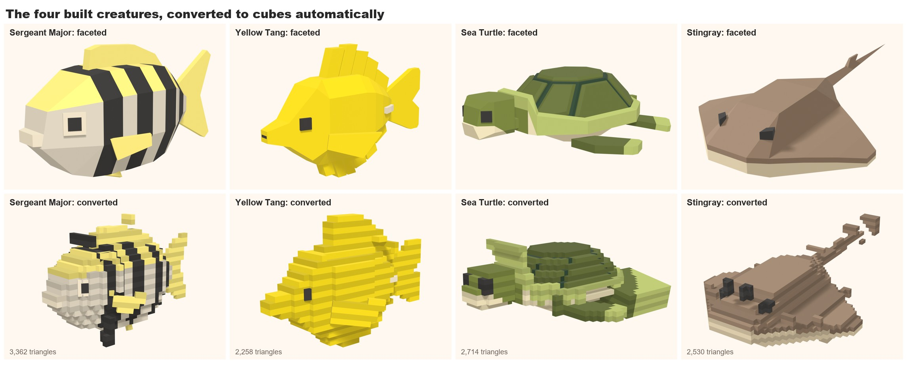

It works, but it's the weaker way. The shapes go ragged, thin fins and the eyes get lost or fattened, and the stray cubes are
the converter's own roughness. It also costs the most: 2,300 to 3,400 triangles a creature, against 650 for the faceted
Sergeant Major.

### Designed block by block (way D, close to C)
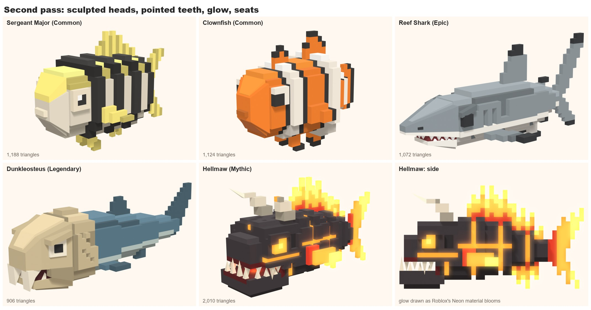

Five models: the Sergeant Major and the Clownfish (Commons), the Reef Shark (Epic), Dunkleosteus (Legendary) and the Hellmaw
(Mythic). Each is rigid parts on joints, so it swims like the faceted fish:
[Sergeant Major](../attachments/voxel-sergeantmajor-swim.gif), [Reef Shark](../attachments/voxel-reefshark-swim.gif),
[Dunkleosteus](../attachments/voxel-dunkleosteus-swim.gif), [Hellmaw](../attachments/voxel-hellmaw-swim.gif). Dunkleosteus and
the Hellmaw have a jaw on its own joint that chomps.

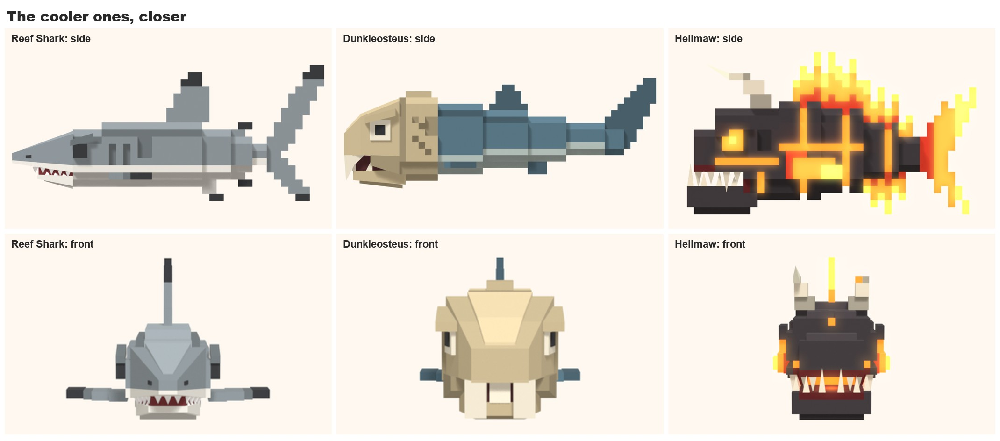

**The rules they share** (the cohesion the reference lacks):
- **Stepped slabs:** the body is slabs with stepped corners, one cube size per creature (0.35 studs for the Commons, 0.4 for the
  shark, 0.5 for the two big ones).
- **Patterns are raised:** the Sergeant Major's bars and the Clownfish's white bands stand one cube proud. The Hellmaw turns it
  round: charcoal plates stand proud of a lava core, so the cracks glow.
- **Two tones by one rule:** each colour's darker tone goes on the step below it (the shoulder, the belly steps).
- **Framed square eyes,** one cube proud, with a brow block where the creature should look fierce.
- **Teeth, blades and horns are stepped blocks,** never smooth cones.
- **Fins are stepped plates one cube thick,** with coloured tips: black on the shark and the Clownfish, flames on the Hellmaw.
- **The mouth is cut in,** dark inside, on the shark and the two big ones.
- **The rider's seat is designed in:** on the Hellmaw the rider sits between the horns.

### The Sergeant Major three ways
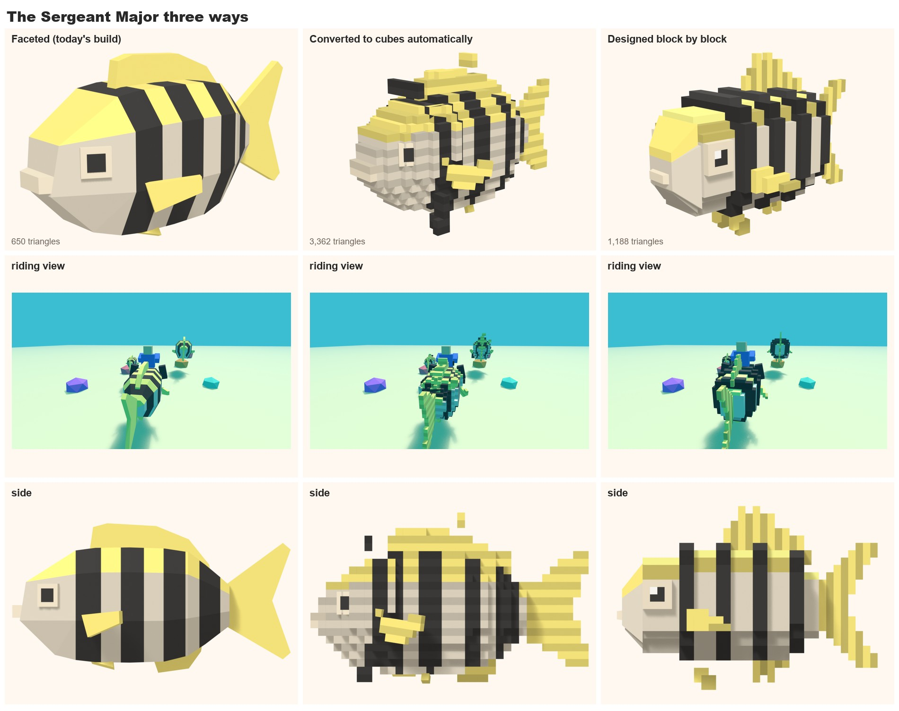

| | Triangles | Reads as |
|---|---|---|
| Faceted (workout 2) | 650 | smooth, toy-like |
| Converted automatically | 3,362 | noisy |
| Designed block by block | 1,188 | the reference's kind of voxel look, cleaner |

### What it showed
- **Designing in voxels beats converting,** in looks and in cost. Converting isn't worth pursuing.
- **The voxel style suits the cooler creatures best:** armour slabs, block fangs, horns and flame fins come naturally to it.
- **It costs about twice the faceted look's triangles** (900 to 2,000 a creature, the second pass included). That's still light for Roblox, but it adds up
  with a herd on screen; far-off creatures could use a simpler version.
- **From the riding camera,** raised bands and a stepped fin read at least as well as the faceted back.
- **Not judged yet:** in Studio, in the water (nothing is uploaded: uploads are permanent). The sizes of the three cooler ones
  (17, 24 and 20 studs long) are first guesses. Turtles and rays aren't tried from scratch yet.

## The second pass (2026-11-10, the user's notes)
The user liked the Hellmaw most and found some heads lacklustre. Their notes:
- Give the builder more freedom, and make sure the faces look good.
- Voxels aren't law: if a face looks better built another way, build it that way.
- Teeth are triangles, not cubes.
- More glow on the Hellmaw.
- The Reef Shark's mouth and front didn't look right.
- Think about where the rider sits: a slight place for the legs, without bending the look round it.

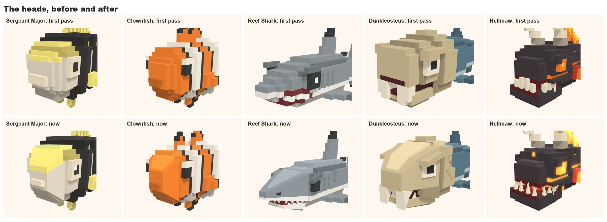

**What changed:**
- **Free pieces in the kit.** A model can add plain solids beside its cubes: tapered blocks (`taper`, `block`), pyramids
  (`spike`, `tooth`) and flat shapes with thickness (`prism`). Bodies and fins stay stepped; heads are sculpted where a slope
  serves them.
- **Reef Shark:** the head is rebuilt as a shark's. One long snout slopes to a blunt tip and overhangs a mouth set back
  underneath, with rows of pointed teeth, a small all-dark eye under a slanting brow, and nostrils.
- **Hellmaw:** pointed fangs, a spike on the horn, the other horn snapped off. The lava, the eyes and the fins shine by
  themselves (`GLOW`: Roblox's Neon material), and small lights in the mouth, by the eyes and along the cracks spill onto the
  charcoal (`LIGHTS`: Roblox PointLights). Cracks cross the skull and run down the cheeks. On the sheets the glow's halo is
  drawn in afterwards, the way Neon blooms in Roblox.
- **Dunkleosteus:** a deep sloping skull under a lighter roof plate, a heavy slanting brow over a ringed eye, cheek plates, and
  sharp blades that interlock: two above, one below. Old scars cross the shield.
- **The Commons:** a blunt muzzle slopes out of the head, and the Sergeant Major's eye has a glint. Friendly, where the
  predators look mean.
- **A third tone:** each colour is lighter on plates that face up, as well as darker on the step below.
- **Seats:** every creature has one, with a place for the legs (`SEAT`; the kit renders `seat.png` with the rider on it). On the
  Commons the rider sits in the gap between two raised bands. On the shark, Dunkleosteus and the Hellmaw a slot one cube deep
  is cut either side.

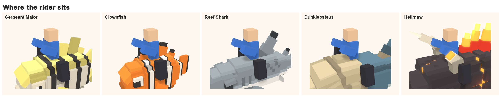

**Fable's own ideas, offered with this pass.** Built in: faces by temperament, the third tone, one exaggerated feature that
shows from behind (the shark's tall fin, the Hellmaw's horns), scars on the big ones. Not built, for the user to weigh:
- **Rarity you can read at a glance:** each rarity step adds a layer (raised armour, then spikes and scars, then glow, then
  moving parts).
- **Small movements:** glow that pulses, a fin flick when idle.
- **A saddle on tamed creatures only:** wild ones are bare. It marks the seat and shows ownership. It changes the game a
  little, so it's the user's call.

## The third pass: big blocks (2026-11-10, the user's notes)
The user's notes on the second pass:
- The reference's blocks are more intentional. It doesn't overprescribe the voxel art: its look comes from stacking blocks.
- Keep the extra voxel features, but build from big block elements. Tail fins don't have to be voxelly.
- The reworked heads are liked, but their sloping faces read as foreign to the rest. They need to blend, most of all on the
  Reef Shark. Dunkleosteus is a bit better.

**What the reference does, looked at again** (four of its creatures, closer up):
- A creature is about 20 to 60 big boxes, and each box is a body part: a skull, a jaw, a thigh, a tail segment.
- Boxes turn freely. A neck, a tail or a leg is a chain of boxes, each turned a little more than the last.
- Nothing is squeezed. Every piece is a plain box (or a pyramid, for claws, teeth and spikes). A slope is a box that has been
  turned, or a stair of boxes.
- Stripes are thick plates with thin plates set back between them.

**Why our sculpted heads looked foreign.** They were the only place with squeezed (tapered) faces, and the only place with any
slope at all: the bodies and fins were stairs of small cubes. Two languages on one creature.

**The rule that fixes it: a slope is a whole block, turned.** Never a block squeezed to a point. Then turn blocks on the fins
and the tail too, so the head isn't the only place with an angle.

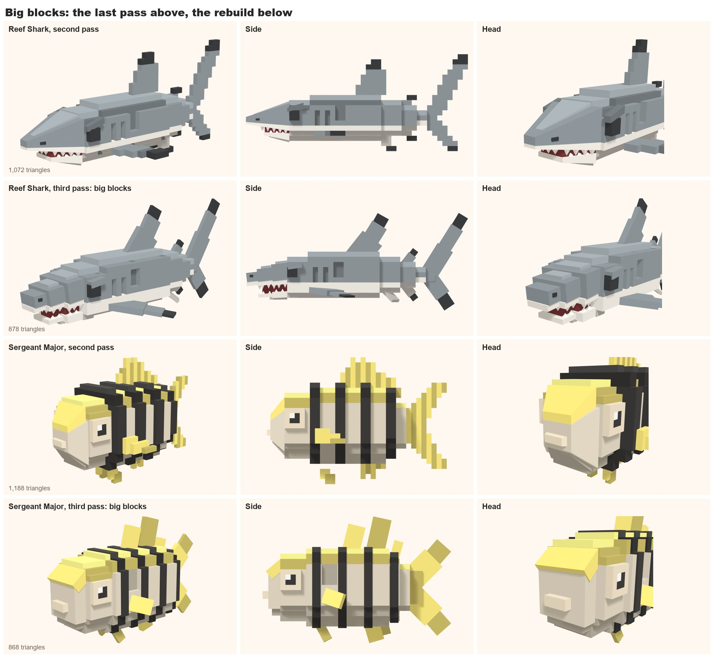

**What changed on the two rebuilt so far:**
- **Fins and tails** are two or three boxes each, at an angle, smaller toward the tip. The shark's tips are black blocks a
  little bigger than the box before, so they stand proud. The Sergeant Major's back fin is four leaning plates in two yellows.
- **The Reef Shark's snout** is three big blocks in a chain, each tilted nose-down and a step lower and narrower than the last.
  Each has a lighter plate on top, as the body's slabs do, and a white lip plate underneath that the teeth hang from. The jaw
  is two boxes.
- **The Sergeant Major's face** is a muzzle box, a thick yellow slab leaning down it for the forehead, a darker slab leaning up
  under the chin, and a cream lip block.
- **Bodies** keep their slabs, with one step at the corners where there were two or three.
- Kept from before: raised bars, the three tones, pointed teeth, brows, gill slits, seats with leg slots.
- Triangles went down: Reef Shark 1,072 to 878, Sergeant Major 1,188 to 868 (after the clean-up and the gate below).

**Tried first and dropped: thin plates laid on the slope.** The squeezed snout stayed underneath and plates stepped down it
like shingles. It read as a pile of planks, and the squeezed core still showed between them.

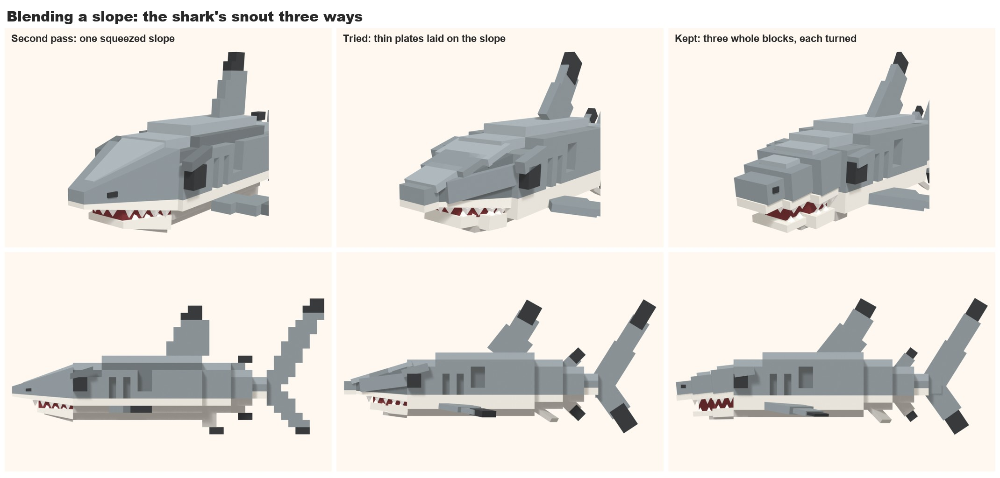

**Fable's read of the result.** The creatures now hold together as one kind of thing, and the fins look more like the
reference's. The cost is on the shark: the second pass's snout was sleeker. If that matters more, the middle road is a snout
of two longer blocks with a steeper tilt.

Swims: [Reef Shark](../attachments/voxel-reefshark-swim.gif), [Sergeant Major](../attachments/voxel-sergeantmajor-swim.gif).
The older swims of these two are replaced.

**Extra features this way of building makes cheap** (offered, not built):
- **Fins that flap.** A fin is already two or three boxes, so each can sit on its own joint.
- **Tails that curl.** A chain of boxes bends box by box, where a stair of cubes can't.
- **A blink.** One eyelid box that drops over the eye.
- **Stripes the reference's way:** thick plates with thin plates set back between them, for the Clownfish's bands.
- **Rarity as layers of blocks:** plain boxes for a Common, then armour plates, then spikes and scars, then glow.

**Kit:** `beam` (a box from one point to another, lying flat or on edge) is what the fins, tails and snouts are made of.
`shingles` (plates down a slope) is in the kit but not used by any creature.

## The clean-up: bars, gaps and overlaps (2026-11-10, the user's notes)
The user liked the shark and the direction. Their notes:
- The Sergeant Major's bars are far too thick. A band of colour should stand out only a little.
- Both have small faults: gaps, and faces that overlap. The shark's tongue came through its lower jaw. The fish had pieces
  with air showing under them.

**What the faults were.** Three kinds, all from placing free boxes by eye:
- **A root that shows.** A leaning box that only crosses a surface leaves a wedge of air under one corner (the fish's
  forehead slab, most fins), or floats off it (the fish's side fins, some of the shark's teeth).
- **A piece that comes out of another.** The dark inside of the shark's mouth was one squeezed block, wider than the front
  jaw box, so it showed past the jaw.
- **Two faces in one plane.** They flicker in Roblox. The shark's brow sat exactly level with its eye.

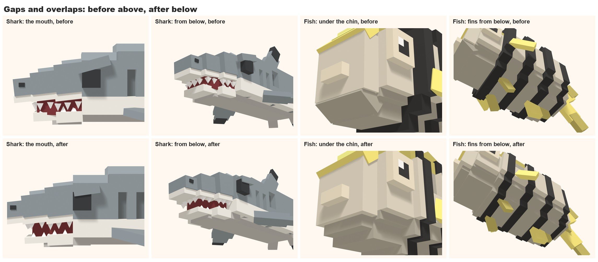

**The rules that stop them:**
- **Bury the root.** A piece has one whole face inside something else, or flat against it. A leaning fin starts deep enough
  that both corners of its end are under the surface.
- **Chains nest.** Each box of a fin is smaller than the one before and starts inside it.
- **Fillings stay behind what they fill.** A mouth's dark inside is plain boxes, narrower than the teeth, ending inside the
  lips and the jaw.
- **No two faces in one plane.** Make one piece a little thicker or thinner, or move an end off the grid line.
- **Raised colour is raised a little.** A bar is a band a third of a cube proud (`band`), not a slab a whole cube proud. It
  starts just in front of its joint, so it covers the seam.

**The kit now checks this on every build.** It prints a line for each piece that touches nothing, each piece with no buried
face, and each pair of faces lying on each other. `--check` stops after the check (a few seconds). `--inspect` renders close
views from below, behind and above, for what measuring can't judge: a piece that comes out where it shouldn't. The Reef Shark
and the Sergeant Major pass with nothing flagged. At that point the other three hadn't been cleaned: the gate stopped the Clownfish on 4 faults, Dunkleosteus on 10 and the
Hellmaw on 19. They were rebuilt afterwards (the last section).

**Also changed on the fish:** the face's slopes are now seated (the forehead slab's top is inside the head and its underside
inside the muzzle), the chin is a jaw box, the tail has a thick stock, and the seat has a shallow leg slot now that the bars
no longer make one.

**Small touches that would suit this style** (offered, not built):
- **A gum line:** a thin pink plate between lip and teeth on the predators.
- **A collar where a fin meets the body:** one darker plate round the root.
- **The shark's side line:** the grey steps to white through one lighter plate, not straight to white.
- **Bars that stop short of the belly,** as the real fish's do.
- **One flaw on the rarer ones:** a notch in the shark's back fin, a chipped tooth.
- **A glint in the dark eyes:** one small white block.

## The gate, hidden faces, and bars as touches (2026-11-10, the user's notes)
The user asked for the two further fixes, so that nothing can flicker and fewer triangles are drawn, as long as the look and
the swim don't suffer. And one more note on the fish: the first bar sat where the body steps up from the head, so it looked
thick. A band of colour should read as an artistic touch, not as a shape of its own.

**The weld was tried and is not the default.** Welding a part into one closed shell works (Blender's exact union; every part
came out closed, in one piece). But it costs triangles, where I had said it would save them. Every face that a fin or a
tooth passes through has to be cut round it:

| | Loose pieces | Welded | Hidden faces left out |
|---|---|---|---|
| Reef Shark | 1,000 | 1,415 | 878 |
| Sergeant Major | 936 | 1,238 | 868 |

**What is built instead:**
- **Hidden faces are left out.** A piece's face is dropped when every point just outside it is inside the same part's cubes
  or pieces: a fin's buried root, a tooth's base, the faces between a band's layers. Nothing is cut, so the count only falls.
  Only a part's own pieces count, because another part swings away when a joint bends.
- **The check is a gate.** With any fault the build stops before it renders (`--force` overrides). It now also refuses two
  faces that face the same way, overlap and lie under 0.05 studs apart. In one plane they flicker; that close they shimmer
  at a distance. So a fin's boxes each get clearly thinner toward the tip, and a block sits a clear step inside the one it
  joins.
- `--weld` still builds the closed shells, for a creature where that is worth its triangles.

**Proof that nothing changed to the eye.** Each creature was rendered with and without its hidden faces from seven close
views, and compared pixel by pixel: the largest difference in any pixel was 2 of 255. All 72 frames of each swim were
compared the same way: no difference at all.

**Not tested yet:** the 0.05-stud rule is my estimate of where Roblox stops shimmering. It needs one look in Studio at a
distance, once a creature is uploaded.

**The bars as touches.** Three things make a bar read as paint:
- It stands a third of a cube proud, no more.
- **It never sits where the body changes size.** The first bar starts a cube behind the step up from the head. The step then
  reads as the body's own, with body colour on it, and the bar is a thin line on the body behind it.
- Its ends stay clear of any step or slot.

The fish is one cube longer for it (12.9 studs), and the seat moved back with the slot.

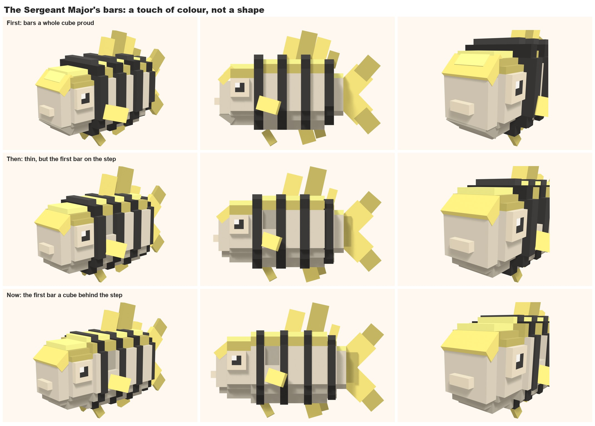

## Touches, and all five in big blocks (2026-11-10)
The user asked which touches were meant, said to add the good ones, and to rebuild the other three.

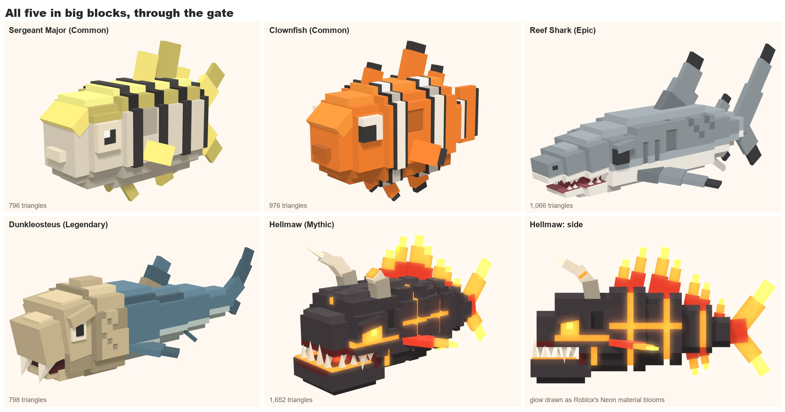

**Touches added** (small things that suit the style and cost little):
- **A gum line on the predators.** A thin plate between lip and teeth, set in from the lip's edge, that the teeth stand in.
  Pink on the Reef Shark. On the Hellmaw it is lava, so the jaw's rim glows.
- **A collar where a big fin meets the body.** One darker box round the root, a little wider and thicker than the fin. On
  the shark's back and side fins, and in bone on Dunkleosteus's back fin.
- **A side line on the shark.** One lighter row where the grey meets the white.
- **Bars that stop short of the belly** on the Sergeant Major, as the real fish's do (`band(..., stop=)`). They read more
  like paint that way. The Clownfish's bands go right round, as a clownfish's do.
- **One flaw on each rarer creature.** The shark has an old scar on its left flank. Dunkleosteus keeps its scarred shield,
  the Hellmaw its snapped horn.

Left off on purpose: a glint in the shark's eye. Its flat black stare is the meaner look. The Clownfish's glint went too:
in a pupil of four cubes it made an L.

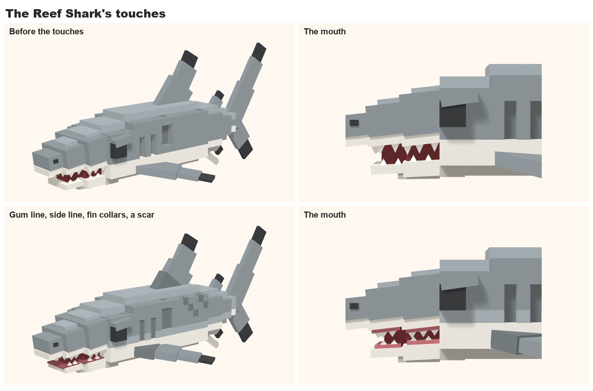

**The three rebuilt.** Each keeps what made it itself and is built by the same rules as the first two.

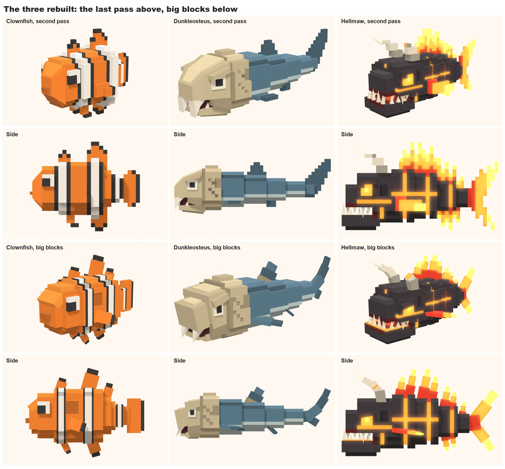

- **Clownfish:** orange slabs; the three white bands are thin bands with a black edge either side, none on a step in the
  body; fins are boxes with a black tip box; the face is the Sergeant Major's kind (muzzle box, leaning forehead slab, jaw
  box, lip block).
- **Dunkleosteus:** the skull is two big blocks in a chain, tilted nose-down, each with a lighter roof plate; a heavy brow
  box over a ringed eye; a darker cheek plate either side of the mouth; the jaw tucked between them, still on its own
  joint; blades as pyramids; an eel tail whose boxes turn upward one by one.
- **Hellmaw:** the plates, cracks, glow and lights are kept. The horns are now chains of boxes that curl forward. The fins
  are tongues of flame, each a chain of three boxes (red, orange, yellow). Neighbouring tongues use two sets of
  thicknesses, so where they overlap no two sides share a plane.

| | Second pass | Now | Size (studs) |
|---|---|---|---|
| Sergeant Major | 1,188 | 788 | 12.9 long |
| Clownfish | 1,124 | 972 | 10.1 long |
| Reef Shark | 1,072 | 1,040 | 17.6 long |
| Dunkleosteus | 906 | 774 | 24.5 long |
| Hellmaw | 2,010 | 1,652 | 20.5 long |

All five pass the gate with nothing flagged, and were looked over from below, behind and above. The shark's count went up
by its touches (878 before them).

Swims: [Sergeant Major](../attachments/voxel-sergeantmajor-swim.gif), [Clownfish](../attachments/voxel-clownfish-swim.gif),
[Reef Shark](../attachments/voxel-reefshark-swim.gif), [Dunkleosteus](../attachments/voxel-dunkleosteus-swim.gif),
[Hellmaw](../attachments/voxel-hellmaw-swim.gif).

## Shallow recesses, and the gum line as a choice (2026-11-10, the user's notes)
The user's notes on the four that don't glow:
- The little recessed details are too deep. A hole a whole cube deep gives a Minecraft-build feel. Where a recess doesn't
  glow and doesn't have to be deep, make it shallower.
- The shark's gum line comes off as lipstick and makes it less intimidating. Try it top only, without, thinner, or turned
  another way.

**Recesses are now a third of a cube deep** (`dent` in the kit): the shark's gill slits, Dunkleosteus's scars, and every
leg slot. The cubes are cut out and the hole is filled again to just short of the surface, in the darker tone. It reads as
a line drawn on the body, not a missing block. The Hellmaw's cracks stay deep: they glow, and the depth is what lights them.

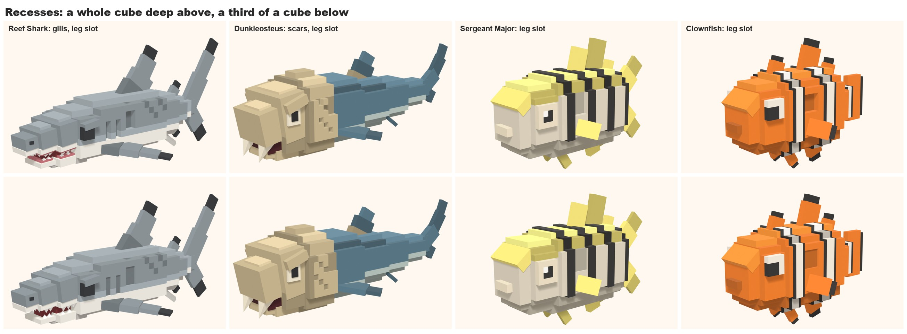

**The shark's gum line, five ways** (`GUM` in its model):

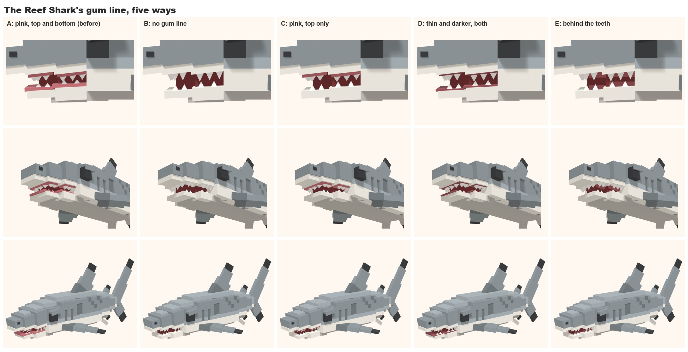

- **A: pink, top and bottom** (as it was). The pink outlines the lips: the lipstick.
- **B: none.** The teeth come straight out of the white lips over a dark mouth.
- **C: pink, top only.** Half the lipstick.
- **D: thin and darker, both.** Quieter, but still a line round the lips.
- **E: behind the teeth.** A darker band inside the mouth, seen only between the teeth.

Fable's pick is **B**, and the model is set to it for now: the dark mouth with long teeth is the meanest of the five, and it
is the cheapest. **E** is the one to take if a little colour in the mouth is wanted: it adds red without drawing a line
round the lips. The Hellmaw's glowing gum is a different thing and stays.

**The user's pick: D, the thin darker line, on select animals from now on.** It may change later. The model is set to it.

| | Triangles now |
|---|---|
| Sergeant Major | 796 |
| Clownfish | 976 |
| Reef Shark (gum D) | 1,066 |
| Dunkleosteus | 798 |
| Hellmaw | 1,652 |

The swims weren't rendered again for this pass: nothing that moves changed. (The Hellmaw was redone afterwards as a
Mythic: see [workout 5](05-rarity-look.md).)

## Next
- **The rarity pass (the user's plan):** ideas are in [workout 5](05-rarity-look.md). The Mythic almost reads as a Legendary, and the Legendary as an Epic: the rarer
  creatures need something that makes them look cooler. Ride a Dino's cooler animals carry small stripes scattered all
  over for colour variety, even where the real animal has none. The user will show references. Useful ones: close
  shots of its rarest creatures from the side and from three-quarters, and one plain Common beside them.
- The user's verdict on the five: is this the creature look?
- One look in Roblox Studio at a distance, to test the 0.05-stud rule and how the glow and the thin bands hold up. Uploads
  are permanent, so ask first.
- If this is the look: redo the Sea Turtle, the Yellow Tang and the Stingray this way, then the rest of the roster.
- Move the helpers each model repeats (the body slab, the snout chain, the flame tongue) into the kit.
- Offered and not built: fins that flap on their own joints, tails that curl box by box, a blink, rarity as layers of
  blocks, pulsing glow.
