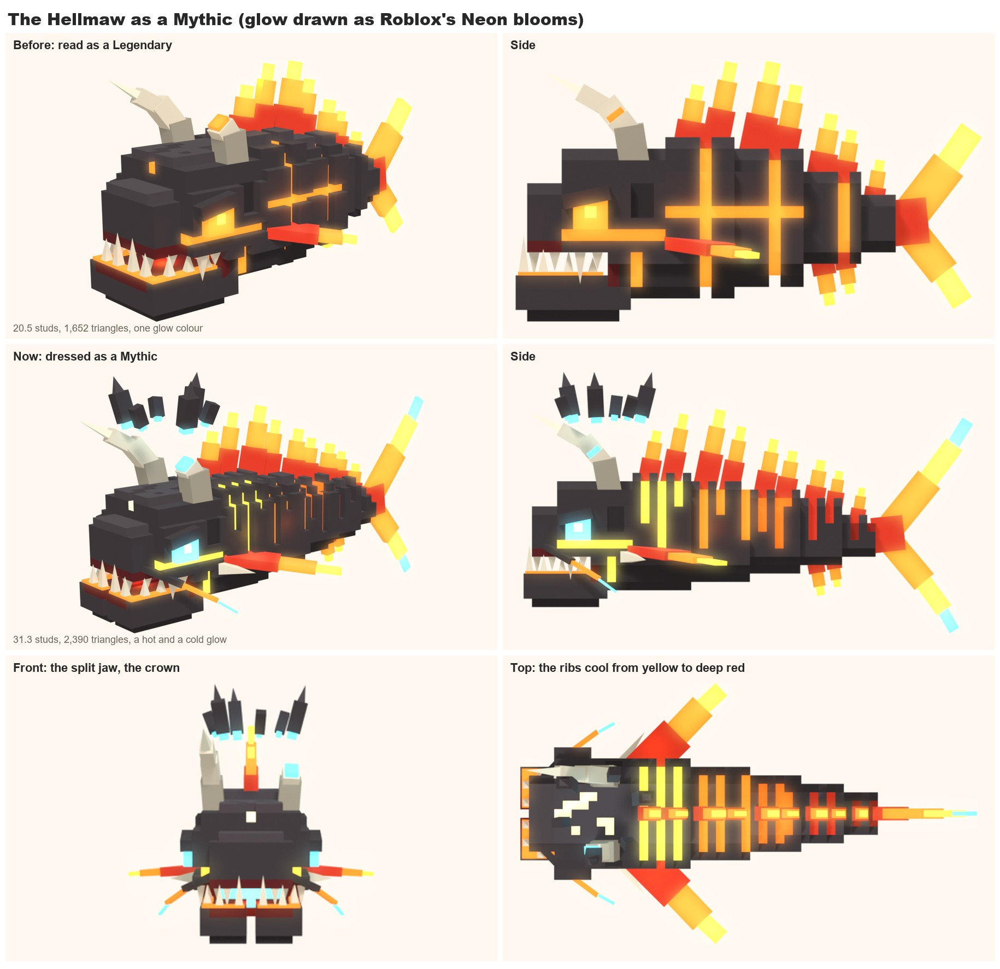
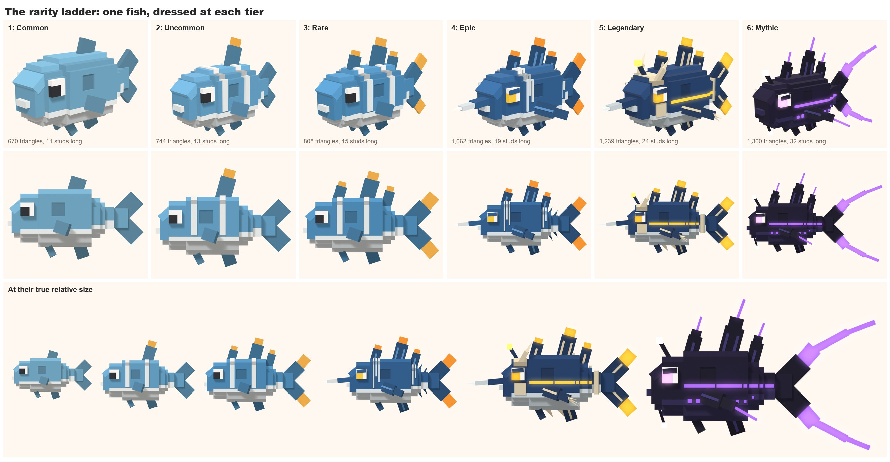
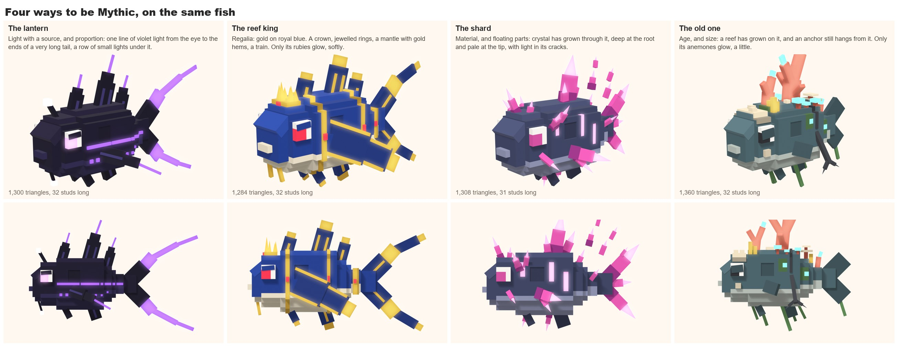
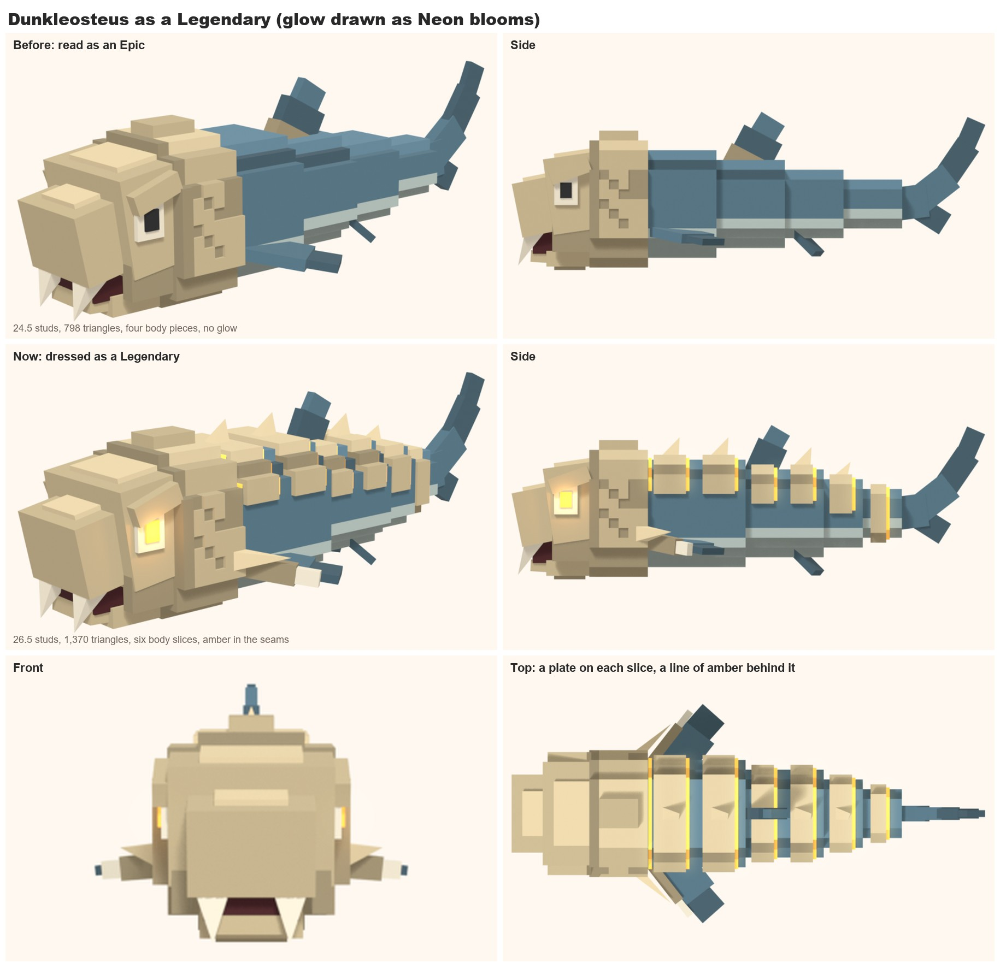
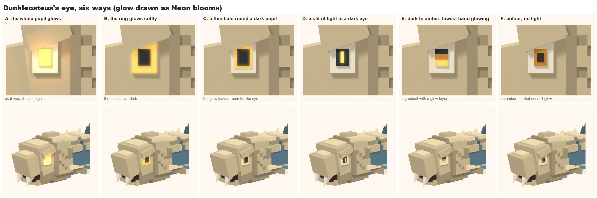
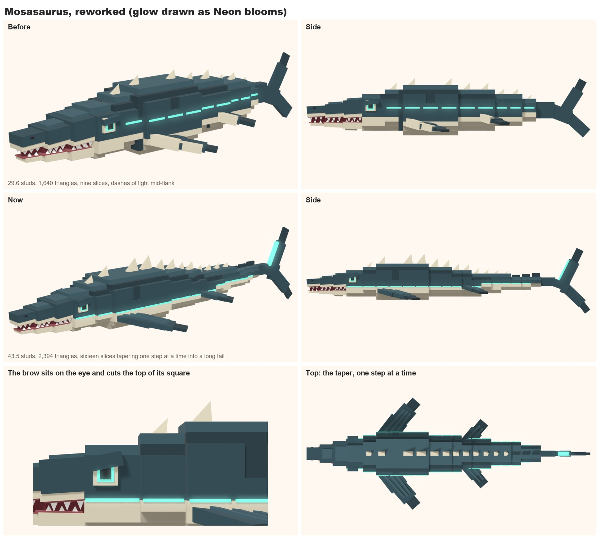
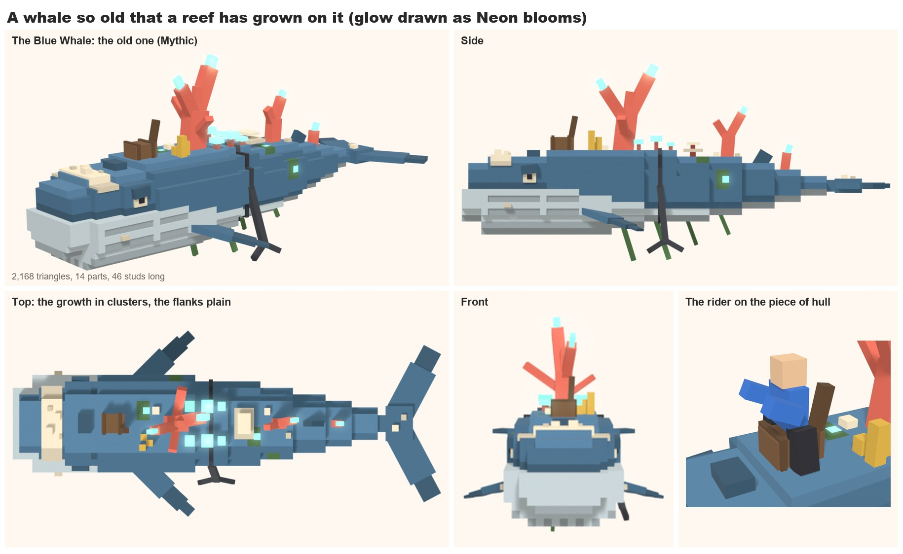
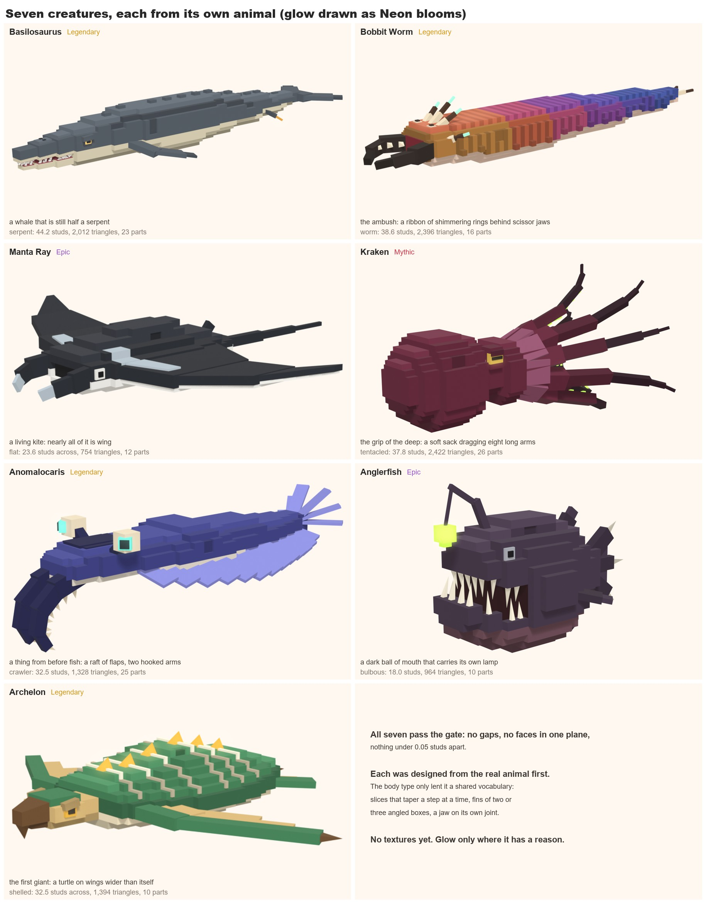

# Workout 5: the rarity look

**State (2026-11-10): the ideas are proposed, not decided. Two tests are built: the Hellmaw redone as a Mythic, and the
ladder.** Back to [Style workouts](Style%20workouts.md).

## The question
How does a creature look as rare as it is? The user's read of the five voxel creatures
([workout 4](04-voxel-style.md)): the Mythic almost comes off as a Legendary, and the Legendary as an Epic. They need
something that makes them look cooler: colour, kind of creature, glow, how colour is spread, ribbons of colour, silhouette.

## What the references show
The user's two screenshots from Ride a Dino are in `research/ride-a-dino/` (private). Read for rules, not copied. The user
doesn't think its Legendary is a good display of a Legendary.

- **Its Legendary (a long-necked dinosaur):** only two colours. What lifts it: its size; a long silhouette nothing else has;
  dozens of thin stripes in the belly colour laid across the spine, of uneven lengths, which follow every box of the neck
  and tail and so show off the curve; an eye framed in a third colour.
- **Its Uncommon (a dome-headed dinosaur):** three colours, spikes round the head, chevrons on the neck, patches on the
  back. So decoration there is not tied to rarity. Rarity is mostly the species and the size.
- **Online (video thumbnails only, small and unverified):** the top of its range stops being animals. A white machine
  dinosaur with a red eye; a skeleton dragon with red wings, labelled Eternal; a glowing gold figure with a halo; a
  glowing blue "Spectral" dinosaur. Its tiers run Common to Mythic with Secret above, and auras and mutations are separate
  layers put on any creature.

## Why ours read a tier low
- **The Hellmaw (Mythic)** is a fish with fire painted on: the same body plan as a Common, with horns. One glow colour.
  Nothing on it is impossible. It is also smaller than the Legendary (20.5 studs against 24.5).
- **Dunkleosteus (Legendary)** is special only at the head. Behind the shield it is plain slabs in two quiet colours, like
  the Epic shark, with small fins and no pattern.
- **No ladder.** Nothing gets stronger step by step from Common to Mythic. Each creature was dressed alone.

## The idea: a ladder with a budget on each rung
Each rarity gets a fixed allowance on a few axes. A creature of that rarity spends it. Going up a tier always adds something
on every axis, so two tiers can't look alike.

| | Common | Uncommon | Rare | Epic | Legendary | Mythic |
|---|---|---|---|---|---|---|
| **Kind** | familiar fish | odd-shaped fish | strange real animals | predators | prehistoric giants | not real: myth |
| **Length (studs)** | 9 to 12 | 11 to 14 | 13 to 17 | 17 to 21 | 24 to 28 | 30 and up |
| **Silhouette** | body and fins | one mark (a crest, a long fin) | two marks | a weapon at one end | the outline is broken all along (plates, a sail, spikes) | parts no animal has (below) |
| **Colours** | 2 | 3 | 3 | 3, darker and sharper | 4, one of them a strong signature colour | a dark body and two glowing colours |
| **Pattern** | big bands or none | one simple pattern | pattern and coloured tips | scattered thin stripes | two layers (armour, then stripes or runes) | pattern that glows and moves |
| **Glow** | none | none | none | the eye only | spots and thin lines, steady | whole ribbons, pulsing, casting light |
| **Movement** | swims | and a fin flicks | and the jaw works | fins on their own joints | trailing parts that follow late | floating parts, a trail, an aura |

## Ideas, axis by axis
**Silhouette** (the strongest, and the one seen from the riding camera):
- Break the outline more with every tier: a row of back plates, a sail, spikes, a clubbed or forked tail.
- **Mythic means impossible anatomy.** Parts that float (a broken crown of rock over the horns, shards that orbit), two
  jaws or a split jaw, fins as wide as wings, long tendrils or chains that trail behind.
- Make it uneven on purpose at the top: one huge horn, one torn fin.

**Size.** Make the ladder true first. The Mythic has to be the biggest thing in its zone.

**Colour and how it is spread:**
- **Value does the work.** Commons sit in friendly middle tones. Rarer creatures get a darker body with brighter accents.
- **A signature colour** from Legendary up, used only in ribbons and tips, never as a body colour: amber on bone, teal on
  slate, violet on black.
- **A shift along the body** at Mythic: white-hot at the head cooling to deep red at the tail, or the reverse.
- **Two glowing colours** at Mythic, one hot and one cool, so it doesn't read as one orange light.

**Ribbons and stripes:**
- **Scattered stripes** as in the reference: thin bands in the belly colour across the back, of uneven lengths and
  spacing. We have the piece for it (`band`, stopped short). They show the body's curve as it swims.
- **A ribbon along the body:** one line of the signature colour from the eye to the tail. Plain at Epic, glowing at
  Legendary, pulsing at Mythic.
- **Chevrons, spots, plate edges** as other patterns, one family per creature, so a zone's creatures don't all look striped.
- On the Hellmaw: make the cracks its stripes. Uneven ribs of lava across the back in place of the even grid.

**Glow** (the sea makes this fair: deeper zones are darker, so living light reads as both depth and rarity):
- None below Epic. An Epic's eyes. A Legendary's lure, spots and lines. A Mythic's whole ribbons, with light cast on the
  rider and the water.
- A pulse that runs from head to tail on a Mythic.

**Movement and effects:**
- Trailing parts that lag behind the body: tendrils, ribbons of fin, chains.
- Floating parts that turn slowly.
- Particles: embers, bubbles, motes, by zone.

**Material:** Roblox materials are cheap. Bone and armour in Metal, some fins in Glass, glow in Neon.

**The saddle:** a tamed creature's saddle could be grander by rarity (the reference's Legendary carries a little house).

## What this would mean for ours
- **Hellmaw:** longer than everything else; a second glow colour; lava ribs in place of the grid; a floating crown of
  broken rock; trailing flames that lag; a second jaw or a split one; the head-to-tail colour shift.
- **Dunkleosteus:** the armour carried down the spine as plates; scattered pale stripes on the slate; a signature colour
  (amber or teal) in the eye and a thin line along the side; a heavier tail.
- **Reef Shark:** a few scattered darker stripes over the back; a brighter eye. It is close already.
- **Commons:** nothing. Their plainness is what makes the rest read.

## How to test it
Build the ladder on one body: the same fish dressed at each of the six tiers, on one sheet. If the six read in order at a
glance and at game distance, the budget works. Then redo the Hellmaw and Dunkleosteus by it.

## Test 1: the Hellmaw as a Mythic (built 2026-11-10)
The user asked for the Hellmaw to be redone first. It spends the Mythic's whole allowance:

- **Size:** 31.3 studs, from 20.5. It is now the biggest creature made.
- **Impossible parts:** a broken crown of rock shards that floats over the head and turns; a lower jaw split down the
  middle, each half on its own joint, opening down and apart; flame fins as wide as wings.
- **Pattern that glows:** the even grid of cracks is gone. Uneven ribs of lava are cut across the back, some short, some
  running down the flank.
- **A shift along the body:** the lava is white-hot in the skull, yellow behind the head, orange, then deep red at the tail.
- **Two glowing colours:** the hot one, and a cold soul-fire blue in the eyes, the throat, the crown, the snapped horn and
  the last tips of the whiskers and the tail.
- **Trailing parts:** a whisker each side of the snout, and the two tips of the tail on joints of their own, which whip late.
- Kept: the horns (bigger), the snapped one, the fangs in a glowing gum, the tongues of flame down the back.

It is 2,390 triangles in 13 parts, and passes the gate. The kit gained `FLOATING`: a model names the parts whose pieces
float on purpose, and the gate doesn't ask those to touch anything. [Its swim](../attachments/voxel-hellmaw-swim.gif) shows
the jaw, the crown and the tail tips moving.

**Fable's read.** It now looks a tier above Dunkleosteus at a glance, mostly from the crown, the second colour and the
size. What is still fish-like is the body itself: a straight chain of slabs. A longer, more serpentine body would push it
further.

## Test 2: the ladder (built 2026-11-10)
One invented reef fish, the same body and the same blue at every tier, dressed with each tier's allowance. The model is
`art/style/rarity_ladder/ladder.py` (`TIER = 1` to `6`); `tools/art/rarity_ladder.py <scratch folder>` builds all six and
the sheet. Every tier passes the gate.

| Tier | What it adds | Triangles | Length |
|---|---|---|---|
| Common | two colours, body and fins | 670 | 11 studs |
| Uncommon | an accent colour, a tall crest with a coloured tip, two pale bands | 744 | 13 |
| Rare | a third band, coloured tips on every fin, long tail tips, a jaw on its own joint | 830 | 15 |
| Epic | darker; a bill; scattered thin stripes; a glowing eye under a brow; teeth; side fins on their own joints | 1,174 | 19 |
| Legendary | a glowing amber ribbon, a lure, a bone helmet, back plates, cheek spikes, streamers on their own joints | 1,408 | 26 |
| Mythic | near-black; amber and cold blue glow; glowing stripes; a floating crown; wing fins; a split jaw; whiskers | 1,640 | 32 |

**Does it read in order?** Yes, at a glance, and the size strip helps most. What carries each step: colour count for the
first three, the darker body and the bill at Epic, the glowing ribbon at Legendary, the second glow colour and the
floating crown at Mythic.

**Where it is weak:**
- **Rare sits close to Uncommon.** Coloured tips and one more band are not enough. It needs a real mark of its own.
- **The Epic's stripes are too many and too even.** They read as a ribcage. Fewer, of more uneven length, would read as
  markings.
- **The Mythic's split jaw only shows from the front,** and from the side it is still the same fish, darker. The first
  version read as a darker Legendary; a bigger crown and upswept wings fixed most of that.
- **Common to Rare gain almost nothing in silhouette.** That may be right: it leaves room above.

**One thing found in the kit:** `GLOW` doesn't reach a colour's lighter top tone, so the top row of a glowing band doesn't
glow.

## The user's notes on the two tests (2026-11-10)
- **The Hellmaw is liked.** It looks quite good, and the added glowing touches are liked. It borders on messy, but is just
  good enough.
- **The ladder's Epic and Legendary look messy.** From Epic up the designs stop looking good.
- **Glow and effects must not be overprescribed.** A design has to feel intentional: it must look good and flow, not glow
  for the sake of glowing.
- **Mythic can't mean one thing.** If every Mythic is a dark body glowing the same way, it gets stale. We need several
  ways to get the Mythic feel, combined differently from creature to creature.
- **Not always blue.** A purple one, at least.
- **Later, not now:** moving textures on parts (VFX), and surface textures. The reference uses two simple ones, a round
  stud like a toy brick's and a rounded rectangle (`research/ride-a-dino/ref_textures_stud_and_rounded.png`, private). It
  puts them on some creatures only. The user wants ours varied and applied with care. Don't start on them yet.

### What makes a design messy (Fable's read)
The ladder's Epic covers its whole flank in thin stripes of one length, then adds a bill, coloured tips, a glowing eye and
teeth. The Legendary lays a ribbon across those stripes and adds a helmet, plates, a lure, spikes and streamers. Nothing
is left quiet and nothing leads. The Hellmaw holds together because it has one idea, its detail is grouped (ribs on the
body, a plain head) and it uses one family of colour with one cold accent.

### Rules for a clean design
- **One idea, in a sentence.** Every feature serves it. If one doesn't, it goes.
- **Few kinds of feature.** At most two new kinds at Epic, three at Legendary, four at Mythic. A motif repeated counts once.
- **Patterns never cross.** Stripes or a ribbon on the flank, not both.
- **Leave it quiet.** At least half the flank stays plain. Detail sits in one or two clusters.
- **Fewer, bigger shapes.** Three to five uneven stripes over the shoulder, not a ribcage.
- **One focal point** at the head, one echo at the tail, the middle calm.
- **Accent colour is about a tenth** of the surface.
- **Glow needs a reason:** an eye, a lure, heat, a crystal. Below Mythic, one glowing thing at most.

### Ways to feel Mythic
Glow is one of them, not the definition. A Mythic combines two or three, and no two Mythics combine the same ones:
- **Light:** glow with a source.
- **Impossible parts:** things that float, split or have no business being there.
- **Regalia:** a crown, rings, plates of gold. No glow.
- **Material:** crystal, glass, bone, metal. It is made of something else.
- **Age:** coral, barnacles and wreckage grown into it.
- **Void:** matte black, holes through the body, a rim of one colour.
- **Scale:** sheer size, or one part stretched beyond reason.
- **Motion:** for later, with the VFX.

The glow's colour changes with the creature too: violet, green, gold, pink, white, as well as blue and fire.

## Test 3: the ladder cleaned, and four ways to be Mythic (built 2026-11-10)
Built on the notes and rules above. The picture in Test 2 now shows this version; the table there is the first one.

**The ladder, cleaned:**

| Tier | Its idea | Triangles | Length |
|---|---|---|---|
| Common | a plain blue reef fish | 670 | 11 studs |
| Uncommon | the same, with a tall crest and two pale bands | 744 | 13 |
| Rare | a sail of three plates: its own mark | 808 | 15 |
| Epic | a sailfish: a bill, a stare, three stripes over the shoulder and two at the tail | 952 | 19 |
| Legendary | bone at both ends (a helmet, a ring at the tail), one matte amber ribbon, a lure: its one glow | 954 | 24 |
| Mythic | the lantern, below | 944 | 32 |

Cut from the Epic: eight of its eleven stripes, the teeth and open mouth, the coloured tips on the lower fins. Cut from
the Legendary: the stripes, the cheek spikes, the back plates, the streamers, and the glow on the ribbon and the eye.

**Four ways to be Mythic** (`MYTHIC` in the ladder model), on the same fish:

| | Its idea | Routes | Glow | Triangles |
|---|---|---|---|---|
| The lantern | one line of violet light from the eye to the ends of a very long tail | light, proportion | violet | 944 |
| The reef king | gold on royal blue: a crown, two rings, fins like a mantle | regalia | a ruby eye only | 918 |
| The shard | crystal has grown through it: its back fin and tail are rose shards, three float free | material, floating parts | none | 808 |
| The old one | the reef has grown on it: coral where its fin was, a crust on its head, weed | age, size | none | 880 |

**Fable's read:**
- **The mess is gone.** Every tier now has one idea and a quiet flank.
- **But the top lost some force.** Cleaned this far, the Legendary and the lantern are calmer than the Hellmaw, and the
  steps from Epic up are smaller than before. The Hellmaw sits at about the right place between clean and rich.
- **The shard is the strongest Mythic:** its silhouette changes most, and it needs no glow. **The old one is the weakest:**
  it has character, but reads as an odd Rare more than a Mythic.
- **The body is the limit.** A round reef fish can only look so mythical. On real creatures the kind and the silhouette
  will do most of this work, and these routes dress it.
- Small faults left: the lantern's streamers bloom to pale pink; the king's fins read as planks from the front quarter.

## The user's notes on Test 3, and a new reference (2026-11-10)
- The cleaned ladder and the four Mythics look a lot better.
- **Don't be afraid of glow on the ones that aren't the lantern type.** They can have glow and effects. Keep a balance.
- **A new reference:** a "Cosmic Pliosaurus" from Ride a Dino (`research/ride-a-dino/ref_cosmic_pliosaurus_*.webp`,
  private). The user thinks ours follows similar patterns and looks better in some respects, but that there is something
  to learn: extra geometry on flippers for rarity, and more body parts for long creatures of the whale-lizard kind.

**What that reference teaches** (rules, not its look):
- **A long body is many short slices.** Twenty or more, each a little smaller than the last, so the taper and the bend are
  smooth.
- **Glow can live in the seams.** Thin lines of light between the slices and round the edges of the flippers. It covers
  very little, but it is everywhere and consistent, so it reads as what the creature is made of, not as decoration.
- **One hot accent against it:** a single red eye on a body of black and cold blue.
- **Flippers are built up** from stacked, tapering slabs, with the same seam lines.
- **Its look is a layer.** "Cosmic" is put on a species (dark stone, glowing veins). A route to Mythic could work the same
  way for us: a dressing that goes onto different creatures.

## Test 4: Dunkleosteus as a Legendary (built 2026-11-10)
Its idea: **an armoured relic.** The bone of its skull runs on down its spine in plates, and an old amber light shows in
the seams of the armour.

- **More body parts:** six short slices where there were four pieces, so it bends smoothly.
- **Armour down the spine:** a bone plate over the back of each slice, half a cube proud, with a low spike on it. The
  outline is now broken all the way along.
- **Glow in the seams:** a thin line of amber behind each plate and under the edge of the shield, and a glowing amber eye.
  Amber is its signature colour; it is used nowhere else.
- **Flippers with extra geometry:** a bone spar along the leading edge of each side fin, ending in a claw.
- **Head and echo:** a bone spike at each lower corner of the shield; a bone ring on the last slice answers the head.
- **Left plain:** the flank. The scars stay as its flaw.

It is 1,370 triangles in 9 parts (798 before) and 26.5 studs long (24.5 before), and passes the gate.
[Its swim](../attachments/voxel-dunkleosteus-swim.gif).

In the kit, a glowing colour's lighter top tone now glows too.

## Test 5: the ladder's top enriched (built 2026-11-10)
The user asked for the top of the ladder to be enriched, with glow allowed on any type as long as it is balanced. The aim
was the Hellmaw's point between clean and rich. The pictures in Tests 2 and 3 now show this version.

| | What it gained | Triangles | Length |
|---|---|---|---|
| Epic | spars on the sail, sickle side fins with a spar, finlets on the tail stock | 1,062 | 19 studs |
| Legendary | horns on the helmet, cheek guards, bone spars on every fin, claws on the side fins, tusks; the amber ribbon glows faintly beside the lure | 1,239 | 24 |
| The lantern | streamers in two jointed lengths, now truly violet; a row of small lights under the line; rays off the sail tips; a chin barbel with a bulb | 1,300 | 32 |
| The reef king | a mantle down each flank with gold hems; a third ring; softly glowing rubies; a taller crown; a train | 1,284 | 32 |
| The shard | crystal that shifts from deep to pale; clusters on the shoulder, cheek, belly and tail stock; crystal side fins; light in its cracks; five free shards | 1,308 | 31 |
| The old one | bigger coral, a table coral, anemones that glow a little, sponges, weed, a piece of hull, an anchor on an iron strap | 1,330 | 32 |

**Fable's read:**
- **Each step up is bigger again,** and the top three tiers no longer look thin beside the Hellmaw.
- **The shard is still the strongest.** Its glow is the best example of balance: light only in the cracks.
- **The Legendary is near the edge.** It works because everything added is bone, so it reads as one motif. One more kind
  of thing would tip it into mess.
- **The reef king's mantle still reads as planks,** and **the old one's back is the busiest of the four.** Both ideas need
  a shape made for them, not boxes laid on a round fish.
- **On the ladder sheet the lantern looks calmer than the Legendary beside it.** As the calm Mythic that is its nature,
  but it shouldn't be the default one shown.

## Eyes (the user's notes, and a test, 2026-11-10)
**The user:** be careful with glow on the eye. A fully glowing eye may suit a few chosen Mythics. On a Legendary
especially it gives the wrong impression, and it loses contrast. Try a slight glow in several styles: a gradient with a
glow layer, glow only in the ring, glow that leaves a little room for the eye.

Six eyes on Dunkleosteus (`EYE` in its model):

| | The eye | Glow |
|---|---|---|
| A | the whole pupil glows (as it was) | full; it casts light and the eye's shape is lost |
| B | the ring round the eye glows softly, the pupil stays dark | soft |
| C | a thin halo of light round a dark pupil, in a pale ring | soft, and it leaves room for the eye |
| D | a dark eye with one narrow slit of light | small and bright |
| E | dark at the top, a matte amber iris, only the lowest band glowing | a gradient with a glow layer |
| F | an amber iris that doesn't glow, a dark pupil | none |

**Fable's read:** A is the one that washes out. C and D keep a dark pupil, so the eye still reads as an eye and the
contrast is strongest; C is the calmer, D the fiercer. E is the subtlest and suits a creature whose light comes from
within. **The user's pick: C, the thin halo round a dark pupil.** The model is set to it. The ladder's Epic had a fully glowing eye too; it is now colour without glow.

**Rule, proposed:** an eye keeps a dark pupil. Below Mythic it may glow in part (B to E) or not at all (F). A wholly
glowing eye (A) is for a few Mythics whose idea is light or fire, like the Hellmaw.

## Shapes by rarity (the user's notes, 2026-11-10; proposed)
**The user:** as rarity goes up, the animals themselves must be cooler shapes. Past a certain point most should be
shark-like, or the shark-lizard kind with a long snout; or else huge bulbous creatures, or worms with a striking shape.
The lesser prehistoric animals and the merely okay ones belong lower down, with a few cool ones among them. Plan the
progression round that. Hungry Shark's sharks are worth a look.

**What Hungry Shark does** (its wiki's rosters for Evolution and World; body details partly from memory):
- The bottom tiers are real, ordinary sharks, told apart by one feature: a hammer head, a long tail, a snout.
- The middle tiers are the famous big species. Megalodon is the hinge: the last real shark and the first monster.
- Then prehistoric animals that aren't sharks (an armoured fish, a mosasaur, a pliosaur, a plesiosaur) and a whale. "Shark"
  loosens to any big sea predator.
- Every tier has one odd special, usually prehistoric.
- The top is invented: giant monsters, sea serpents, robots, the undead, demons. They gain limbs, horns, armour, glow.
- Late tiers reuse earlier bodies as mutations of them.

**Families of shape, for us:**

| Family | Examples | Where it belongs |
|---|---|---|
| Plain fish | Sergeant Major, Clownfish, tang | Common, Uncommon |
| Odd fish (one strange feature) | sunfish, lionfish, swordfish, puffer | Uncommon, Rare |
| Flat and winged | rays, turtles | Rare, Epic |
| Armoured and many-legged | Dunkleosteus, sea scorpion, isopod, Anomalocaris | Epic, Legendary |
| Sharks | reef shark to Megalodon, goblin, frilled, Helicoprion | Epic and up; one early, as a zone's cool one |
| Shark-lizards (long snout, flippers) | Mosasaurus, Liopleurodon, Kronosaurus, ichthyosaurs | Legendary |
| Serpents and worms | Basilosaurus, eels, oarfish, a giant worm | Legendary, Mythic |
| Giants (huge, bulbous) | whales, a gulper, a giant angler | Legendary, Mythic |
| Invented | one of the last four bodies, dressed by a Mythic route | Mythic |

**The rule:** from Legendary up, the body comes from the sharks, the shark-lizards, the serpents or the giants (or the
armoured ones, if huge). A Mythic is an invented creature on one of those bodies, never a round fish. Lower down, most are
plain or odd fish, but every zone keeps one cool one as its rare spawn.

**The roster against that rule** (the user said to go ahead, so these are now in the [roster](../design/roster.md), each
one easy to undo; Dakosaurus is the kelp forest's new Legendary):
- **Already right:** Great White, Goblin Shark, Helicoprion, Elasmosaurus, Liopleurodon, Shonisaurus, Mosasaurus, Livyatan,
  Basilosaurus, Kronosaurus, Megalodon. The later zones are mostly these families.
- **Steller's Sea Cow as a Legendary (zone 3)** is the clearest miss: a gentle, shapeless giant. Make it an Epic, or give
  the kelp forest a Legendary with teeth.
- **Blue Whale as a Mythic (zone 5):** a giant, but plain. It is the natural home of the user's favourite archetype: the
  old one, a whale so old that a reef has grown on it.
- **Lantern Leviathan (zone 6):** the lantern route, on a serpent's or a gulper's body, not a fish's.
- **Abyssal Watcher (zone 10), "covered in eyes":** it has no body yet. A huge bulbous one, or a worm.
- **The Hellmaw:** liked as it is. Its body is still a fish; if it is ever redone, a shark-lizard's or a serpent's body
  would lift it again.
- **Archelon and Dunkleosteus as early Legendaries (zones 1 and 2)** fit the "some cool ones lower down" part.

**The Mythic routes as archetypes:** the old one (liked by the user: keep it much as it is, with a little more glow, now
added: the ends of its coral and a few specks in its algae), the lantern, the reef king, the shard, and the Hellmaw's
fire. Each can be put on a different body.

## Body archetypes (2026-11-10, in progress)
**The user's plan:** build out body archetypes until they are happy with them; then textures and the rare variants (the
gold and rainbow ones of Ride a Dino); then all the creatures, once the template is right.

| Archetype | Built as | Rarity | Triangles | Length |
|---|---|---|---|---|
| Plain fish | Sergeant Major, Clownfish | Common | 792, 976 | 13, 10 studs |
| Shark | Reef Shark | Epic | 1,064 | 18 |
| Armoured fish | Dunkleosteus | Legendary | 1,406 | 26 |
| Shark-lizard | Mosasaurus | Legendary | 2,394 | 43.5 |
| Giant | Blue Whale, the old one | Mythic | 2,164 | 46 |
| Invented (fire) | Hellmaw | Mythic | 2,386 | 31 |
| Serpent | Basilosaurus | Legendary | 2,012 | 44 |
| Worm | Bobbit Worm | Legendary | 2,396 | 39 |
| Flat, winged | Manta Ray | Epic | 754 | 24 across |
| Tentacled | Kraken | Mythic | 2,422 | 38 |
| Crawler | Anomalocaris | Legendary | 1,328 | 33 |
| Bulbous | Anglerfish | Epic | 964 | 18 |
| Shelled | Archelon | Legendary | 1,394 | 33 across |

The last seven are in "Archetypes are loose", below. Every body type on the list is now built once.

**Mosasaurus, the shark-lizard** (`art/creatures/Mosasaurus/voxel.py`). Its idea: the lizard that became a shark.

- A long snout of three tilted blocks, the thin dark gum line, 18 teeth above and 16 below, a jaw on its own joint.
- Nine short slices, a pale scute on the spine of each, one dash of cold teal light on each flank.
- Four flippers on their own joints, each with a pale spar along the leading edge. A fluke on its own joint.
- The halo eye, in the same teal. [Its swim](../attachments/voxel-mosasaurus-swim.gif).
- Weak: the body is a tall plain box with a narrow head on it; the spars read as planks from the front; the second row of
  teeth isn't built.

**The Blue Whale, the old one** (`art/creatures/BlueWhale/voxel.py`): the giant, and the user's favourite Mythic archetype
on a body that suits it.

- A broad flat head; a huge pale jaw on its own joint that drops to show baleen; throat grooves as shallow lines.
- Nine slices that bend up and down, as a whale swims; flippers of three stacked boxes; flat flukes.
- The growth sits in four clusters down the back: a barnacle crust on the head; a piece of hull (the rider's seat),
  sponges, the tall coral and anemones; a table coral and a smaller coral; a small coral and barnacles at the tail. An
  anchor on an iron chain, weed under the belly. The flanks and the throat are plain.
- Only living things glow: coral ends, anemones, four specks in the algae.
- [Its swim](../attachments/voxel-bluewhale-swim.gif). Weak: the eye is very small, and the seat reads as a crate.

**A fault found on the way.** The hidden sleeve at a body joint could lie in the plane of the stepped corner of the piece
in front of it: two faces in one plane, on two different parts, which the gate didn't look for. It now does (cube faces of
one part against another's), and the sleeves are fixed on the six creatures that had it.

## The Mosasaurus reworked (the user's notes, 2026-11-10)
**The user's notes:**
- **The brow** should sit on the eye: flush with it, standing out from it only a little. The eye is a square, so the brow
  cuts off a bit of the square to make room and sit properly.
- **Longer, with more segments,** and cooler geometry round the fins, the tail fin above all.
- **The dashes of light in the middle of the flank are tacky.** Light should follow the lines of the model itself.
- If it wasn't meant to be small, make it bigger.
- **The Blue Whale is liked.** An archetype isn't for one creature: others of the same kind can follow the same lines, the
  same growths and a similar colour scheme, each balanced in its own way.

**What changed:**
- **Size:** 43.5 studs, from 29.6. It is a headline Legendary, so it is now the longest after the whale.
- **Body:** sixteen slices where there were nine. From the shoulders back each is one step smaller than the last, in
  width or in height but never both, so it tapers smoothly into a long tail. It took three tries. The first rework
  was long and lean. The user asked for chunk, and the second was made thick with short slices; that overshot, and
  its tail tapered oddly. The user's settled note: the lean one was right; the extra slices are there to carry the
  changes in size down a longer tail, and to give a bigger model a little more detail. Not to add bulk.
- **The light** lies on the edge where the dark back meets the pale belly, slice by slice, and runs on along the back of
  the skull. One rib of it follows the leading edge of the tail fin. The dashes are gone.
- **The brow** covers the top of the eye's square, more at the front so it scowls, hides the ring above it, and stands
  about a tenth of a cube proud of the pupil.
- **Flippers:** a third bigger, three stacked paddles, with raised ridges fanning along them like the bones of a hand. The
  pale spars that read as planks are gone.
- **The tail fin:** a third bigger, each lobe in two boxes. The ridge of scutes is bigger over the shoulders and becomes a
  low crest of plates along the tail, leading into the fin.

It is 2,394 triangles in 24 parts and passes the gate. [Its swim](../attachments/voxel-mosasaurus-swim.gif).

**Rules taken from this:**
- **A brow sits on the eye.** It overlaps the top of the eye and stands only a little proud of the pupil. It never floats
  above the eye or far out from it.
- **Light follows the model's own lines:** an edge where two colours meet, a seam between slices, the edge of a fin or a
  plate. Never a mark placed in the middle of a plain surface.
- **An archetype is a family.** Several creatures share a body and its patterns, and each is balanced in its own way.
- **Taper one step at a time.** Along a long body, each slice changes by one cube in width or in height, not both, and
  never jumps. More slices are for a smoother taper and a longer tail, not for bulk.
- **A bigger creature carries a little more detail,** not a lot more.

## Archetypes are loose (the user, 2026-11-10)
**The user:** "I don't want to build out archetypes for you to copy animal by animal based on what type they are. Each
one should follow it loosely but be based on their actual animal."

So an archetype is a shared vocabulary and a set of rules, not a template. Each creature is designed from the real animal:
what it looked like, how it moved, the one or two things that made it itself. Two creatures of one family should be told
apart at a glance.

**Seven more, built to try that** across the body types not yet made and a spread of rarities. When these are
right, the next stage is textures.

| Type | Creature | Rarity | What makes the real animal itself |
|---|---|---|---|
| Serpent | Basilosaurus | Legendary | a whale as long and thin as a sea serpent, a narrow toothed snout, tiny hind limbs |
| Worm | Bobbit Worm (new to the roster) | Legendary | many short rings, an iridescent sheen, five antennae, scissor jaws that open sideways |
| Flat, winged | Manta Ray | Epic | wings that flap, two horns curling by a wide mouth, a whip tail |
| Tentacled | Kraken | Mythic | a soft mantle, eight tapering arms with suckers, slit pupils, a jet of a swim |
| Crawler | Anomalocaris | Legendary | two spiny grabbing arms, eyes on stalks, rippling side flaps, a tail fan |
| Bulbous | Anglerfish | Epic | a round body, needle teeth, a lure on a stalk |
| Shelled | Archelon | Legendary | a ridged leathery shell, a hooked beak, huge front flippers |

### The seven, built (2026-11-10)

All seven pass the gate without `--force`. None needed a change to the kit. Each has its own sheet and swim.

| Creature | Its idea | Numbers | Sheet, swim |
|---|---|---|---|
| Basilosaurus | a whale that is still half a serpent | 44.2 studs, 2,012 triangles, 23 parts | [sheet](../attachments/voxel-basilosaurus.jpg), [swim](../attachments/voxel-basilosaurus-swim.gif) |
| Bobbit Worm | the ambush: a ribbon of shimmering rings behind scissor jaws | 38.6 studs, 2,396 triangles, 16 parts | [sheet](../attachments/voxel-bobbitworm.jpg), [swim](../attachments/voxel-bobbitworm-swim.gif) |
| Manta Ray | a living kite: nearly all of it is wing | 23.6 studs across, 754 triangles, 12 parts | [sheet](../attachments/voxel-mantaray.jpg), [swim](../attachments/voxel-mantaray-swim.gif) |
| Kraken | the grip of the deep: a soft sack dragging eight long arms | 37.8 studs, 2,422 triangles, 26 parts | [sheet](../attachments/voxel-kraken.jpg), [swim](../attachments/voxel-kraken-swim.gif) |
| Anomalocaris | a thing from before fish: a raft of flaps, two hooked arms | 32.5 studs, 1,328 triangles, 25 parts | [sheet](../attachments/voxel-anomalocaris.jpg), [swim](../attachments/voxel-anomalocaris-swim.gif) |
| Anglerfish | a dark ball of mouth that carries its own lamp | 18.0 studs, 964 triangles, 10 parts | [sheet](../attachments/voxel-anglerfish.jpg), [swim](../attachments/voxel-anglerfish-swim.gif) |
| Archelon | the first giant: a turtle on wings wider than itself | 32.5 studs across, 1,394 triangles, 10 parts | [sheet](../attachments/voxel-archelon.jpg), [swim](../attachments/voxel-archelon-swim.gif) |

**How each reads (Claude's own read, before the user's):**
- **Anglerfish:** the strongest. One idea, one glow, a mouth you read from across the map. From the side it is a rounded
  block more than a ball.
- **Anomalocaris:** reads as nothing else in the game. Thin in a pure side view. The teal ring on the eye is a full
  bright square, louder than the halo the user chose.
- **Bobbit Worm:** the colour running along the body does the work of a Legendary without any glow to speak of. Low and
  flat from the side; from above its feet are close to a comb.
- **Manta Ray:** right for an Epic. The gills and blotches are paint only. The rider's legs sink into the flat body.
- **Archelon:** a clear turtle, but modest for a Legendary: the ribs and gold knobs are its only show. The flippers are
  still close to planks. The rider's shins sink into the dome.
- **Kraken:** a good octopus, not yet a Mythic. Its light is on the suckers, underneath, so the side and front show a
  plain maroon animal.
- **Basilosaurus:** the plainest. Clean and correct, a straight grey log at rest. The snout is a little crocodile-like.

**What the batch showed:**
- **The rule holds.** Seven bodies, no two built alike, one vocabulary: slices that taper a step at a time, fins of two
  or three angled boxes, a jaw on its own joint, the halo eye.
- **A real animal can be right and still read a tier low** (Basilosaurus, Archelon). The animal gives the shape; the
  rarity still has to be added on purpose, from the budget table.
- **Glow has to face the player.** Light on the underside (the Kraken) is spent where no one looks.
- **Flat bodies need a seat.** On the Manta and Archelon the rider's legs go into the body. A low saddle rise or a
  shallow slot would fix it.
- **One kit gap:** `dent` only works on a side column. A shallow recess on a top or an underside would give the Manta
  real gills and the Anglerfish a proper leg slot.

## Open, for the user
- Which axes matter most to them?
- Should Mythics leave real animals behind entirely?
- Does glow belong only to the upper tiers, or also to deep-zone Commons?
