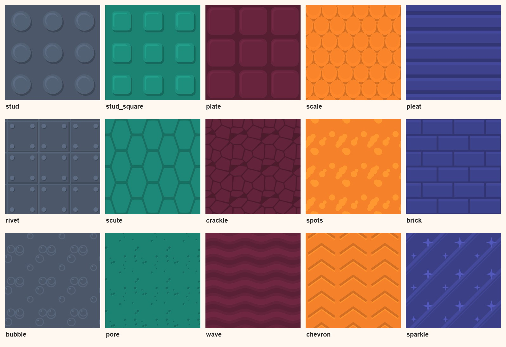
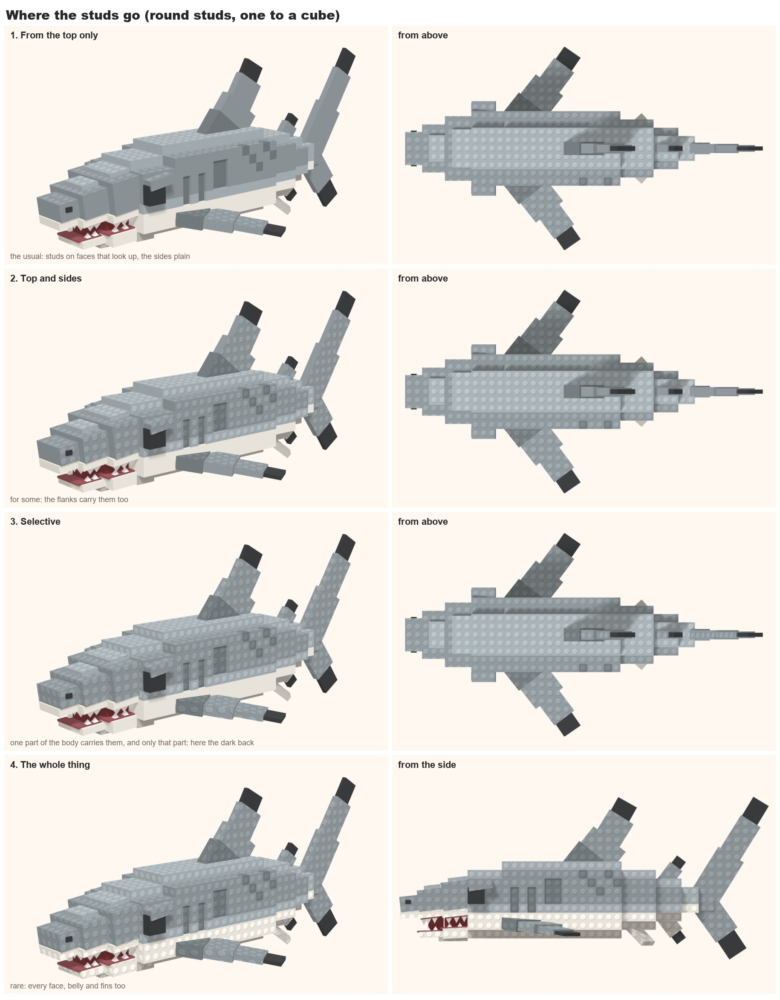
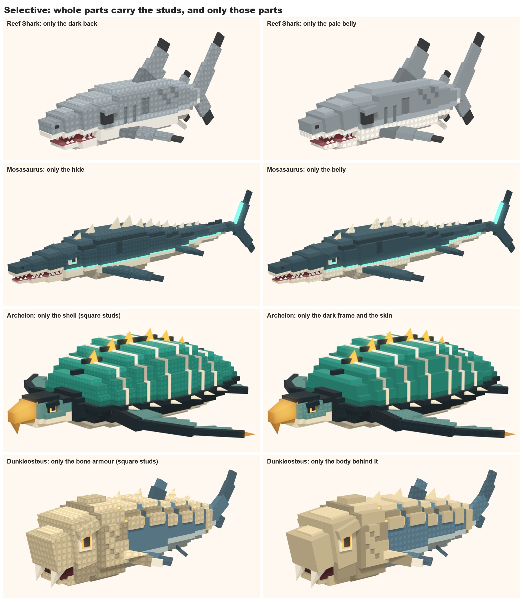
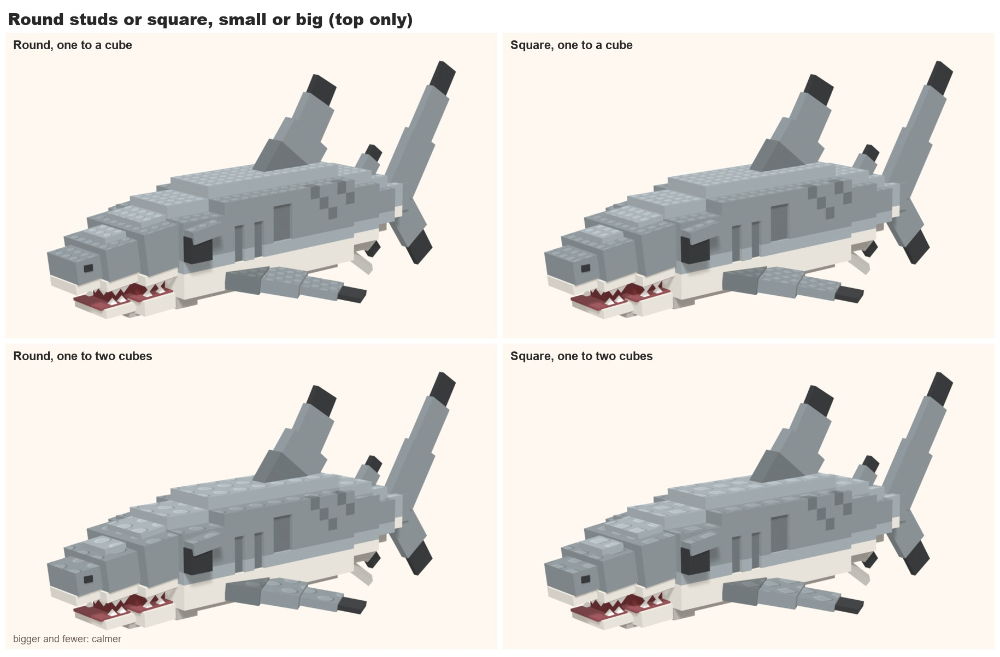
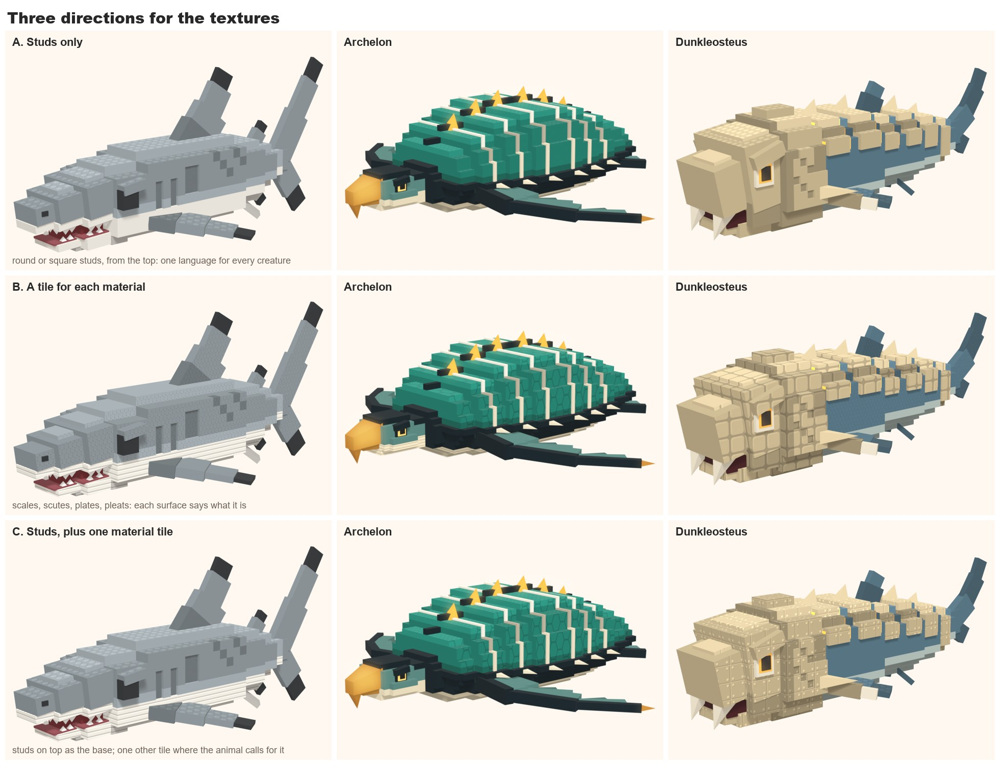
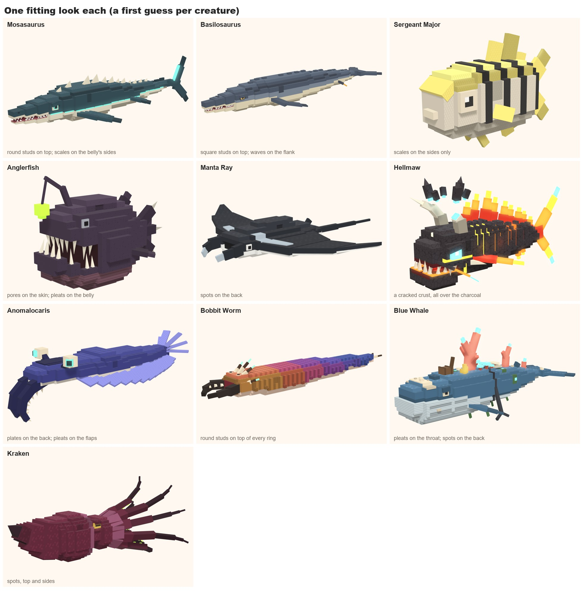
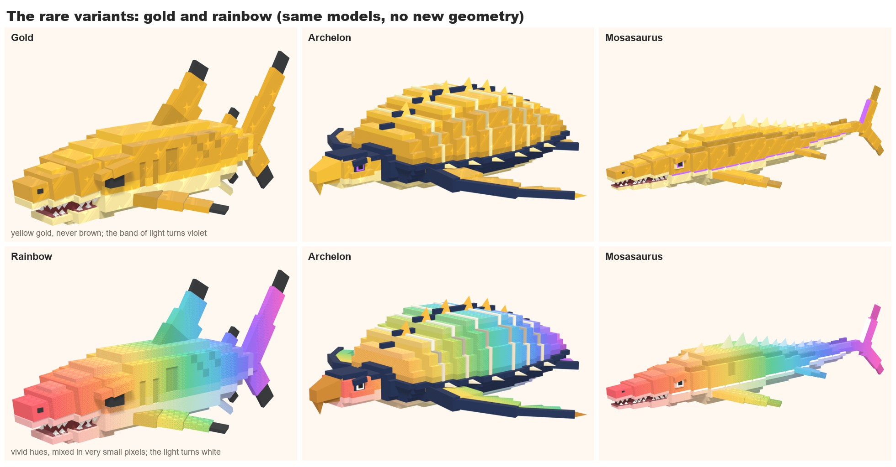
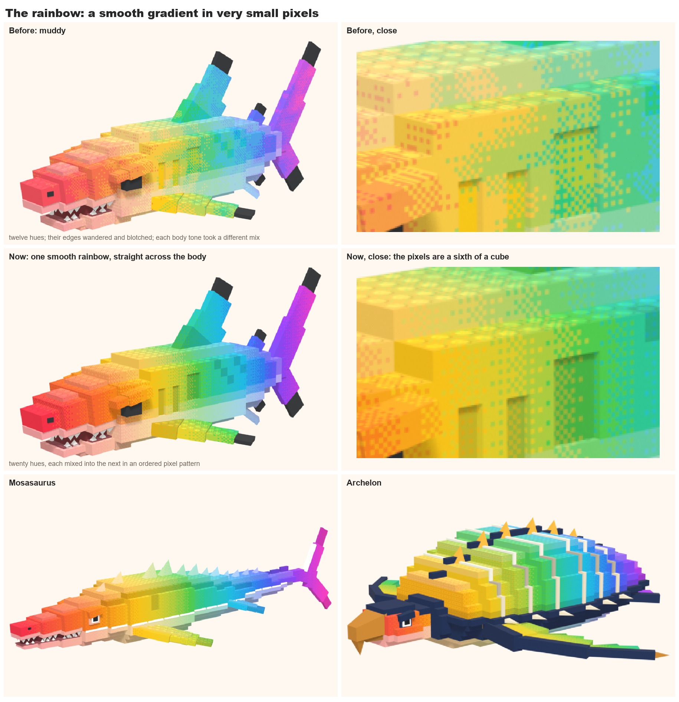

# Workout 6: textures and the rare variants
Up: [Style workouts](Style%20workouts.md). Before it: [the rarity look](05-rarity-look.md).

**Status: first test, 2026-11-10. Nothing is decided but the user's own direction below. Everything here is rendered in
Blender; none of it has been tried in Roblox yet.**

## The question
The models are flat colour. Ride a Dino lays a round stud and a rounded rectangle over some of its creatures. How do we
texture ours, so it looks meant and not silly?

## The user's direction (2026-11-10)
- **A mix of round studs and square studs** across the animals.
- **Where they go is the variety:**
  1. **Most: from the top only.** Studs on the faces that look up; the sides plain.
  2. **Some: the sides too.**
  3. **Some: selective.** Chosen parts of the body are studded, and only those parts (the dark back, or the pale belly).
  4. **Rarely: the whole thing.** It can look tacky, and it can work. Use it with care.
- Ride a Dino does this, but not well: theirs reads as unintended and silly. Ours should look chosen.
- **Other tiles too:** armour, fish skin, pleats, and special ones.
- **Gold and rainbow variants.** Gold is the whole animal in gold with a few accent colours, plus a gold kind of texture.
- **Every texture is cartoonish.**

## How a tile works here
- A tile is a small square grey picture that repeats, drawn by code (`tools/art/creature_tiles.py`, into
  `art/style/tiles/`). No image generator, no cost.
- Mid grey leaves the creature's colour as it is; lighter grey lifts it; darker grey shades it. So one tile works on any
  colour, and the colours stay in the model.
- The shapes are flat and hard-edged, in three or four tones: a face, a lit edge, a drop shadow. Cartoon, not photo.
- **One tile to a cube,** lined up with the cubes, so a stud sits in the middle of each cube and is never cut by an
  edge. A model may ask for one tile to two or three cubes.
- A model says where tiles go with `TEXTURES`, a short list of rules (which tile, which faces, which colours, which
  parts). `--look file.json` tries a look without touching the model. See the top of `tools/blender/voxel_kit.py`.
- Eyes, teeth, mouths and anything that glows are never textured.

## A ton of textures
Drawn so far (fifteen), and more that could be, by family. **Bold** ones are drawn.

| Family | Tiles | For |
|---|---|---|
| Toy brick | **round stud**, **square stud**, hollow stud (a ring), a pin hole, a slotted grille, a smooth tile with a bevel | the base language, any creature |
| Skin | **scale**, small scales (four to a cube), **spots**, **wave**, **chevron**, rosettes, wrinkle lines, shark-skin dots | fish, eels, rays, sharks |
| Armour | **plate**, **rivet**, **scute**, **brick**, shingles, chain rings, studs with a cross slot | shells, bone heads, crabs, stone creatures |
| Soft | **pleat**, **bubble**, sucker rings in rows, jelly dots, frills | throats, bellies, jellyfish, tentacles |
| Old and grown | **pore**, **crackle**, barnacle rings, moss blotches, planks, rust patches | bone, coral, wrecks, the old one |
| Special | **sparkle**, stars, runes, circuit lines, crystal facets, frost, glowing cracks, a skull mark | gold, Mythics, Secrets, event creatures |

## Test 1: where the studs go
The Reef Shark, round studs, the four placements the user named.

## The user on the first sheets (2026-11-10)
- **The tiles that aren't studs don't look very good yet.** They will be worked on one at a time, later.
- **Studs go on most things in one of three ways:** from the top only, top and sides, or selective.
- **Selective does not mean a band in the middle.** It means chosen parts of the body carry the studs, and only those
  parts. On the shark, for example: the darker base, or the lighter base.
- (All over stays the rare case.)

### Selective, redone: whole parts
Each creature twice: the studs on one of its parts, then on the other. Every face of that part carries them.

- A part here is a colour area of the body: the back, the belly, the shell, the armour, the frame.
- Row 3 of the placement sheet above now shows this too (the shark's dark back).

## Test 2: round or square, small or big

## Test 3: three directions
The same three creatures under three ways of choosing tiles.

- **A. Studs only.** Round or square studs, from the top. One language for every creature; the variety is in where they
  sit. Closest to the reference, and the simplest to make.
- **B. A tile for each material.** Scales on skin, scutes on shell, plates on bone, pleats on bellies. Each surface says
  what it is. Richer, and further from the toy look.
- **C. Studs, plus one material tile.** Studs on top as the base everywhere; one other tile only where the animal calls
  for it.

## Test 4: one fitting look each
A first guess for ten more creatures, to see the tiles on different bodies.

## Test 5: gold and rainbow
The same models with no new geometry.

**The user on the first variants (2026-11-10):**
- Selective as whole parts is what they meant; which parts is Claude's call, creature by creature.
- The gold tile isn't liked, but stays for now. The gold itself must be **more gold and less brown**.
- The rainbow must be **more vibrant**, and its change of hue **stylised: pixelled, but not heavily**, so the
  transition reads as pixel art, almost painterly.
- **A creature's band of light must not clash with a variant.** The Mosasaurus's cyan line didn't work on the rainbow.
  On a gold or rainbow variant the band takes a contrasting colour.

**What changed (the sheet above is the new one):**
- **Gold:** yellow golds from deep to pale, never brown; the darker tone of each stays gold.
- **Rainbow, first try (wrong):** each whole cube took one hue. The user: that is voxel art, and the pixels are huge.
  What they meant is a gradient that looks semi-pixelled, as if it had been sharpened and worked over: **very small
  pixels**. The vibrancy is right and stays.
- **Rainbow, second try (muddy):** twelve hues mixed at their edges in small pixels, with the edges made to wander.
  The user: it looks muddy; the colours form splotchy bands and aren't placed correctly; it should follow a smooth
  gradient, properly aligned.
- **Rainbow, now:** one smooth rainbow, straight across the body, in twenty flat hues. Each hue is mixed into the next
  pixel by pixel in an ordered pattern, in pixels a sixth of a cube across: smooth from a distance, crisp pixels close
  up. Nothing wanders. Every body colour takes the same vivid rainbow; only a pale colour (a belly) takes it paler, and
  a colour's darker tone a little darker. The pattern is laid flat on each face, so it lines up.

  
- **The band of light:** on a variant every glowing colour takes one accent: violet on gold, white on a rainbow
  (`ACCENT` changes it for one creature).
- **Selective, the rule of thumb:** stud the part you want looked at (the shell, the armour, the back). Studs on a pale
  belly show from below and hardly from above.

- **Gold:** every colour becomes a tone of gold by how light it was (dark hide deep gold, pale belly pale gold). Eyes,
  teeth and mouths are kept, and one more colour where it frames the animal (the Archelon's dark lip). A sparkle tile,
  one to four cubes, and a little more shine.
- **Rainbow:** it replaces the body colours. Pale parts take it a little paler, dark parts a little deeper, so the
  animal's own pattern still shows. The accents are kept.
- In a swim the rainbow's cubes are worked out in the renderer and crawl a little as the body bends; in the game the
  hues would be fixed to the model.

**The rainbow, settled (the user, 2026-11-10):** a bit more pixelled, the pixels smaller, and a little of the pastel
back, midway. Now: fourteen hues, pixels a ninth of a cube, a tenth of white mixed in (half on a pale belly). The user
doesn't need to check it again.

## Studs only, for now (the user, 2026-11-10)
- **Nothing but studs is laid on the models for now.** The other tiles wait for a texture pass, worked by hand, one
  creature at a time.
- Claude says which creatures it would want a special texture on. A first list, by what the animal is known for:

| Creature | The texture it wants |
|---|---|
| Archelon, Sea Turtle, Grave Turtle | scutes on the shell |
| Dunkleosteus, Giant Isopod, Sea Scorpion | bone or shell plates |
| Hellmaw, Brimstone Eel, Molten Megalodon, Cinder Ray | a cracked crust with light in the cracks |
| Blue Whale, Galleon Whale | throat pleats; barnacles; planks on the Galleon |
| Kraken, Octopus, Giant Squid | sucker rings under the arms |
| Leopard Shark, Manta Ray, Goliath Grouper, Moray Eel, Boxfish | spots or blotches |
| Lionfish, Sergeant Major, Clownfish | their stripes are already geometry: studs only |
| Pufferfish | spines or bumps |
| Seahorse | armour rings |
| Electric Ray, Storm Serpent | a lightning mark |
| Steller's Sea Cow | bark-like wrinkles |
| Bone Leviathan, Skull Angler | bone pores |
| Abyssal Watcher | eyes |
| Parrotfish, Humphead Wrasse | big scales |

## How this would work in Roblox (not tried)
- The classic Roblox stud was a top-face texture, so "from the top only" is at home there.
- A tile needs texture coordinates on the faces that carry it. The kit already knows them (it lays them out for these
  renders), so an export can carry them.
- To find out with one test upload: whether a small shared grey tile can sit over a part's own colours, and whether a
  part can mix textured and plain faces. If not, the textured faces become a second mesh in the same part.
- Gold is a palette swap. The rainbow here is made in the renderer; in Roblox it would be painted into the model's
  colours, a band to a slice.

## Open, for the user
- Which direction: A, B or C?
- Round and square studs: by animal, by rarity, or by zone?
- One stud to a cube, or bigger and fewer on the big animals?
- How strong should the tiles be? They are drawn at full strength here so they show on a sheet.
- Rainbow: smooth from nose to tail, or in bands?
