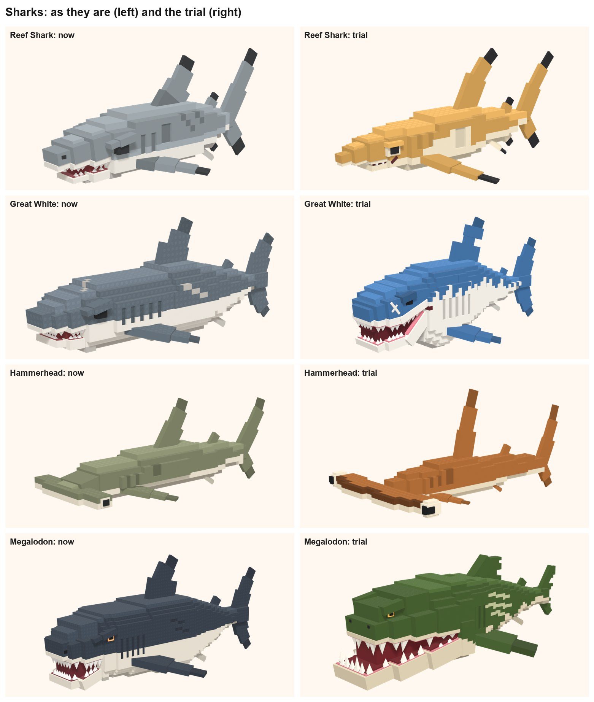

# Workout 7: telling creatures apart (shape, mouth, colour, mark)

Up: [Home](../../Home.md). Written 2026-11-16. **A trial, not a standard yet:** four sharks are being rebuilt by these
rules to see if they work. Nothing here replaces [workout 4](04-voxel-style.md) or [5](05-rarity-look.md): the blocks,
the gate, the seat and the rarity rules all still hold.

## The problem (the user, 2026-11-16)
Our fish follow an extremely similar look, so getting a new one feels like getting the last one again. The user sent a
size chart of the sharks from Hungry Shark as a reference for **how** a set of similar animals is kept apart: colour,
patterns, details, and above all the shapes of the body and the mouth. We read it for rules. We do not copy its
characters: every creature here is still designed from its real animal, in our blocks.

## What ours look like now
[The eight sharks on one sheet](../../work/voxel/sharks-now.jpg) (a working file, not kept in the repo). Measured from
the exports:

- **Four of them are one template at four sizes:** Reef Shark, Great White, Megalodon, Hellfin Shark. Depth to length
  0.40 to 0.44 on all four, width to length 0.50 to 0.64. The same stepped head, the same wedge of a body, the same fins
  in the same places, the same mouth with the same teeth.
- **The Hammerhead and the Goblin Shark are that template with a different tip to the snout.**
- **Colour:** grey, grey-blue, navy, olive, tan, brown. Only the Goblin Shark (pink) and the Hellfin (orange line) have
  a colour you could name from across the lane.
- **Marks:** the same row of gill slits on five of them; a few pale dashes.

So what changes from shark to shark is size and a grey. What stays is everything the eye reads first.

## The rules the reference uses
In the order the eye meets them.

1. **One body idea each, and the proportions are pushed to say it.** No two share a profile. A bruiser is all chest and
   head; a racer is a thin dart; one is a flat wide blade; one is mostly tail. What is varied:
   - how much of the length is **head** (a fifth, up to nearly a half);
   - how **deep** the body is and **where** it is deepest (at the chest, at the middle, nowhere);
   - how fast it **tapers** to the tail, and how big the **tail fin** is against the body;
   - how big the **side fins** are (stubs, or wings).
2. **The mouth is the face, and no two are alike.** It varies in size (a slit, up to a third of the animal), in where it
   sits (under the snout, or at the very front), in whether it is shut or hanging open, in the jaw (an underbite, an
   overbite, a jaw shot forward), in the teeth (a few big triangles, a comb of needles, a ragged uneven row), and in how
   much pink gum shows. The line of the lips is drawn: a grin, a frown, a smirk.
3. **One clear colour each, across the whole wheel.** Each animal has one hue you could name (slate blue, teal, orange,
   violet, pink, sand, moss) on top, and a pale belly. The **line between the two has a shape** of its own: straight and
   low, high and wavy, a sharp zigzag.
4. **One mark each, drawn big.** Stripes, or spots, or saddles, or dark fin tips, or a scar, or gill slashes in a colour
   that stands out. One, not all of them.
5. **Fins are part of the outline.** A tall sickle, a low bump, a ragged torn edge, tips of another colour.
6. **The big ones carry history:** scars, notches, torn fins. The small ones are clean.

## The same rules in our blocks
- **Set the body idea as numbers before building,** and check them on the side and top views: head as a share of the
  length, body depth over length (the body alone, not the fins), where the deepest slice is, tail fin height over body
  depth. Two creatures of one family must differ by a clear step in at least three of these.
- **Build the mouth as its own design,** not from the last shark's: its size, its place, open or shut, which jaw leads,
  the teeth's size and count, and gum showing as a thin line set inside the lip (the gum rule of workout 4 stands).
- **Pick the top colour from the animal, then push it** until it has a name: saturation of about a third or more, where
  ours are now a tenth to a fifth. Keep the belly pale. Give the meeting line a shape and keep it off the places where
  the body changes size. No pure black for big areas.
- **One mark, in whole blocks:** a stripe is a block wide, a spot is a block, a scar is a thin pale line. Thin and proud
  by 0.3 as workout 4 has it, or flush in colour.
- **A torn fin is blocks left out** of its trailing edge, not blocks added.
- **Still true:** big intentional blocks; no gaps or overlapping faces (the gate); the rider's seat is clear, with room
  for the legs; a big animal is built from more cubes, not bigger ones; glow needs a reason.

## The four trials
Built beside the game's models, in `art/creatures/Trial<Name>/`, so nothing in the game changes. Each keeps its animal,
its land, its rarity and its length.

| Trial | The body idea | The mouth | Colour and line | The one mark |
|---|---|---|---|---|
| Reef Shark | the quick one: a slim dart, short pointed head, long fins | small, under the snout, a shut smirk with a few small teeth | warm sand-gold on cream, the line a pale wedge sweeping up the flank | black tips on every fin |
| Great White | the bruiser: a barrel chest, deepest a third of the way along, a blunt cone of a snout | a huge open grin curving up toward the eye, pink gums, big triangles top and bottom | strong steel blue on white, the line a sharp ragged zigzag high on the flank | one pale scar, and a notch in the back fin |
| Hammerhead | the hammer: a head half as wide as the animal is long and thin as a plank, the slimmest body, the tallest back fin | tiny, tucked under the hammer | copper-bronze on cream, the line low and straight | a dark band along the hammer's front edge |
| Megalodon | the mouth: head and jaws over two fifths of the length and wider than the body, which falls away to a small tail | gaping, the lower jaw jutting past the upper, huge uneven teeth | dark moss green on bone, the line low and wavy | claw scars on the flank, torn fins |

## The trials as built (2026-11-16)

All four pass the gate. Each has its own sheet and swim: `docs/attachments/voxel-trial<name>.jpg`. Two builders were
cut off before their last look (the Great White, the Megalodon); their models were complete and were finished as they
stood. How strong the top colour is, from the models' palettes: Reef Shark 0.11 to 0.59, Great White 0.21 to 0.64,
Hammerhead 0.21 to 0.68, Megalodon 0.32 to 0.54.

What stands out on the sheet, before the user has judged it:
- **It works for the outline and the colour:** the four can now be told apart by either alone.
- **Reef Shark:** the pale flank wedge came out as a small square patch that reads as a window; the mouth hardly shows.
- **Great White:** the strongest of the four. The belly under the jaw is a busy staircase.
- **Megalodon:** the jaw reads more like a crocodile's or a dinosaur's than a shark's; the lower jaw is one heavy slab.
- **Hammerhead:** the hammer and the tall fin read at once; the body is plain.

## To judge
One sheet, old beside new. With the names covered: can each be told from the others by its outline alone? By its mouth
alone? By its colour from across the lane? And does each still read as our style, big blocks first?
