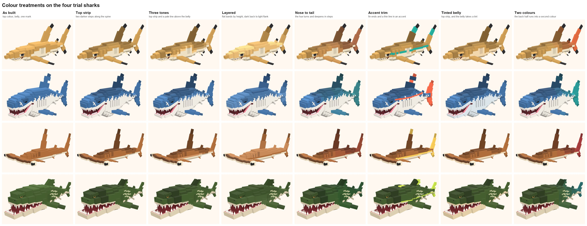
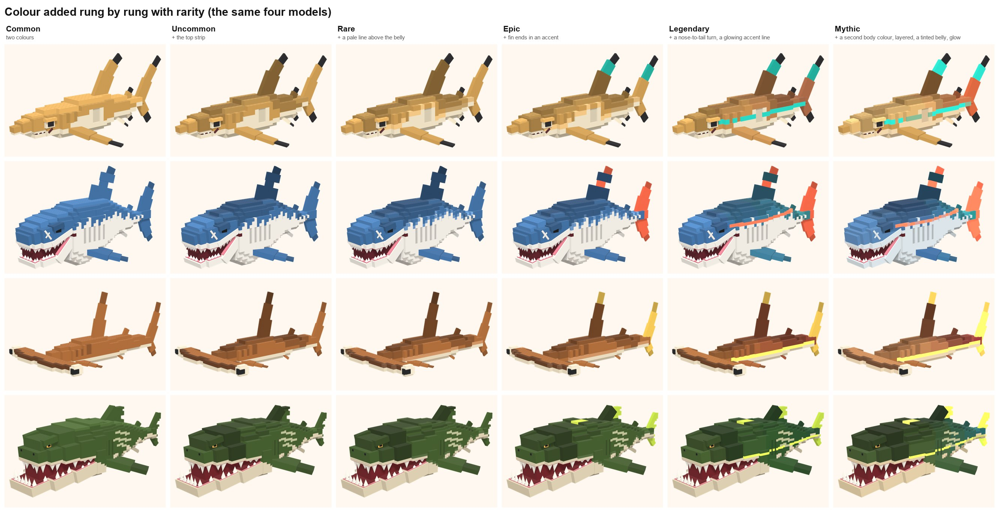
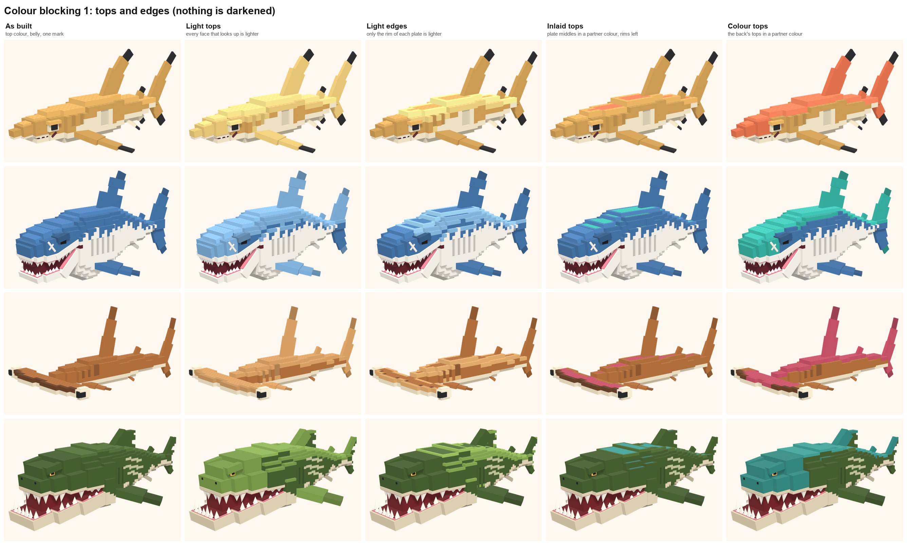
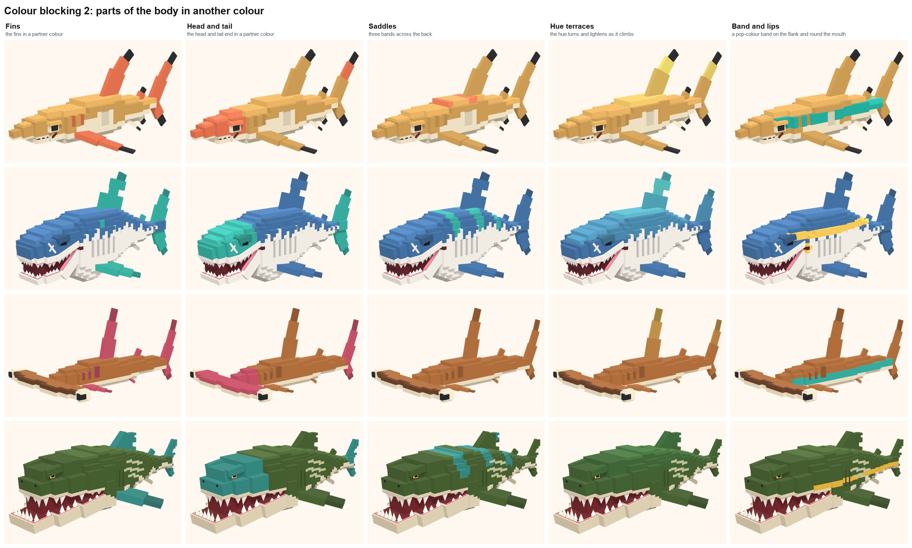
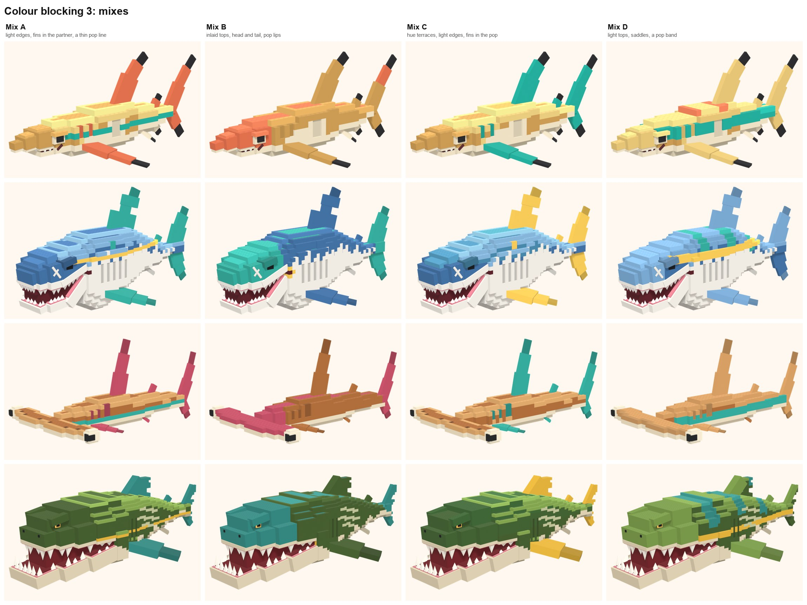

# Workout 8: colour treatments, and colour that grows with rarity

Up: [Home](../../Home.md). Written 2026-11-16. **A trial for the user to judge, not a standard.** It follows
[workout 7](07-shape-variety.md) and uses its four trial sharks.

## What the user asked
To experiment with adding colour in different ways, to make the creatures more aesthetic. One way named: how Ride a
Dino sometimes puts a short strip on top of an animal, darker, in layers. And ways that might scale with rarity.

## How it is done
A treatment is not painted into a model by hand. It is a short list of rules ("the top two layers of cubes along the
spine, darker") that the kit runs over a built model: `PAINT`, in `tools/blender/voxel_kit.py` (its opening notes list
what a rule can pick and what it can do). So one treatment can be tried on any creature in seconds, no model file is
touched, and the same rule can later be given to every creature of a rarity.

- The treatments and the rarity ladder: `tools/art/voxel_colour_trials.py`. Run it to render all of them again (about
  two minutes) and rebuild both sheets.
- A rule recolours whole cubes, so nothing is added to the mesh but material splits: the Great White went from 2,318
  to about 2,490 triangles with the top strip on.
- Not in the game. A treatment would reach the game by being baked into a creature's export and uploaded.

## The treatments

| Treatment | What it is |
|---|---|
| As built | the top colour, the belly, the one mark |
| Top strip | two stepped layers along the spine, each darker: the Ride a Dino strip. It stops short of the nose and the tail |
| Three tones | the top strip, and a pale line where the top colour meets the belly |
| Layered | the top colour in four flat bands by height, darkest on the back |
| Nose to tail | the hue turns and deepens in five flat steps down the length, with the top strip |
| Accent trim | the top strip, the end of the back fin and tail in an accent, and one thin straight accent line along the flank |
| Tinted belly | the top strip, and the belly takes a tint instead of plain cream or white |
| Two colours | the back half runs into a second colour in steps, with the top strip |

Each shark has its own accent, second colour, belly tint and direction of turn, chosen by hand to sit with its top
colour: teal on the gold Reef Shark, coral on the blue Great White, yellow on the copper Hammerhead, lime on the green
Megalodon.

## Colour that grows with rarity

The idea: a rarer creature carries more colour, in a fixed order, so the eye learns the ladder.

| Rarity | What is added |
|---|---|
| Common | two colours |
| Uncommon | the top strip |
| Rare | a pale line above the belly |
| Epic | fin ends in an accent |
| Legendary | a nose-to-tail turn, and the accent as a thin glowing line along the flank |
| Mythic | a second body colour, layered bands, a tinted belly, a stronger glow |

The sheet shows all six rungs on the same four models, to compare the rungs. In the game each creature has one rarity,
so each would wear one rung.

## What I see on the sheets (the user has not judged them yet)
- **The top strip works on all four** and is the cheapest: it gives the back a second tone and reads from the riding
  view, which looks down on the back.
- **Nose to tail and two colours** change a shark the most for the least clutter.
- **Layered** is quiet: at this size the bands are hard to see on the blue and the green.
- **The accent line** has to be straight. The first try followed the meeting of top and belly, which on the Great
  White's zigzag made a row of coral teeth, and on the Hammerhead flooded the whole hammer.
- **Fin ends** work for the back fin and the tail. They do not work by rule for the side fins: by position alone a side
  fin's end can't be told from the widest part of the body. A side fin's tip is set by hand in the model, as the Reef
  Shark's black tips are.
- **The Mythic rung is close to too much** on the Great White and the Megalodon: five things at once.

## Second round: colour blocking (2026-11-16)
**The user on the first round:** none of them as a rule or a standard; the ones that darken make it too dark. Wanted
instead: parts in different colours, to mark edges and tops and other things, artistically.

So nothing in this round darkens. Each shark has a **light** version of its top colour, a **partner** (a neighbouring
hue of about the same strength, for whole parts) and a **pop** (a far hue, for thin things). The rules are in
`tools/art/voxel_colour_blocks.py`.

| Treatment | What it is |
|---|---|
| Light tops | every face that looks up takes the light colour |
| Light edges | only the rim of each plate takes it, so every step is drawn as a line |
| Inlaid tops | the middle of each plate in the partner colour, the rim left |
| Colour tops | the tops along the back in the partner colour |
| Fins | the fins in the partner colour |
| Head and tail | the head and the tail end in the partner colour |
| Saddles | three bands across the back |
| Hue terraces | the hue turns step by step as the body climbs, and lightens |
| Band and lips | a two-cube band of the pop colour along the flank, and the mouth's rim |
| Mixes A to D | two or three of the above together |

What I see, before the user has judged:
- **Light tops, light edges, colour tops, head and tail, the flank band** come out clean on all four.
- **Fins** needed a fix. Picking fins by how thin they are caught only bits of them. They are now found as free
  pieces behind the head, which is right for these four but is not a rule to trust: a model should give its fins a
  colour name of their own (the Megalodon does), and then any fin colour is one line.
- **Saddles** are weak: one band on the Reef Shark, none on the Hammerhead (its body is too low in its own height).
- **Inlaid tops** is small: only the middles of the biggest plates take it.
- **The mixes** are the liveliest, and the nearest to the reference's use of colour; Mix D may be one thing too many.
- **What a rule can't do:** choose which part deserves the colour. The partner and the pop were picked by hand for
  each shark, and that choice is most of what makes a look work.

## Open
- Which treatments the user likes, and whether the ladder is the right order.
- Whether the ladder should hold for every creature or bend to the animal (a clownfish already has three colours as a
  Common).
- How this sits with [workout 5](05-rarity-look.md), which already gives rarity a look (halo eyes, glow with a reason).
