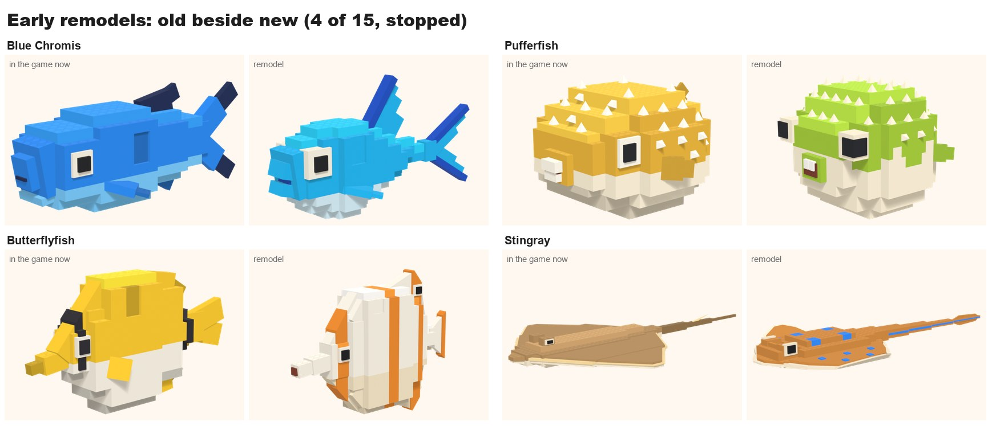

# Workout 9: fifteen early creatures remodelled

Up: [Home](../../Home.md). Written 2026-11-17. **Trials for the user to judge.** They are built beside the game's
models, in `art/creatures/Trial<Name>/`, so nothing in the game changes until the user says so (each would be a new
upload, and uploads are permanent).

## What the user asked
To use the Hungry Shark material and other good designs to remodel some of the more boring models, especially toward
the start of the game. Fifteen at most.

## How they were picked
All four early zones were laid out on one sheet each (`work/voxel/zone1-now.jpg` to `zone4-now.jpg`, working files).
A creature was picked when it was a plain block in a dull colour, or when it shared its colour with its neighbours:
- **Zone 1 had four yellow fish** (Boxfish, Butterflyfish, Pufferfish, Yellow Tang). Two of them change colour.
- **Greys, tans and browns:** Stingray, Cuttlefish, Sea Lion, Giant Sea Bass, Leopard Shark, Steller's Sea Cow,
  Barracuda, Sawfish, Goliath Grouper.
- **Plain shapes:** Blue Chromis (a blue brick), Sea Turtle, Moray Eel (a green tube), Octopus (a lump with sticks).

The four sharks of [workout 7](07-shape-variety.md) are not counted in the fifteen.

## What was read from the references
The sharks chart of workout 7, and the same game's smaller animals (its wiki's gallery of prey, looked at 2026-11-17).
Rules only; no character is copied, and every creature is still designed from its real animal in our blocks.
- **Small animals get big eyes.** The eye is a third of the head on the small fish, the turtle and the cuttlefish.
- **One feature is pushed until it is the animal:** the turtle is its dome, the pufferfish its ball and spines, the
  cuttlefish its eyes and skirt, the anglerfish its mouth.
- **Every animal has a colour you can name,** and neighbours do not share one.
- The rules of workout 7 for the body idea, the mouth, the colour line and the one mark.
- From the user's verdict on [workout 8](08-colour-treatments.md): nothing is made darker to add interest. Colour comes
  from parts in another colour.

## The fifteen
| Zone | Creature | Rarity | The body idea | The face | Colour | The one mark |
|---|---|---|---|---|---|---|
| 1 | Blue Chromis | Common | the dart: a teardrop deepest just behind the head, a thin stalk, a long scissor tail | a big round eye, a tiny upturned mouth | electric cyan over silver-blue | deep blue edges on the back fin and the tail's fork |
| 1 | Pufferfish | Common | the balloon: nearly a ball, stub fins, a stub tail | wide-set bulging eyes, a small round pout with two buck teeth | lime green over cream, the line scalloped | cream spines in ordered rows |
| 1 | Butterflyfish | Common | the disc with the straw: a tall disc and a long tube snout | a small eye inside a band, the mouth at the end of the straw | pearl white | three copper bands and a false eye high at the back |
| 1 | Stingray | Uncommon | the kite: a rounded diamond with the wing tips curled up, a raised head | two eyes standing up on a ridge | caramel over cream | big electric blue spots, blue lines down the tail |
| 1 | Cuttlefish | Uncommon | the shield: a broad oval with a skirt fin all round, a bunch of short arms | huge eyes with W pupils | violet over pink-cream | a yellow skirt and yellow arm tips |
| 1 | Sea Turtle | Uncommon | the dome: a high shell, long front flippers like wings | a big head, big friendly eyes, a beak with a smile | amber shell, green skin | large shell plates with cream seams |
| 2 | Moray Eel | Rare | the ribbon with the jaws: a tall thin ribbon, a head bigger than the body | jaws agape, needle teeth, leaf nostrils | electric blue | a yellow crest from head to tail tip, a yellow lower jaw |
| 2 | Octopus | Rare | the bulb: a tall mantle leaning back, thick arms that curl | eyes on bumps, bar pupils, heavy lids | tomato red over cream | two rows of cream suckers under every arm |
| 3 | Sea Lion | Uncommon | the acrobat: chest up and head lifted in one arc | a dog's muzzle, a big nose, big glossy eyes, ear flaps | caramel gold with a cream bib | chocolate flippers |
| 3 | Giant Sea Bass | Rare | the boulder: very deep, a head two fifths of the length, a saw of back spines | a giant frown, the lower jaw jutting, thick pale lips | plum over lilac | big indigo spots |
| 3 | Leopard Shark | Rare | the slinker: long and low, a flat wide head, two back fins of one size, a long low tail | a small frown under the snout, cat eyes | ivory over white | chocolate saddles with spots between |
| 3 | Steller's Sea Cow | Epic | the barrel: a huge round body, a tiny head, stub arms, a whale's fluke | a broad bristly muzzle turned down, tiny eyes | dusty teal over pale | a kelp frond in the mouth, barnacles on the back |
| 4 | Barracuda | Uncommon | the spear: a tenth as deep as it is long, a pike's head a third of the length | the lower jaw past the upper, a few big fangs | silver with a jade back | dark chevrons along the back |
| 4 | Sawfish | Rare | the chainsaw: a broad saw a third of the length, a flat guitar-shaped front, a shark's tail | eyes on top; the saw is the face | rust red over cream, a bone saw | a thin cream line along the side |
| 4 | Goliath Grouper | Epic | the vacuum: wider than deep, a head nearly half the length | a huge round open mouth, small eyes set forward | mustard gold over cream | brown tiger blotches; a hook and a broken line in the lip |

## For the builder
You build ONE of these as a new model beside the old one. Read, in this order, and nothing else unless you are stuck:
1. [The creature brief](creature-brief.md), from the top down to the heading "Running a batch": the kit, the tools,
   the hard rules (the gate, the seat, big blocks).
2. This note down to here, then ONLY your own creature's block below.
3. The old model, `art/creatures/<Name>/voxel.py`: read it to learn how this kind of animal is put together in the kit
   (its parts and joints, its swim, its seat). Then depart from its shape on purpose.
4. If you want to see the new manner in a finished model: `art/creatures/TrialGreatWhite/voxel.py`.

Rules for all fifteen:
- Write to the NEW folder `art/creatures/Trial<Name>/voxel.py`. Never edit the old folder or any other creature.
- `NAME` ends in " (trial)". Keep the zone, the rarity, the cube size `U` and the length given.
- Design from the real animal. Other games were studied for rules only: imitate no character from any game.
- The numbers in your block are the design. Check them on the side, top and front views. The outline alone, filled in
  black, must say the body idea and must not be mistaken for the old model.
- The face must read in the 3/4 view at the size of the preview: the eye and the mouth are built big enough to see.
- Colour: the hex given is the top colour; keep it that bright. Nothing is darkened to add interest: set `SHADE = 0.9`
  so the made tones stay close. No pure black but pupils. A colour line or a patch must be BIG: a shape that runs at
  least a third of the body, never a small square (it reads as a window).
- One mark, as given, in whole blocks. Nothing else added: no extra spots, stripes or scars.
- Lessons from the first trials: no staircase of one-cube steps under a jaw (one or two broad steps); a jaw is two or
  three blocks, not one slab; fins are part of the outline, so give them the shape described.
- The rider's seat stays clear with leg room, as the brief says. Studs as your block says.
- Work with `python tools/art/voxel_preview.py Trial<Name>` and look at `work/voxel/Trial<Name>_preview.png`. Up to
  five look-and-fix rounds here (quality over speed), silhouette first. Then
  `python tools/art/voxel_finish.py Trial<Name> "<the idea in one line>"`.
- Do not use git. Do not run `voxel_export_all.py`. Touch nothing outside `art/creatures/Trial<Name>/`, `work/` and the
  two attachment files the finish script writes. Other builders are working beside you on other creatures.
- Report (under 150 words): the gate's result; length, triangles, parts; the body numbers as built against the numbers
  asked; the colours; what is still weak or unchecked.

## The designs in full
Lengths are in studs, nose to tail tip. "Depth" and "width" are the body alone, without fins, as a share of the length.

### Blue Chromis
`TrialBlueChromis`. `"Blue Chromis (trial)", "ZONE 1 / SHALLOWS", "COMMON"`. `U = 0.35`. About 10 long. Under 800
triangles. Studs on the top of the back colour.
- **The dart.** A teardrop: depth 0.36, deepest at a quarter of the way back, right behind the head; from there one long
  even taper to a thin tail stalk (2 cubes deep). Width 0.2. The old one is a brick of one depth: this one must taper.
- A **scissor tail**: two long thin lobes in a deep V, the fin as tall as the body is deep and a quarter of the length.
  One tall pointed back fin swept back; small side fins.
- **Face:** a big round eye, 3 by 3 cubes with its cream ring, on a head only 6 or 7 cubes long. A tiny mouth at the tip
  of the snout, turned up (a notch one cube deep). Friendly: no brow.
- **Colour:** electric cyan `#19B4F2` on top, silver-blue `#CFEAF7` belly, the line straight and low (the bottom third).
- **The mark:** deep blue `#1B4FC4` on the leading edge of the back fin and the outer edge of both tail lobes.
- A Common: three colours and the pupil. Very simple.

### Pufferfish
`TrialPufferfish`. `"Pufferfish (trial)", "ZONE 1 / SHALLOWS", "COMMON"`. `U = 0.35`. About 10 long. Under 1,100
triangles. Studs on the top of the back colour.
- **The balloon.** Nearly a ball: depth 0.8, width 0.85, with broad stepped corners in all three views (a plateau and
  two steps, not terraces). The ball IS the animal.
- Fins are stubs: two small paddles on the sides set far back, a small back fin near the tail, a short tail on a
  two-cube stalk. They look too small for the body on purpose.
- **Face:** eyes set wide, on the front corners of the ball, each 3 by 3 with a cream ring, bulging half a cube proud.
  Between and below them a small round pout: a raised square of lips with a dark opening and two big white buck teeth.
- **Colour:** lime green `#A4CE3A` on top, cream `#FBF3DC` below. The line sits at the ball's middle and is scalloped:
  three broad waves along each side.
- **The mark:** cream spines (small pyramids, as teeth are made) in ordered rows over the green, about 5 across the top
  and 3 rows down each side. None on the seat. No spots.

### Butterflyfish
`TrialButterflyfish`. `"Butterflyfish (trial)", "ZONE 1 / SHALLOWS", "COMMON"`. `U = 0.35`. About 10 long. Under 800
triangles. Studs on the top of the white.
- The animal is a copperband butterflyfish. **The disc with the straw.** A tall thin disc: depth 0.75 with the fins
  (the back fin and the belly fin continue the disc's curve), width 0.22. In front of it a long thin tube snout, a
  fifth of the whole length, 2 cubes thick, level or tilted slightly down. A small fan tail on a short stalk.
- **Face:** the eye sits inside the first band, a dark pupil with a thin pale ring. The mouth is the end of the straw.
- **Colour:** pearl white `#F4F1E6`, a little warmer and darker on the belly.
- **The mark:** three upright copper bands `#E8892B`, each 2 cubes wide, top to bottom: one through the eye, one at
  the middle, one at the back of the disc; and one false eye, a dark block in a pale ring, high on the back fin near
  its rear. A thin copper edge on the tail. Nothing else.

### Stingray
`TrialStingray`. `"Stingray (trial)", "ZONE 1 / SHALLOWS", "UNCOMMON"`. `U = 0.4`. About 23 long with the tail (the
disc about 11). Under 1,200 triangles. Studs on the top of the caramel, the body only.
- The animal is a bluespotted ribbontail ray. **The kite.** Seen from above a rounded diamond, as wide as it is long
  (about 13 across). Seen from the front NOT a flat slab: the middle is a raised hump 3 cubes high, the wings thin
  out, and the last quarter of each wing tilts UP (a turned block), so the front view is a shallow W.
- A raised head at the front of the hump. A tail as long as the disc, thick at the root, thin at the end, with a low
  fin fold along its last third.
- **Face:** two eyes standing up on top of the head, each on its own raised block one cube high, with a cream ring,
  and a spiracle dent behind each. A thin level brow ridge joins them.
- **Colour:** caramel `#D08A3E` on top, cream `#F4E9D2` below, showing as a thin rim all round the disc's edge.
- **The mark:** electric blue `#2D8CFF` spots, each one block (some 2 by 2 on the hump), about 14, spaced evenly and
  mirrored; and one thin blue line down each side of the tail.

### Cuttlefish
`TrialCuttlefish`. `"Cuttlefish (trial)", "ZONE 1 / SHALLOWS", "UNCOMMON"`. `U = 0.4`. About 13 long. Under 1,500
triangles. Studs on the top of the violet.
- The animal is a flamboyant cuttlefish. **The shield.** A broad oval mantle: width 0.5, depth 0.28, flat on top with
  one broad step. All round its edge a thin skirt fin, one cube wide and half a cube thick, of the yellow.
- The head is short and as wide as the mantle's front. Eight arms in a bunch, short (a quarter of the length), thick at
  the root, hanging slightly down, the two outer ones raised like a pair of horns; two thin feeding arms a little
  longer between them.
- **Face:** HUGE eyes on the sides of the head, 4 cubes across with a pale ring, and the pupil a W: a dark bar with
  the two ends turned up. This is the thing people remember; build it carefully.
- **Colour:** violet `#8A44A6` on top, pink-cream `#F6DCE0` below, the line low and straight.
- **The mark:** yellow `#FFD23F` for the skirt fin and the last block of every arm. Nothing else.

### Sea Turtle
`TrialSeaTurtle`. `"Sea Turtle (trial)", "ZONE 1 / SHALLOWS", "UNCOMMON"`. `U = 0.4`. About 16 long. Under 1,500
triangles. Square studs (`stud_square`) on all of the shell colour, as the old one has.
- **The dome.** The shell is a high dome: its height 0.45 of its own length, a wide flat top and two broad steps down,
  with a thin cream rim plate all round sticking out half a cube. The old one is a low lid: this one is tall.
- Front flippers long and swept back like wings, in two turned blocks each; the pair spans more than the animal's
  length. Rear flippers small. A short pointed tail.
- **Face:** the head is big for the body (a quarter of the shell's length), held up and forward on a short neck. Big
  friendly eyes, 3 by 3 with a cream ring, set on the sides. A blunt beak with a mouth line that turns up at the back.
- **Colour:** an amber shell `#C9782E`; green skin `#9CC46A` with a cream `#F4EBCB` underside and throat.
- **The mark:** the shell's plates: five big plates down the middle and four each side, parted by thin cream seams
  (flush colour, one cube wide). The seat is on the top plate; keep it flat.

### Moray Eel
`TrialMorayEel`. `"Moray Eel (trial)", "ZONE 2 / CORAL REEF", "RARE"`. `U = 0.4`. About 22 long. Under 2,000
triangles. Studs on the top of the blue.
- The animal is a ribbon eel (a moray). **The ribbon with the jaws.** The body is a tall thin ribbon: 5 cubes deep and
  3 wide for most of its length, in many short slices on joints so it can bend in an S, thinning only in the last fifth.
- The head is BIGGER than the body: 7 cubes deep at the jaw's hinge, and a sixth of the length. Behind it the neck
  steps down to the ribbon.
- **Face:** the jaws hang open: a long upper jaw, and a lower jaw dropped about 25 degrees, both in two blocks. Needle
  teeth, top and bottom, about 7 a side, with a thin gum line inside the lips. Two leaf-shaped nostril flaps standing
  up at the snout's tip (the animal's own). A small pale eye with a dark pupil under a brow that comes past it.
- **Colour:** electric blue `#1E6BF0` body; the mouth inside dark red.
- **The mark:** yellow `#FFD426`: a crest fin one cube thick and 2 high running unbroken along the whole back from
  behind the head to the tail's tip, and the whole lower jaw. Nothing else.

### Octopus
`TrialOctopus`. `"Octopus (trial)", "ZONE 2 / CORAL REEF", "RARE"`. `U = 0.45`. About 18 long with the arms trailing.
Under 2,000 triangles. Studs on all of the red, the mantle and head only, as the old one has.
- **The bulb.** The mantle is a tall rounded bulb, taller than it is long (about 9 high, 8 wide, 7 long), leaning back
  over the body behind the head. The head is lower and narrower, between the bulb and the arms.
- Eight arms trail behind in swimming, but NOT as straight sticks: each is three blocks, thick at the root (3 cubes),
  thinner at each block, and the last block turns outward or up in a curl. A web of thin plates joins the arms' roots
  for their first quarter. The arms fan out in a skirt seen from above.
- **Face:** an eye on each side of the head on a raised bump, with a dark bar pupil lying level and a heavy lid of the
  body colour cutting the top third (sleepy and a little cross).
- **Colour:** tomato red `#E2452F` on top, cream `#F8DDBB` on the underside of the head and arms.
- **The mark:** two rows of cream suckers, each one block, under every arm, showing along its lower edge.
- The seat is where the old model has it unless the bulb gives a better one; keep it flat and clear.

### Sea Lion
`TrialSeaLion`. `"Sea Lion (trial)", "ZONE 3 / KELP FOREST", "UNCOMMON"`. `U = 0.4`. About 16 long. Under 1,600
triangles. Studs on the top of the gold.
- **The acrobat.** The side view is one arc, not a log: the chest is the deepest and lowest part (depth 0.3, a third of
  the way back); in front of it a thick neck rises to a head held UP, nose above the back's line; behind it the body
  tapers and lifts slightly to the rear flippers, held together and fanned like a tail. Build the neck and the hind
  body as turned slices on joints.
- Long front flippers swept back and down from the chest, two blocks each.
- **Face:** a dog's head: a rounded skull, a tapering muzzle one step narrower, a big dark nose block at the tip, a
  cream muzzle pad with three whisker dots a side, a mouth line turned up. Big glossy eyes, 3 by 3, dark with one
  white block of shine. Small ear flaps behind the eyes (one block each).
- **Colour:** caramel gold `#D9953B`; cream `#F6E7C6` as a bib: from the chin down the throat and the chest to the
  belly, widest at the chest. The line is the bib's edge.
- **The mark:** all four flippers in chocolate `#6B4630`. Nothing else.

### Giant Sea Bass
`TrialGiantSeaBass`. `"Giant Sea Bass (trial)", "ZONE 3 / KELP FOREST", "RARE"`. `U = 0.45`. About 20 long. Under
2,000 triangles. Studs on the top and sides of the plum.
- **The boulder.** Very deep: depth 0.46, deepest at two fifths of the way back; width 0.34. The head with its gill
  cover is two fifths of the length. A short thick tail stalk and a broad square tail.
- The back fin is a saw: nine separate upright spines (thin tall boxes, tallest in the middle), then a soft rounded
  lobe behind. Big round side fins.
- **Face:** a giant frown. The mouth is at the very front, wide, its corners turned DOWN, and the lower jaw juts past
  the upper by a full cube. Thick lips in pale pink-cream `#F1D9CF`, raised. A row of small teeth just showing. Small
  eyes set high, under a heavy level brow (grumpy, not evil).
- **Colour:** plum `#7B5698` on top, lilac `#DCCFE6` below, the line low and gently wavy.
- **The mark:** big indigo `#4B3276` spots, each 2 by 2 blocks, about 8 a side on the body behind the head, flush.
- It must not look like the Goliath Grouper: this one is DEEP and narrow-mouthed with a frown; that one is wide with
  a round open mouth.

### Leopard Shark
`TrialLeopardShark`. `"Leopard Shark (trial)", "ZONE 3 / KELP FOREST", "RARE"`. `U = 0.4`. About 18 long. Under 1,800
triangles. Studs on the top of the ivory.
- **The slinker.** Long and low: depth 0.14, width 0.17 (wider than deep). The head is flat and broad with a short
  rounded snout, a spade seen from above. No chest: the depth hardly changes until the tail.
- TWO back fins of the same size and shape (rounded triangles), one at the middle and one at three quarters. The tail
  is a quarter of the length and lies low: a long upper lobe at about 20 degrees with a notch near its end, almost no
  lower lobe. Broad rounded side fins held flat.
- **Face:** a small mouth UNDER the snout, a level frown line with a few tiny teeth. Oval cat eyes on the sides: a
  pale eye with an upright slit pupil and a lid over the top third (sleepy).
- **Colour:** ivory `#EFE3C2` on top, white `#FBF8EE` below, the line low and straight.
- **The mark:** chocolate `#5B3A2A` saddles across the back, each 2 cubes wide and reaching halfway down the sides,
  about seven from the head to the tail, with one round spot (a single block) on the flank between each pair. They
  continue as bars on the tail.
- It must not look like the trial Reef Shark (a gold dart with tall fins): this one is low, flat-headed and patterned.

### Steller's Sea Cow
`TrialStellersSeaCow`. `"Steller's Sea Cow (trial)", "ZONE 3 / KELP FOREST", "EPIC"`. `U = 0.45`. About 29 long.
Under 2,600 triangles. Studs on the top of the teal.
- **The barrel.** A huge round body: depth 0.34, width 0.38, biggest at the middle, with three-step corners. It
  narrows quickly behind to a thick stalk and a wide whale's fluke (two lobes, as wide as the body).
- The head is comically small: a tenth of the length and half the body's depth, on a short thick neck that steps down
  from the barrel. Two stub arms, short blunt paddles held forward and down like little arms.
- **Face:** a broad square muzzle pad turned down at the front, pale, with rows of bristle dots; a mouth line under it.
  Tiny eyes (one dark block with a pale ring) set far apart. Gentle: no brow.
- **Colour:** dusty teal `#5E9396` on top, pale `#DCE6D2` below, the line low and wavy in three long waves.
- **The marks (an Epic may have two):** a frond of kelp trailing from one side of the mouth, bright green, three
  blocks long, on its own joint if it suits; and three small clusters of cream barnacles on the back and shoulder
  (each a few low blocks), none on the seat.

### Barracuda
`TrialBarracuda`. `"Barracuda (trial)", "ZONE 4 / SHIPWRECKS", "UNCOMMON"`. `U = 0.4`. About 20 long. Under 1,800
triangles. Studs on the top of the jade.
- **The spear.** Depth 0.11, width 0.09: the thinnest body in the game for its length, the same depth from the gills to
  the second back fin. The head is a pike's: a third of the length, a long flat-topped wedge coming to a point.
- Two small back fins set far apart, the second well back over a matching fin below; a forked tail with thin pointed
  lobes, taller than the body is deep.
- **Face:** the LOWER jaw is longer than the upper and juts past it by a cube and a half, with a knob at its tip. The
  mouth is slightly open along its whole length. Few teeth and big: two long fangs at the front of the lower jaw
  standing up outside the upper lip, and about five uneven needles a side behind them, top and bottom, with a thin gum
  line. A large round eye with a pale ring under a brow that comes past it.
- **Colour:** bright silver `#DCE6EA` sides and belly; a jade `#1F9E8F` back, the line high (the top third) and straight.
- **The mark:** about ten dark jade `#146B66` chevrons along the upper side, each a slanted bar 1 cube wide leaning
  back, from the gills to the tail. Nothing else.

### Sawfish
`TrialSawfish`. `"Sawfish (trial)", "ZONE 4 / SHIPWRECKS", "RARE"`. `U = 0.4`. About 25 long. Under 1,800 triangles.
Studs on the top of the rust red.
- **The chainsaw.** The saw is a third of the whole length, 3 cubes wide and half a cube thick, the same width from
  root to a blunt square end, with nine big teeth a side (pyramids lying flat, pointing outward, evenly spaced and
  easy to count).
- Behind the saw the front of the body is flat and wide: the head runs into broad triangular side fins, so from above
  the front half is a guitar or a spade (width 0.36 across the fins) and only 3 cubes deep. The back half is a
  shark's: two tall back fins of one size, a tail with a long upper lobe.
- **Face:** two eyes on top of the head on low raised blocks, with cream rings, and a spiracle dent behind each. The
  mouth is underneath and need not show. The saw is the face.
- **Colour:** rust red `#B8503C` on top, cream `#F2E5CC` below; the saw bone `#E6D6B0` with white teeth.
- **The mark:** one thin cream line along each side from the saw's root to the tail (one row of cubes, unbroken).

### Goliath Grouper
`TrialGoliathGrouper`. `"Goliath Grouper (trial)", "ZONE 4 / SHIPWRECKS", "EPIC"`. `U = 0.45`. About 24 long. Under
2,600 triangles. Studs on the top and sides of the gold.
- **The vacuum.** A fat wide fish: width 0.42, depth 0.38, widest at the gill covers a third of the way back. The head
  is nearly half the length. Behind the gills it shrinks quickly to a short stalk and a round paddle tail. Small round
  fins like paddles; a long low back fin.
- **Face:** the mouth is a cave. It is at the very front, wide open and round: an opening about 7 cubes wide and 5
  high, half the body's depth, framed by thick raised lips all round, dark red inside with a pink tongue block on its
  floor. Rows of tiny teeth just inside the lips. Small eyes set far forward and high, close above the mouth's
  corners, each with a pale ring (a dopey look). No brow.
- **Colour:** mustard gold `#D6A62C` on top, cream `#F3E6BE` below, the line low.
- **The marks (an Epic may have two):** brown `#7A5326` tiger blotches, five broken upright bars down each side, each
  2 or 3 cubes wide with ragged edges in whole blocks; and a fishing hook in one corner of the lip with a short broken
  line trailing back (grey metal, a pale line).
- It must not look like the Giant Sea Bass: this one is WIDE with a round open mouth; that one is deep with a frown.

## As built
**Stopped by the user on 2026-11-17 with 4 of the 15 built.** Nothing was exported or uploaded.

| Creature | State | What is weak |
|---|---|---|
| Blue Chromis | built, passes the gate | the mouth is small in the 3/4 view |
| Pufferfish | built, passes the gate | the eyes stick out as slabs; the lips are green and square |
| Butterflyfish | built, passes the gate | the disc reads as a white box; no side fins |
| Stingray | built, passes the gate | the hump reads as stacked slabs; single-block spots are small |
| Cuttlefish | cut off part-way: a `voxel.py` exists, not checked, not finished | |
| Sea Turtle, Moray Eel, Octopus | started and cut off before a file was written | |
| The other seven | not started | |

To carry on: one builder a creature, as "For the builder" says, four at a time. The Pufferfish and the Butterflyfish
want a second pass first.
