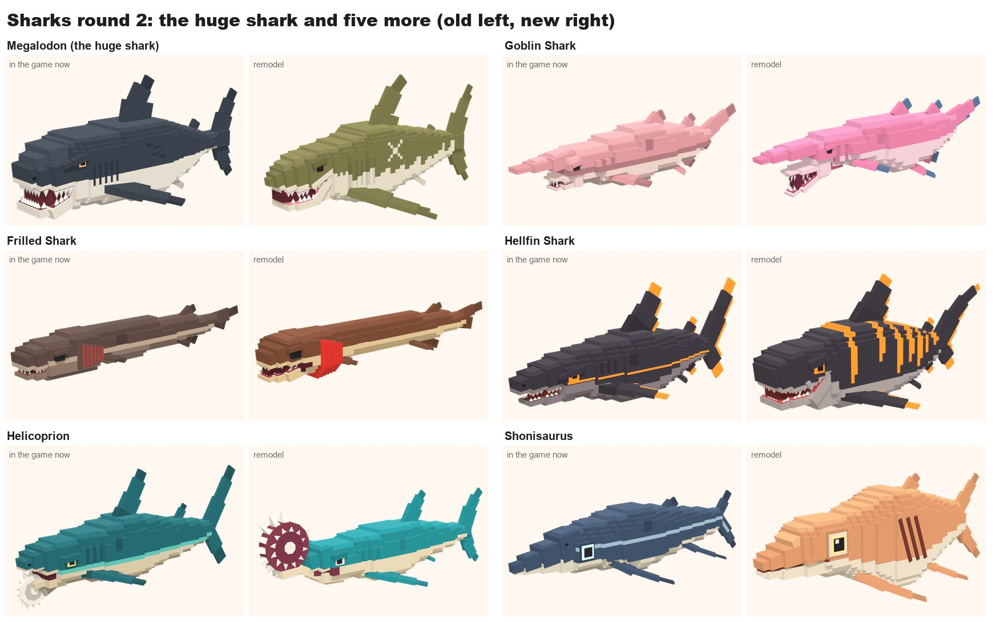
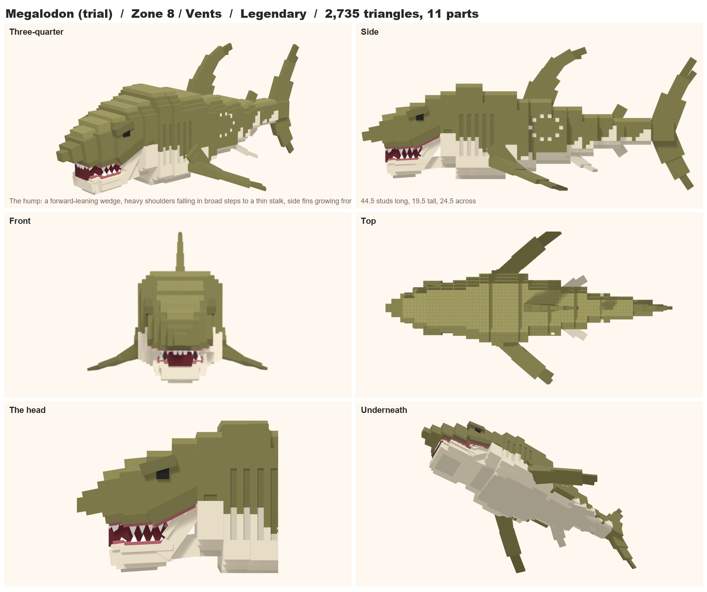
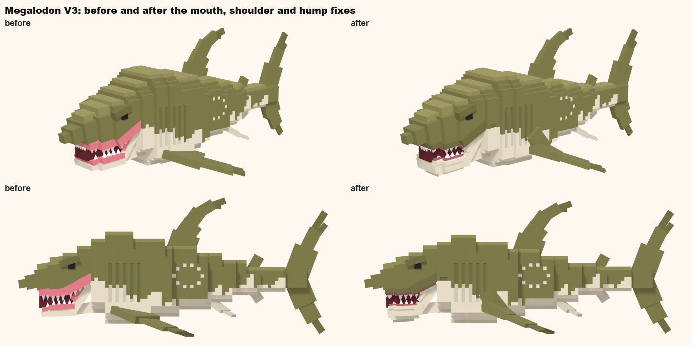

# Workout 10: the huge shark and five more, after the shark chart

Up: [Home](../../Home.md). Written 2026-11-18. **Trials for the user to judge.** Built beside the game's models, in
`art/creatures/Trial<Name>/`, so nothing in the game changes until the user says so.

## What the user asked
"Could we try do some more hungry shark model changes, using the reference i sent a while back. Id like to see the huge
shark and others." The reference is the Hungry Shark size chart of [workout 7](07-shape-variety.md) (a copy for builders
in `work/voxel/ref/shark-chart.png`, not kept in the repo). Its rules are in workout 7. We read it for rules only: no
character is copied, and every creature is designed from its real animal in our blocks.

## What the user said about the last round (2026-11-18)
The old models (made by Fable 5.2) were **better modelled**; the remodels were **better coloured**. Kept remodels: Sea
Lion, Steller's Sea Cow, Goliath Grouper. So this round has to be both: new shape and colour, and modelling at least as
clean as the old model's. The old model is the floor for craft: broad deliberate steps, big blocks, clean joints, a
swim that flows. Changing the outline is the point; getting sloppier is not.

## The six
The huge shark is the chart's giant at the top left: a long, heavy, powerful shark, not a mouth on a tail. Our first
Megalodon trial (`TrialMegalodon`) went the other way and read as a crocodile, so this is a second, separate try.

| Folder | Zone, rarity | The body idea | The face | Colour | The one mark |
|---|---|---|---|---|---|
| TrialMegalodonV2 | 8, Legendary | the titan: a long heavy torpedo, deepest a third of the way back, a tall sickle back fin, a huge crescent tail, long wing-like side fins | a pointed cone of a snout over a long grin that curves up toward the eye, slightly open, pink gums, big white triangles top and bottom | olive khaki over bone white, the line a hard jagged edge from the mouth's corner to the tail | history: ragged torn edges on the back fin, the tail and one side fin, and one big pale X scar on the flank |
| TrialGoblinShark | 6, Epic | the slingshot: a flabby soft body that sags, a long flat blade of a snout, a long low tail with almost no lower lobe | the jaws shot forward out under the blade, hanging open, a comb of needle teeth, tiny eyes | bubblegum pink over pale pink | slate-blue edges on every fin |
| TrialFrilledShark | 7, Epic | the serpent with a collar: an eel-long body, no taper until the back third, the fins all set far back | a lizard's head with the mouth at the very front, wide, rows of small three-pointed teeth | cocoa brown over sand, the line low and straight | a bright red frilled collar of six gill frills that wraps the throat |
| TrialHellfinShark | 10, Legendary | the tiger: a broad, blunt, square snout, a deep head and shoulders, a thick body, a long upper tail lobe | a wide jagged grin, the corners turned up, the teeth uneven | charcoal over ash grey | glowing ember tiger stripes across the back that run out onto the fin edges (glow allowed: it is a Legendary of fire) |
| TrialHelicoprion | 5, Legendary | the buzz-saw: a slim long fish with a short low head; the spiral whorl in the lower jaw is a third of the head's height again and shows from the side and the seat | the whorl is the face: the lower jaw curls into it, the upper jaw small | teal over cream | the whorl's teeth bright bone white, ringed |
| TrialShonisaurus | 6, Legendary | the leviathan dolphin: a huge deep round body, a short beak, four long paddle flippers, a crescent tail and a small back fin | an ichthyosaur's huge eye (a third of the head's height) over a long thin beak of a mouth | sandstone peach over cream | three long claw scars down the flank in dark red-brown |

Each keeps its old model's zone, rarity, cube size `U` and length (within a tenth). Triangle limits as the creature
brief has them for the rarity.

## For the builder
You build ONE of these as a new model beside the old one. Read, in this order:
1. [The creature brief](creature-brief.md), from the top down to the heading "Running a batch".
2. [Workout 9's "For the builder"](09-early-remodels.md) section: every rule there holds (Trial folder, `NAME` ends in
   " (trial)", `SHADE = 0.9`, big colour shapes, one mark, the jaw and fin lessons, no git, no export, touch nothing else).
3. This note, then your row above.
4. Look at the chart, `work/voxel/ref/shark-chart.png`, for HOW its animals are told apart (body, mouth, colour line,
   one mark, torn fins on the big one). Copy none of its characters.
5. The old model, `art/creatures/<Name>/voxel.py` (for the Megalodon also `art/creatures/TrialMegalodon/voxel.py`, to
   see what not to do: its jaw reads as a crocodile's). Learn its parts, joints, swim and seat, and **match its craft**.
   `art/creatures/TrialGreatWhite/voxel.py` is the best shark trial so far.

Then: `python tools/art/voxel_preview.py Trial<Name>`, look at `work/voxel/Trial<Name>_preview.png`, up to five
look-and-fix rounds, silhouette first. Then `python tools/art/voxel_finish.py Trial<Name> "<the idea in one line>"`.
Report under 150 words: the gate's result; length, triangles, parts; the colours; what is weak or unchecked.

## As built (2026-11-18)

All six pass the gate (rechecked). Each has its own sheet and swim: `docs/attachments/voxel-trial<name>.jpg`.

| Trial | Length, triangles | Weak spots (the builders' and mine) |
|---|---|---|
| Megalodon V2 (the huge shark) | 43.5 studs, 2,959 | reads as a shark now, not a crocodile; the back and belly are long one-cube staircases, the eye is small, the belly fins are sticks |
| Goblin Shark | 26.1 studs, 1,464 | closest to the old one; the head behind the blade is a plain box, the tail stalk shows slice lines |
| Frilled Shark | 26.4 studs, 1,772 | the collar reads as one red sheet, not six frills; small teeth |
| Hellfin Shark | 34.2 studs, 2,328 | the stripes bunch toward the tail; an ember eye ring beyond the one mark |
| Helicoprion | 35.1 studs, 1,920 | the wheel reads at once from the side, but from the riding camera only its top teeth show; the jaw is a stick holding it |
| Shonisaurus | 40.5 studs, 2,846 | the biggest change; the beak is three stacked boxes, the flippers are strips, the rider's legs sink into the wide back |

My read: Hellfin, the huge shark and Helicoprion are the clearest gains; Shonisaurus is a bold change; the Goblin and
Frilled sharks moved least. Next, on the user's word: their picks and fixes, then export and upload (permanent).

## The huge shark, third try (2026-11-18)
The user sent a close-up of the chart's giant and asked for that one. We don't copy another game's character, so this
is our own Megalodon that takes the qualities which make it read, measured against our V2 (close-up in
`work/voxel/ref/huge-shark.png`, not kept in the repo). Folder `TrialMegalodonV3`; V2 stays as it is.

What V2 lacks, and V3 must have:
- **The hump.** Deepest just behind the head: heavy shoulders and a thick neck. The chest bulges down below the jaw
  line. From there the body tapers in a long smooth fall to a thin tail stalk. The side view is a wedge leaning forward,
  not an even bar: depth about 0.30 of the length at the shoulders, 0.08 at the stalk.
- **Smooth lines.** The back and belly fall in broad deliberate steps of two to four cubes, never long one-cube
  staircases (V2's main fault). Match the old Megalodon's craft at least.
- **The snout.** A long pointed cone that overhangs the mouth well in front, a quarter of the head's length.
- **The grin.** A long mouth from under the snout tip back past the eye, its corners turned up. Thick lips in their own
  pink (two cubes deep, not a gum line), slightly open, big white triangles in a top and a bottom row.
- **The fins.** Long side fins swept back like wings, as long as the head. A tall back fin swept back with a ragged
  trailing edge. A big crescent tail, the upper lobe longer, torn at the tips. Two small fins on the back near the tail.
- **The eye.** Small and set high, under a heavy brow that slants down to the front.
- **Colour.** Olive khaki over bone white (as V2). The meeting line is torn and ragged, running from the mouth's corner
  down and back to the tail. SHADE 0.9.
- **Our own mark, not the chart's.** No X scar. Instead: a ring of bite punctures on the flank behind the rider (pale
  pits in an arc, a bigger animal's bite), plus the torn fins.
- Zone 8, Legendary, U 0.5, about 43 studs long, about 3,000 triangles. The rider's seat on the hump's back slope, clear, with
  leg room, so from the riding camera the hump's crest and the snout show ahead of the rider.

### V3 as built

Passes the gate (rechecked). 44.5 studs, 2,577 triangles, 9 parts; depth 0.29 of the length at the shoulders, 0.08 at the
stalk; the back and belly fall in two-cube steps with flats of 7 to 9 cubes. Pink lips two cubes deep. Weak: from the
riding camera the hump hides the head (only the crest shows); the back fin is swept low and a little far back to keep the
rider in view; the stalk is long and level; the snout tip is a small knob; the ring of bite pits reads a little like a
dotted circle.

### V3 fixes (2026-11-18, the user's asks)

The user: "fix the mouth and make it look better and less like lipstick ... give the shark more of a limb like a
shoulderblade for the fin ... make the top highest bump ... slightly more shallow". Done on the same model, gate passes
(rechecked), 2,735 triangles, 11 parts. Mouth: skin-coloured jaw edges with a ridge, a muted rose gum recessed a cube
inside, teeth big at the front and smaller to the corner, a heavier stepped chin, an olive crease at the corner. Shoulder:
raised blocks on each flank behind the gills, a thick root narrowing into the blade, each fin its own part jointed inside
the shoulder. Hump: the crest and every step behind it one cube lower (shoulder depth 0.28 of the length). Weak: the
mouth now reads smaller and the grin's upturn is quieter; the corner crease is busy close up; the snout still hides behind
the hump from the riding camera. The version before the fixes is in `work/voxel/before_v3fix/`.
