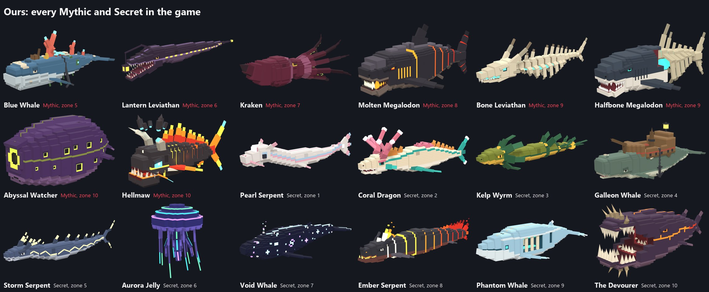
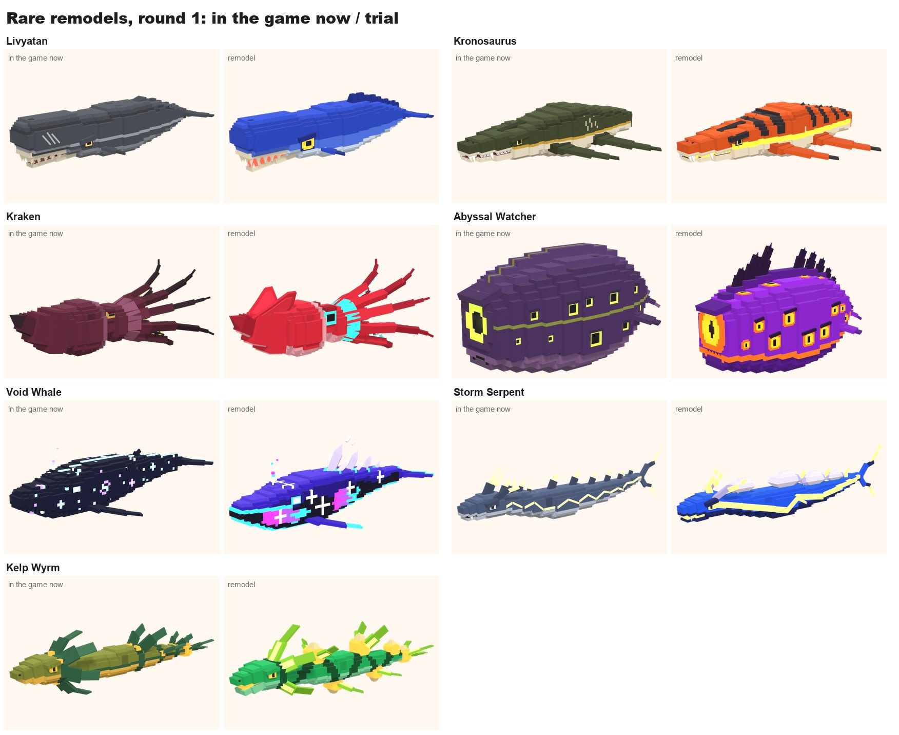
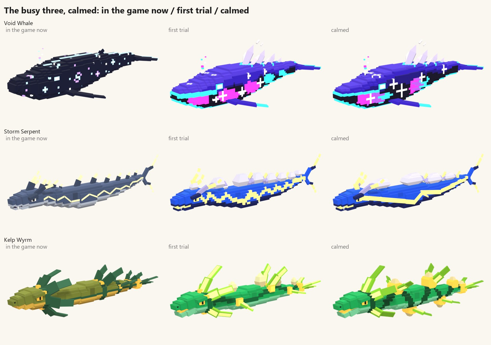

# Workout 11: what gives Ride a Dino's rare dinos their wow, and what ours lack

Up: [Home](../../Home.md). Written 2026-11-18. **A study for the user to judge; nothing in the game changes.**

## What the user asked
"Find Ride a Dino dinos to study for colourways, mythic components, ways they use glowing colours and how they
orchestrate their cooler designs in ways we dont. I feel like our rarer designs lack in the colourway and detail
department for the wow factor." Then: use the videos that show Secret, Divine and Spectral dinos.

## Sources
- The game's five store images (Roblox's thumbnail service).
- Stills from three public gameplay videos, read through `tools/sources/yt.py frames`:
  - BemmyBlox, "I got FIRST SECRET and REACHED THE END" (`Zv6ruzbhcyY`);
  - BlakeGamer, "I Got the 0.1% RAREST Spectral Dino" (`BOR7UxmbY7s`);
  - Pak GM, "Aku Beli SEMUA GAMEPASS Demi DIVINE" (`uRQ-MML_JGI`).
- "Divine" in that last video is an aura tier (a cosmetic effect round the player), not a dino.
- The study board, `work/research/ride-a-dino-rare-board.jpg`, is another game's art, so it stays out of the repo,
  like the shark chart. It is read for rules only: no dino is copied.

Ours for comparison:

## How their rare dinos are made

**1. Most of the wow is a variant, not a new animal.**
- Every dino can come as Silver, Golden, Rainbow, Magma, Spectral, Skeleton or Cosmic. The game's Index shows
  "Variants 2/30" per dino.
- Every dino also comes in sizes: Tiny, Big, Giant, Huge.
- Each variant is a whole re-material of the same model:
  - **Spectral:** the whole body one translucent, glowing teal, like a ghost of the dino.
  - **Golden:** gold over every block, with sparkles.
  - **Rainbow:** bands of pure hue down the body, no shading at all.
  - **Magma:** charcoal with lava cracks.
  - **Cosmic:** crystal ice with a glowing symbol (a swirl on the Mammoth's flank).
  - **Skeleton:** bone white, open ribs.
- One modelled dino becomes about 30 collectable looks. A Spectral Giant reads as rare from across the map before
  you read its name.

**2. The named rare dinos use one saturated hue at full strength.**
- Examples: a pure red Spinosaurus with navy stripes up the sail; a magenta and black rex; a royal blue Abyss Fang.
- No greys, no browns, no muddy mid tones. Three values of the one hue, then one accent.

**3. Glow is used in big areas, not thin lines.**
- Glowing cracks run over the whole body of the purple Spinosaurus.
- On the black rex, every block's edges glow magenta, so a black dino still reads against anything.
- The Abyss Fang has glowing cyan orbs as big as its eye.
- The Spectral body glows all over.
- The mouths are lit inside (pink, magenta).
- Glow covers roughly a fifth to a half of what you see. Every glowing piece is at least a few blocks wide.

**4. They are built in two layers: a dark core and a bright shell.**
- The King Yeti is dark navy fur under a shell of huge pale crystal spikes.
- The Abyss Fang is a deep blue body with pale ice plates on top.
- The shell is faceted, angled, and much lighter than the core. That value jump is the wow, and the facets catch light.

**5. Their silhouettes break upward.**
- Sails, crystal spikes, horns and spines stand a third to a half of the body's height above the back.
- From the riding camera and in the pen, the top line is the first thing you see.

**6. Themed parts on a known animal.**
- Event Secrets wear props on a familiar body: the Hollowtusk mammoth carries pumpkins, the Jackstraw has a pumpkin
  head and a witch's hat.
- The Mythic LichSpinosaur is a known animal made undead.

**7. Rare dinos are shown off.**
- Big rare dinos stand huge in your pen, where everyone walking past sees them.
- Big coloured labels sit above them: "Secret", "Cosmic", "Mythic", with $/s.
- Auras (fire, crimson, lightning) are bought separately and wrap the rider. They are effects, not the model.

**8. The zone answers the dino.**
- The Volcano's floor has glowing lava tiles that match the red and black Hellasaurus.
- The Cosmic zone has cyan crystals that match the Cosmic dinos.

## Where ours fall short (the sheet above)

**1. Muted base colours.**
- Our deep rares are slate navy (Storm Serpent, Void Whale), maroon (Kraken), olive and sage (Kelp Wyrm, Galleon
  Whale), dusty purple (Abyssal Watcher) or charcoal (Molten Megalodon).
- Theirs would be pure red, magenta or royal blue. On a dark zone floor ours sink in.

**2. Glow as one-cube lines and dots.**
- Lantern Leviathan's dots, Storm Serpent's zigzag, Void Whale's specks and Molten Megalodon's stripes are all a
  cube wide.
- They vanish from the riding camera and at a distance. Glow parts are many (Kraken 24) but small.

**3. One material, no shell.**
- Bone Leviathan and Halfbone come closest (bone over dark).
- None has a pale, faceted second layer over a dark core.

**4. Long, low outlines.**
- Most are torpedoes. Only Hellmaw (the fire fin), The Devourer (spikes) and Blue Whale (coral) break the back line.

**5. Our variants are placeholder tints.**
- Silver, Gold and Rainbow exist (`src/shared/Variants.luau`), but as tints with sparkles.
- There is no Spectral, Magma or Cosmic, and no whole-body re-material that reads from far away.

**What already works:** Hellmaw is the closest to their level: a saturated fire fin, a lit mouth, an upward
silhouette. Aurora Jelly and The Devourer read well too.

## Rules this suggests, for our own designs (proposed)

**1. One hero hue at full chroma for every Mythic and Secret.** Three values of it plus one accent. No grey, brown or
olive as a main colour above Legendary.

**2. A glow budget by rarity, glow as shapes.**

| Rarity | Glow, as a share of what you see |
|---|---|
| Legendary | about 5% |
| Mythic | 10 to 20% |
| Secret | 20 to 40% |

- Every glowing shape is at least 2 to 3 cubes wide: plates, orbs, edge rims, cracks, a symbol.
- Never a line one cube thin as the main glow.

**3. A dark core and a bright shell on every Secret.**
- The shell is a pale, faceted layer: crystal, ice, coral, bone or armour.
- It has at least three big pieces rising above the back line.

**4. The back line rises.** On Mythics and Secrets, crests, spines or shards reach a third of the body's height above
the back.

**5. A lit mouth** (glow inside) on the predators, from Epic up.

**6. Whole-body variants.** A Spectral (translucent glow), a Magma (cracks) and a Cosmic (crystal and a symbol) as
variants every creature can roll, beside Silver, Gold and Rainbow. This is the biggest gain: one rule makes every
species more collectable. It needs code in `Variants.luau` and a bake rule per variant.

These sit on top of [workout 5](05-rarity-look.md) (glow with a reason) and [workout 8](08-colour-treatments.md)
(the colour ladder). They push the top rungs much further.

## Remodels, round 1 (2026-11-18)
The user: "remodel some of ours that fall short in the mythic legendary or higher categories". These seven sank the
most on the sheet above: muted base colours, glow a cube thin, low outlines. Each is a trial beside the game's model, in
`art/creatures/Trial<Name>/`, so nothing in the game changes until the user picks.

| Folder | Zone, rarity | Keep (its idea) | Hero hue, values, accent | Glow, as shapes | Shell and back line |
|---|---|---|---|---|---|
| TrialLivyatan | 7, Legendary | the battering ram with tusks: a third of it one blunt box head, a narrow jaw of ivory tusks | ultramarine #2747C9 in three values, pale ice-blue belly; the tusks ivory | about 5%: the mouth lit inside in hot coral, a molten gold eye halo | a ridge of knuckle humps down the back, each 2 to 3 cubes high |
| TrialKronosaurus | 8, Legendary | the crocodile skull a third of the animal on a scarred whale body with four giant flippers | burnt orange #E2571C over charcoal bands, cream belly | about 5%: the sulphur line becomes a 2-cube band along the flank; the mouth lit sulphur yellow | a row of short dark scutes along the spine |
| TrialKraken | 7, Mythic | backwards: the mantle leads, eight arms trail and fan; its only light runs down the inside of its grip | crimson #E0263A in three values (no maroon), a pale rose underside | 10 to 20%: the inside of every arm a lit aqua band 2 cubes wide with sucker discs as bigger lit circles; big halo eyes | the mantle's fins flare up and back past the mantle's top |
| TrialAbyssalWatcher | 10, Mythic | the swollen slow bulk that is all eyes: one great halo eye, smaller eyes everywhere | magenta-violet #8E1FD9 in three values with black-violet shadows | 10 to 20%: every eye glows molten gold, 2 to 4 cubes across, each with a lit socket ring; a lit seam round the body | a crest of tall dark spines down the back, the tallest a third of its height |
| TrialVoidWhale | 7, Secret | the whale-shaped hole full of stars | electric indigo #3A1FD6 over a near-black core | 20 to 40%: a glowing nebula in broad patches (magenta to cyan, 3 cubes and up); stars as 2-cube crosses; a cyan rim on the outline's edges | pale lavender crystal shards rising from the back like comet fragments |
| TrialStormSerpent | 5, Secret | the storm cloud drawn out into a serpent, the lightning still in it | electric royal blue #1F5BFF over dark navy | 20 to 40%: lightning as thick bolts, 2 to 3 cubes wide, crackling across the body in yellow-white; the bolt spines lit; glowing eyes | a crest of pale storm-cloud billows, big faceted white-lavender plates, rising high along the back |
| TrialKelpWyrm | 3, Secret | the wyrm half kelp: one stem winds the whole flank, a blade and an amber bladder at each turn | emerald #16B35A in three values, bright lime blades | 20 to 40%: the amber bladders big glowing orbs, 3 cubes; lit lime veins in the blades | the mane of kelp blades rises high; pale gold bladders stand proud as the shell |

Each keeps its old model's zone, rarity, cube size `U` and length (within a tenth), and its one idea. Triangle limits
(about 1.3x the old model's): Livyatan 3,000 (old 2,342), Kronosaurus 3,500 (2,700), Kraken 3,400 (2,596), Abyssal
Watcher 3,500 (2,732), Void Whale 3,400 (2,592), Storm Serpent 2,900 (2,210), Kelp Wyrm 2,900 (2,254).

### For the builder
You build ONE of these as a new model beside the old one. Read, in this order:
1. [The creature brief](creature-brief.md), from the top down to the heading "Running a batch".
2. [Workout 9's "For the builder"](09-early-remodels.md) section: every rule there holds (Trial folder, `NAME` ends in
   " (trial)", `SHADE = 0.9`, big colour shapes, the jaw and fin lessons, no git, no export, touch nothing else).
3. This note from "How their rare dinos are made" down, then your row above. **This round overrides the brief's rules 7
   and 11 on glow and colour:** glow is used to the share your row gives, as wide shapes, never a one-cube line as the
   main glow; the hero hue is used at full strength; a Secret has a pale shell over its dark core.
4. The old model, `art/creatures/<Name>/voxel.py`: learn its parts, joints, swim and seat, and **match or beat its
   craft**. The old model is the floor.

The hard part is wow without mess: big glowing shapes and a bright shell, with half the surface still plain. Keep the
rider's seat clear.

Then: `python tools/art/voxel_preview.py Trial<Name>`, look at `work/voxel/Trial<Name>_preview.png`, up to five
look-and-fix rounds, silhouette first. Then `python tools/art/voxel_finish.py Trial<Name> "<the idea in one line>"`.
Report under 150 words: the gate's result; length, triangles, parts; the colours; the glow share you aimed for; what is
weak or unchecked.

### As built (2026-11-18)

All seven pass the gate (rechecked). Each has its own sheet and swim: `docs/attachments/voxel-trial<name>.jpg`. The
glow shares are the builders' counts from the renders. The renders sit on a pale background, which undersells glow:
in a dark zone it will read much stronger.

| Trial | Studs, triangles, parts | Glow | Weak (the builders' and mine) |
|---|---|---|---|
| Livyatan | 40.5, 2,186, 22 | about 3 to 4% | the knuckle ridge reads like a small comb; the body is still one plain blue |
| Kronosaurus | 42.5, 2,944, 12 | about 5% | the scars vanish on the orange; the band is one flat stripe |
| Kraken | 48.6, 3,090, 26 | 10 to 15% | most arm glow faces inward (it shows from the seat more than the side); the glowing web was the builder's own call |
| Abyssal Watcher | 39.0, 3,216, 10 | 13% side, 26% front | the great eye's lid is a flat slab, small teeth, little glow from above |
| Void Whale | 45.0, 3,088, 13 | about 35% | the nebula reads as flat magenta and cyan bars, loud rather than deep; it loses some of the void |
| Storm Serpent | 42.8, 2,844, 21 | about 24% | the stair-stepped bolt is busy at three-quarters; the cloud crest is modest |
| Kelp Wyrm | 40.5, 2,654, 25 | 17 to 22% | the bladders are small for the length; the lit veins outline the blades like wire |

My read: Abyssal Watcher, Kronosaurus and Kraken are the clearest gains. They are saturated, with an outline that
breaks and glow you can see. Livyatan is a solid step. Void Whale, Storm Serpent and Kelp Wyrm are much brighter but
busier. Their glow shapes want to be bigger and fewer.

### The busy three, calmed (2026-11-18, the user's ask)

The user picked "calm the busy three". The first trials are kept in `work/voxel/before_calm/`. All three pass the gate
(rechecked).
- **Storm Serpent** (2,426 triangles, down from 2,844; glow about 24%): one bolt per flank in four long straight strokes
  and a fork; a crest of four big cloud masses, the biggest 47% of the body's height. The clearest gain of the three.
  Weak: the clouds read as flat pale stones at three-quarters.
- **Kelp Wyrm** (2,890; glow 17 to 20%): solid lime blades with one lit vein each; five big amber bladders with pale
  gold caps at the stem's turns; a thicker, darker stem that zigzags over the back. Weak: no triangles left for more glow.
- **Void Whale** (2,918; glow about 30%): two ragged clouds, magenta to violet to cyan; 12 big star crosses; the cyan
  rim only on the edges. The smallest change: the rim along the jaw is still thick and the clouds still blocky.

## Next
- The user's picks and fixes, then export and upload (permanent, on their word).
- Prototype a Spectral variant on one creature.
- The user will also send their own screenshots. The study will be checked against them.
