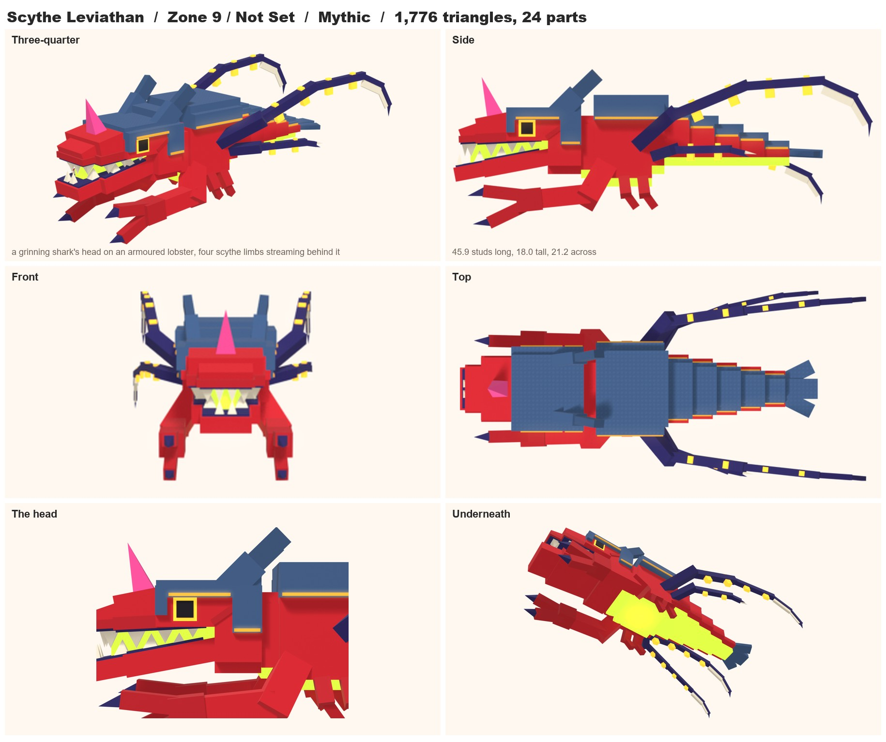
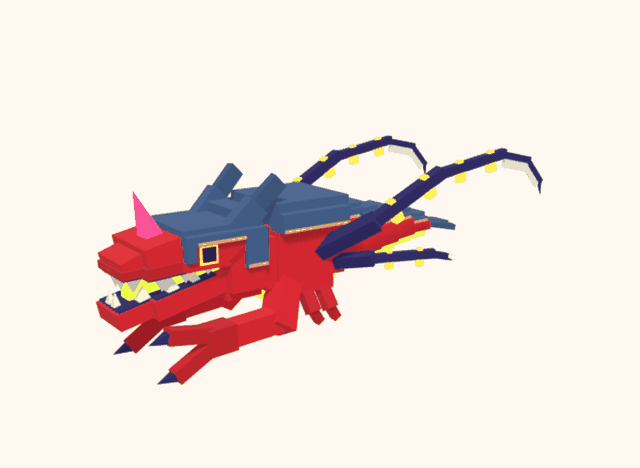

# Workout 12: leviathans
Up: [Style workouts](Style%20workouts.md). Started 2026-11-22 by the creature chat.

## What the user asked
A picture of another game's new creature (kept privately in `work/voxel/ref/leviathan-1.png`, not in the repo), and:
"could you create a cool leviathan creature model like this reference. Create it from your own constructions and dont
try to 1:1 match the picture because i dont want there to be errors or artifacts or improperly thought out dimensions.
But i do want the designs to look alike, make sure the cool stuff is replicated. Lets see this in our style, after this
id like to render out even more leviathan like creatures in different body styles".

So: one leviathan first, in our voxel kit, designed from our own numbers. Then more leviathans in other body plans.

## What makes the reference cool (the qualities we take)
1. **A shark's grin on a monster.** A deep red head, a mouth open wide with big white teeth top and bottom.
2. **A horn on the snout** in a hot pink that nothing else on the animal has.
3. **Armour over flesh.** Slate-blue plates like a helmet and shoulder guards over a crimson body: two strong colours,
   each in big shapes.
4. **Claws out front.** Two heavy clawed arms reaching forward under the chin.
5. **Scythe limbs trailing.** Long thin dark limbs that sweep up and far back and end in hooks. They make the outline
   three times bigger than the body.
6. **Lit from below.** A yellow-green belly, and rows of gold dots along the limbs.

What we do not take: its exact proportions, its plate shapes, its scale pattern, its pose. Ours is a different animal
under the same ideas: an armoured lobster body (a thorax, a tapering abdomen of plates, a tail fan) with a shark's head.

## Leviathan 1: the Scythe Leviathan
Folder `art/creatures/ScytheLeviathan`. `NAME = "Scythe Leviathan"`, Mythic, zone not set yet (`ZONE = 9` as a
placeholder), `U = 0.45`. Not in the game.

**Its idea in one line:** a grinning shark's head on an armoured lobster, four scythe limbs streaming behind it.

### The numbers (in cubes; the creature points to -X)
| Part | Length | Width | Depth | Notes |
|---|---|---|---|---|
| Head | 24 | 16 | 13 at the back | a wedge: the snout is 2 turned blocks and overhangs the mouth by 4 |
| Thorax (shoulders) | 20 | 20 | 16 | the biggest mass, the seat is on it |
| Abdomen | 30 in 5 slices of 6 | 16, 14, 12, 10, 8 | 12, 10, 9, 8, 6 | each slice on its own joint; one thing changes by one cube per side per slice |
| Tail fan | 8 | 14 | 2 | three blades: one centre, two angled out |
| Body in all | about 80 (36 studs) | | | |
| With the scythes | about 100 (45 studs) | about 44 across the scythes | | |

- **Head.** Deep and blunt behind, pointed in front. The mouth runs from under the snout back past the eye, open about
  3 cubes, its corners turned up. Big white teeth top and bottom, larger at the front. The inside of the mouth is lit
  (lime). A heavy jaw of two or three blocks, one broad step under the chin, never a staircase.
- **Horn.** One spike on the top of the snout, a third of the way back from the tip: 7 tall, 3 at the base, leaning
  forward about 20 degrees. Hot pink. It does not glow.
- **Eye.** A gold halo eye (dark pupil, thin lit gold ring), 3 cubes, under the front edge of the helmet, which comes
  past it as the brow.
- **Armour** (slate blue, the shell). Four big plates, each a wide plateau with one broad step down the side and a rear
  lip that rises 2 cubes over the plate behind it:
  1. the helmet over the top and back of the head, with two swept-back crest blades at its rear corners, 5 cubes tall
     (the back line rises here, in front of the rider);
  2. the shoulder plate over the thorax, 2 cubes wider than the body each side (it overhangs as a lip);
  3. to 5. one plate on the top of each abdomen slice, each narrower.
  A thin gold line runs along every plate's lower edge (a `band`, a third of a cube proud, never across a step).
- **Claw arms.** One each side, rooted low at the front of the thorax, their own parts on shoulder joints. Upper arm 8
  long going down and forward, forearm 10 going forward, a pincer of two fingers 8 long, each finger ending in a dark
  indigo talon. Thickness 4, then 3. The claws hang under the back half of the jaw, clear of the teeth.
- **Scythes.** Two pairs, rooted on the flanks at the rear of the thorax, under the shoulder plate's lip. Each is three
  boxes on three joints: a root 12 long going up, out and back at about 45 degrees (thickness 3); a shaft 30 long
  sweeping back nearly level (2.4); a blade 14 long hooking down (1.8) with a pale edge. The upper pair ends about 20
  cubes past the tail fan. The lower pair is 0.7 of that size, lower and further out. They splay outward so the rider
  is seen between them from behind. Indigo, with a row of four gold glowing orbs (2 cubes each) under each shaft.
- **Legs.** Two pairs of short crimson legs under the thorax, two boxes each, tucked. Drop them before any other part
  if triangles run short.
- **Belly.** Lime plates under the thorax and the abdomen, lit, each at least 3 cubes wide: one per slice.
- **Seat.** On the shoulder plate's plateau, clear, with leg dents if the plate allows. The helmet's crest stands in
  front of the rider, the first abdomen plate's lip behind.

### Colour and glow
| Colour | Hex | Where |
|---|---|---|
| Crimson (the hero) | #D9202E | head, body sides, arms, legs: three values of it |
| Slate blue | #3F5E8C | all armour |
| Indigo | #2A2466 | scythes, talons |
| Gold | #FFB52E | plate edge lines; glowing: the orbs, the eye's ring |
| Lime | #C8F03C | glowing: the belly plates, the mouth inside |
| Hot pink | #FF4FA0 | the horn only |
| Ivory | | teeth, the scythe blades' edges |

`SHADE = 0.9`. Glow 10 to 20% of what is seen, as wide shapes. Half the surface stays plain. Studs on the top of the
slate plates.

**The one flaw:** the lower left scythe is snapped short: its blade is missing and the shaft ends in a ragged stump.

**The swim:** `pose()`. The abdomen waves up and down like a lobster's (not side to side), the tail fan following; the
scythes trail with a slow lagging wave, each pair out of step; the claw arms open and close a little.

Limits: about 45 studs with the scythes, at most 3,800 triangles.

### For the builder
Read, in this order:
1. [The creature brief](creature-brief.md), from the top down to "Running a batch".
2. This note from the top down to here. **This note overrides the brief's rules 7 and 11 on glow and colour:** the hero
   hue at full strength, glow to the share given, as wide shapes, never a one-cube line as the main glow.
3. For manner, two finished models: `art/creatures/TrialKraken/voxel.py` (long limbs in boxes on joints, lit bands,
   `pose()`) and `art/creatures/TrialMegalodonV3/voxel.py` (a grin with big teeth, a jaw in blocks, a limb rooted in a
   shoulder). `art/creatures/Anomalocaris/voxel.py` if you want a crawler's legs.
4. Look ONCE at `work/voxel/ref/leviathan-1.png`, for the six qualities listed above only. Do not match it: no
   proportion, plate shape, scale pattern or pose is taken from it. Where the picture and this note differ, the note wins.

Rules:
- The numbers above are the design. Check them on the side, top and front views. If a number makes a bad shape, change
  it and say so; never leave a part whose size does not agree with the parts it joins.
- The face must read in the 3/4 view at the size of the preview: the grin, the teeth, the horn and the eye built big.
- Big colour shapes only. No scale pattern, no scattered spots beyond the scythes' orbs.
- No staircase of one-cube steps anywhere; plates are wide plateaus with one broad step.
- The seat stays clear. The rider must be seen from behind between the scythes.
- Up to five look-and-fix rounds on `python tools/art/voxel_preview.py ScytheLeviathan`, silhouette first. Then
  `python tools/art/voxel_finish.py ScytheLeviathan "<the idea in one line>"`.
- Do not use git. Do not export. Touch nothing outside `art/creatures/ScytheLeviathan/`, `work/` and the two attachment
  files the finish script writes.
- Report under 150 words: the gate's result; length, triangles, parts; the numbers as built against the numbers asked;
  what is weak or unchecked; any choice the note did not settle.

## As built (2026-11-22)

Built by the `creature-builder` helper, then one fix round on the creature chat's read. Passes the gate (never forced).
45.9 studs long with the scythes, 18.0 tall, 21.2 across; 1,776 triangles of 3,800; 24 parts. Not exported, not in the game.

- **First draft:** the head was small and the grin thin, the body a flat bar from the side, the abdomen plates one-cube
  notches, the claw arms sticks, the crest blades antennae. Kept in `work/voxel/before_fix1/`.
- **Fix round:** head 30.7 long, 19 wide, 16 deep (the grin 21 long, open 5 at the front, nine big teeth a side, a jaw
  4 deep); thorax 22 deep with a hump 3 over the helmet; abdomen 14, 12, 10, 8, 6 deep in five overlapping shingles,
  each 2 narrower than its slice so crimson shows from above; arms 5 thick with a palm, two fingers and talons; crest
  blades 5 by 3 at the root.
- **Differs from the numbers above, with reason:** the scythes are longer (root 16, shaft about 40 in two boxes, blade
  16: the first numbers could not reach past the fan); a bare crimson neck 3 cubes long parts the helmet from the
  shoulder plate; the orbs sit on top of the shafts so the rider sees them; widths are odd numbers; teeth stand on an
  indigo gum line.
- **Still weak:** the claw arms hang about 9 cubes below the belly and read long; the eye (4 cubes) is small on the
  bigger head; the flanks are plain flat crimson walls; the lower scythes cross the lime line at the last slice in the
  side view; the glow share is not measured and the lit belly hardly shows except from below; the head and thorax do
  not move in the swim. Half the triangle limit is unused.

Waiting for the user's read.

## Next: more leviathans, other body plans
On the user's word, after they have seen the first. Ideas, none agreed: a serpent leviathan (a plated eel with a crown
of horns), a ray leviathan (a flat armoured wing with scythe tails), a whale leviathan (a breaching bulk in plates), a
squid leviathan (a helmeted mantle, hooked arms), an anglerfish leviathan (all mouth, a lit lure, plated).
