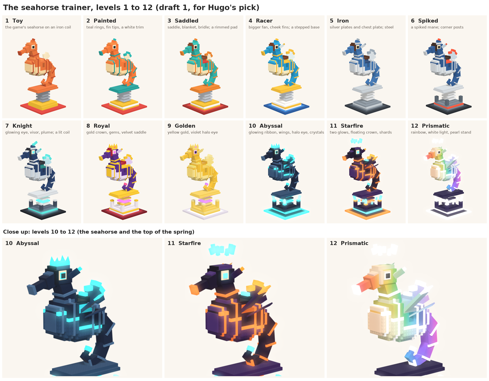
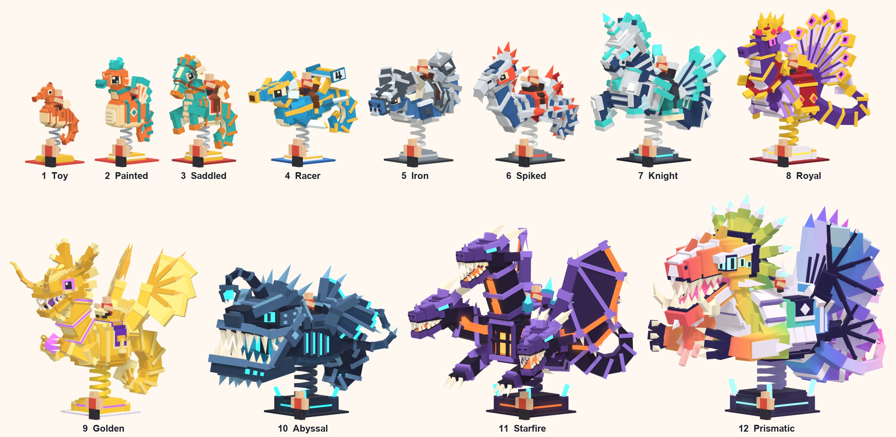

# Workout 13: the seahorse rocker evolves
Up: [Style workouts](Style%20workouts.md). Started 2026-11-25 by the creature chat. The ride itself:
[The trainer](../design/trainer.md).

## What the user asked
"analyse the sea horse models in the game right now and make upgrades to them. use the general color palette and style but
evolve the sea horse into even cooler fish until it becomes a huge insane creature rocker at the end. pass off changes needed
for code to the game chat bc the size will cause placement issues but id like you to generate the models necessary for now.
The later versions should be huge, crazy and cool sea creatures" (2026-11-25).

The same day: "KEEP THE NUMBER ONE as the current model for the seahorse pleasze". **So level 1 stays the seahorse in the game now,
unchanged;** levels 2 to 12 are new.

## What the models in the game are (Hugo's twelve, 2026-11-19)

1. **One outline twelve times.** The trunk, the neck, the head and the tail are the same blocks on every level. A player who
   pays for level 12 stands on the same shape as level 1.
2. **No growth.** All twelve are 9.2 x 13.1 studs on the floor and 20 to 21 tall with the stand.
3. **Dressing carries it all,** and the dressing is small: a saddle, thin plates, one-cube crown points, shards that float.
4. **Levels 4 to 7 read as one blue horse.** Levels 10 to 12 bloom: 10 and 11 are a dark shape with a glowing outline, and 12
   washes out white, because every one of its accents is white Neon.
5. **What is good and stays:** each level's colours, the toy on a real spring, the stand that climbs with it, the curl of the
   tail and the rings.

## The plan: today's seahorse, then eleven new animals of one family
The colours of each level stay. Every level becomes its own animal with its own outline, and each is bigger than the last. The
family marks run through all twelve, so it stays the seahorse growing up: **the curled tail, the armour rings, the crest on the
head, the fan behind the seat.** The long tube snout slowly becomes a jaw (from level 9). Levels 1 to 3 are seahorses, 4 to 6
strange seahorses, 7 to 8 sea beasts, 9 to 12 huge monsters.

The names stay (Config's), so nothing a player has bought is renamed.

1 cube is 0.34 studs in the game. A player is 15 cubes tall. Sizes are the toy's length and width, and the height of its top
over the floor, in cubes (and in studs in the game).

| Level | What it is | Size in cubes | In the game |
|---|---|---|---|
| 1 Toy | today's seahorse, unchanged (the user) | as it is | as it is |
| 2 Painted | a pot-bellied seahorse with a sail fan | 36 x 21 x 55 | 12 x 7 x 19 |
| 3 Saddled | a prancing steed: arched neck, finned mane | 38 x 21 x 60 | 13 x 7 x 20 |
| 4 Racer | a stretched, leaning speedster with swept fins and a spoiler | 70 x 27 x 50 | 24 x 9 x 17 |
| 5 Iron | a battering ram: shells of plate, curled horns, a mace tail | 56 x 31 x 58 | 19 x 11 x 20 |
| 6 Spiked | a seadragon all spikes and flags | 70 x 39 x 66 | 24 x 13 x 22 |
| 7 Knight | a hippocamp: a rearing war horse in front, a fish behind, a lance horn | 72 x 41 x 78 | 24 x 14 x 27 |
| 8 Royal | a peacock seadragon: a great fan of feathers, twin tails | 74 x 55 x 81 | 25 x 19 x 28 |
| 9 Golden | a winged sea drake with antlers, holding a violet pearl | 86 x 69 x 90 | 29 x 23 x 31 |
| 10 Abyssal | a deep-sea maw: an angler's jaw, a lure, tentacles | 100 x 65 x 84 | 34 x 22 x 29 |
| 11 Starfire | a three-headed hydra, four wings, a furnace chest | 108 x 87 x 99 | 37 x 30 x 34 |
| 12 Prismatic | the leviathan: a colossus with four wings, a corona of horns, a giant curl | 132 x 109 x 114 | 45 x 37 x 39 |

Level 7 is about twice today's toy each way and level 12 more than three times. The plot has no room for
that as it stands: see "For the code".

## Rules for every model
- **The frame, the stand, the sizes, the palette:** `art/creatures/Seahorse/evolve/common.py`. Read it whole. The floor is z 0;
  the spring stands on x 0, y 0 and meets the body at z `belly`. `c.stand(m, LEVEL, GAME)` first, in `build`.
- **The spring must hold it.** The underside of `Body` is flat and at least `ring + 2` cubes wide each way round (0, 0, belly),
  and nothing else comes within 2 cubes of the coil. The animal is balanced on it: about as much in front as behind.
- **It rocks.** Nothing of the toy is lower than 4 cubes over the floor plus 0.15 for every cube it is away from the spring
  (ahead or behind), and inside the pad nothing but the body is lower than the stand's top plus 5.
- **Every part's parents lead to `Body`** (Head on Neck on Body...); only `Body` and `Coil` hang on `Stand`. The game splits the
  model into the toy (Body and all under it) and the stand.
- **The tail's curl stays behind** x = ring + 5: it hangs from the back of the trunk, not under it.
- **Parts:** `Body` (pivot (0, 0, belly + a third of its depth), parent `Stand`) carries the seat and the neck's foot. Then
  `Head`, `Jaw` (a joint at the mouth's corner), `Fin` or `Fan`, `WingL` and `WingR` (each wing its own part, so they can beat;
  `Wing2L`, `Wing2R` for a second pair), tail `T1..Tn`, limbs. At most 26 parts. `pose(parts, phase)` moves a few of them
  gently (the head nods, the jaw opens a little, wings beat, the tail follows), and does not turn or move `Body`: the tool rocks
  that. `SWING = ` degrees: 11 for levels 1 to 3, 10 for 4 to 6, 9 for 7 and 8, 8 for 9, 7 for 10, 6 for 11 and 12.
- **The seat:** `SEAT = (x, top, half width)`. A clear place on the back for a rider 15 cubes tall when standing (about 11 over
  the seat when seated) and 7 wide, with leg room each side and 8 cubes clear in front and over. Seen from behind and from
  the side. A saddle from level 3. At levels 10 to 12 the saddle sits in a dip cut 4 to 6 cubes
  deep between the shoulders and the back line: at most z 56 (level 10), 60 (11), 66 (12).
- **Mass.** The first draft of the last creature was thin and small-headed. Bodies, necks, limbs and tail roots are thick, the
  head is big, the mouth is big. Widths are odd numbers. From the front it must look as good as from the side.
- **Colour:** the palette's names for the level (`body`, `belly`, `ring`, `fin`, `tip`, `armour`...), each with its - and +
  tones. Big colour shapes. Add a colour only when the level needs it.
- **Glow:** levels 1 to 6 none; 7 and 8 the eye and one small thing; 9 about 5% of what is seen; 10 about 12%; 11 about 15%; 12
  about 10%. Wide shapes. **Never a whole limb, wing or crown in Neon, never white Neon on a big shape:** that is what washed
  out the old ones.
- **Nothing floats** (no shards), no thin one-cube frills, no balls.
- Everything else as in `creature-look` and the [brief](creature-brief.md): buried roots, whole turned blocks, no squeezed
  slopes, no faces in one plane, no staircases, the gate passes, never `--force`.
- **Triangles:** `SIZES[level]["tris"]`, without the draft coil. Use the budget: at least half of it.

## The twelve
B is the level's `belly` height. Long = along x.

**1 Toy.** The seahorse in the game now, unchanged (the user). `T01/voxel.py` only loads it for the line-up; it is not exported.

**2 Painted.** A pot belly that hangs forward: trunk 17 long, 13 wide, 18 deep, the cream belly a big rounded plate with two
steps. Teal rings 2 cubes wide. A sail fan of five blades, 15 tall, teal tips. Cheek fins as paddles 7 long. A coronet of three
points (teal). A fat tail of 6 blocks, 7 to 2, one and a quarter turns, teal tip. A smile at the snout's tip.

**3 Saddled.** A horse in its bearing: trunk 16 long, 13 wide, 16 deep; the neck arches up and over (3 blocks, 8 to 6 thick, 20 tall), the head hangs from it at
45 degrees, snout 9. A mane of five finned blades down the neck, each 5 to 7 long, orange. Two pectoral fins bent like tucked
forelegs, 2 boxes each, 4 thick. A real saddle (horn in front, cantle behind, skirt each side) on a red blanket with a cream
edge; a bridle with reins. Tail 7 blocks, 7 to 2, a wide proud curl. Cream blaze on the face.

**4 Racer.** Built for speed: trunk 30 long, 15 wide, 14 deep, leaning 12 degrees nose-down (its spring plate level), smooth (few steps), tapered at both
ends; neck low and thrust forward; head 9 long with a snout of 11 (the nose at about x -34), flat on top; goggles-like brow in gold over a fierce eye.
A gold stripe 3 cubes wide along each flank and one down the back. Two swept fins each side (front pair 14 long, back pair 10),
blade-like and lying back. A spoiler: a fin plate 21 wide on two struts behind the seat. Tail streaming back 12, then
the curl (its back at about x 36), its tip gold.

**5 Iron.** A battering ram: trunk 24 long, 23 wide, 22 deep, hunched. Four great overlapping shells down the back (silver), each
a wide plateau with a raised back lip and rivets of 1.5 cubes along its edge. Neck short, 11 thick, in three collars. Head 14
long, 13 wide, 12 deep behind an iron brow plate; snout 7, blunt, with an iron muzzle ring. Ram horns curling back, down and
forward round each cheek, 5 boxes each, 6 to 2.5 thick. Stub armoured fins like shields, 10 tall. Tail 6 blocks, 11 to 6, in
collars, curling up to a mace: a block of 10 with eight spikes of 4.

**6 Spiked.** A seadragon: a long body, arched like a bow, 36 long, 13 wide, 15 deep; neck 22, 9 thick; head 14 with a long
hooked beak of 11, heavy brow, a sharp red eye patch. Seven spikes down the back, the tallest 15, silver with red points. Four
pairs of side spikes 8 to 12 long, swept back. Torn leaf flags in red on four of the spikes (a blade each, 7 by 4). A crest of
five spikes fanned over the head. Tail 8 blocks, 8 to 2.5, a spike on each, curling under to a fork of two blades.

**7 Knight.** A hippocamp, rearing: chest 20 long, 19 wide, 24 deep, raised 25 degrees; two forelegs lifted (upper 10, lower 10,
5 to 4 thick) ending in finned hooves; neck 20 tall, 11 thick; horse's head 18 long in a silver helm with a visor, the aqua eye
behind a slit; a lance horn 20 long, 3.5 at its root, in three collars, silver with an aqua tip. A plume and mane of seven
finned blades in aqua-white, 6 to 10 long. Plates: a peytral over the chest, pauldrons, a crupper in three lames over the hind
body. Teal caparison under the saddle, hanging each side, with a cream hem. The hind body is a fish's, 26 long, tapering, the
tail 6 blocks curling up to a fluke 25 wide. Glow: the eye, the horn's tip.

**8 Royal.** A peacock seadragon: trunk 26 long, 19 wide, 22 deep, purple, pale belly scutes; a ruff of eight gold-tipped blades
round the neck's foot; neck 22 in an S, 10 thick; head 18 with a fine long snout 10 and a crown of five big points (6 tall, 2.5
wide) with gems of 3. **The fan:** nine feathers behind the seat, spreading from side to side like a peacock's (seen full from the
front, 55 across), each 24 to 34 long and 5 wide, stepped in two blocks, lilac with a gold edge, each ending in a diamond: gold,
then magenta, then a dark middle. It leans back and stands 12 clear behind the rider. Velvet caparison with gold hems. Twin tails
(6 blocks each, 8 to 3) sweeping out to both sides and curling. Leaf fins draped from the flanks, 14 long. Glow: the eye, the
diamonds' magenta.

**9 Golden.** A winged sea drake (VARIANT "gold", violet accents; yellow gold, never brown): trunk 30 long, 23 wide, 24 deep (z 26 to 50), in
gold rings; an S neck rising 24, 14 to 10 thick; a drake's head 24 long, 15 wide, with an open jaw (ivory teeth, 3 to 5 long),
heavy brow, two branching antlers 16 long (4 boxes each), their tips at about z 90, two whiskers 22 long curving forward and down, a beard of three blades.
Two arms forward holding a violet pearl between their claws (a block turned on its corner, 9 across). Wings 69 across: an arm of
two boxes 6 and 4 thick, three fingers, and broad membrane panels between them in pale gold, each panel a whole turned box.
Back line of seven gold blades rising. Tail 9 blocks, 13 to 3, a big curl ending in a fan of three. Glow: the pearl, the eyes'
halo, a violet line on each ring of the neck.

**10 Abyssal.** A deep-sea maw: the head IS the animal: 42 long, 31 wide, 30 deep, jaw thrust out and up, open 12 at the front; ten
fangs a side, 5 to 11 long, ivory, uneven; the mouth's inside lit cyan and deep. Small cruel halo eyes (5 cubes) under a heavy
brow. A lure: a stalk of four boxes arching up and forward from the brow, ending in a lantern (a lit block 6 across in a cage of
three dark claws). The head spans about x -58 to -16; trunk 36 long, 27 wide, 28 deep, hunched, dark; on each flank four gill slots 3 wide and 12 tall, lit. Plates
on the back like a wreck's hull, five, each with one back spine 8 to 16 tall. Torn fins like wings, 65 across, in panels with
cyan trailing edges one cube and a half thick. Behind, the thick curl of the seahorse's tail (8 blocks, 15 to 4, lit studs under
it), and four tentacles (4 blocks each, 6 to 2) sweeping out round it.

**11 Starfire.** A hydra: three heads on three necks. Trunk 40 long, 33 wide, 30 deep (z 28 to 58), near-black purple, a furnace in the chest:
an orange plate 17 wide and 20 tall set in a dark rim with bars, lit. The middle neck rises 26 and leads; the side necks spread
28 out and lower, forward (their noses at about x -55). Necks 15 to 11 thick, plated behind, an orange lit stripe 4 wide down the front of each. Heads 24
long, 17 wide and 15 deep, each its own pose: the middle roaring wide, one biting, one turned outward; horns swept back (3 a head, 8 to 14),
jagged teeth, mouths lit orange, cyan slit eyes. Four wings: the front pair 87 across, the back pair 60, dark panels with ragged
orange edges 2 thick (the edge lit, the panel not). Two clawed forelimbs 8 thick, reaching down and forward. Back spines in cyan
crystal, seven, rooted, 8 to 18 tall. Two tails of 8 blocks, 13 to 4, each ending in a four-pointed star blade.

**12 Prismatic.** The leviathan, the insane one (VARIANT "rainbow", one smooth straight run from nose to tail; `core` (near-black
indigo), the pearl plates and the teeth are in KEEP, so the rainbow reads against dark and pearl, and does not wash out). Trunk 54
long (x -27 to 27), 45 wide, 40 deep (z 30 to 70): a whale's bulk, dark core belly with pearl scutes, pearl armour shells over the shoulders. Neck 25 thick, rising
forward from z 56 to z 80 over the trunk's front (x -18 to -34). Head 44 long (x -70 to -26), 33 wide, 28 deep (z 70 to 98): a dragon-whale's, the maw open 14 with two rows of teeth 5 to 10 long,
lit inside (soft pink, not white), three eyes a side in one row (a big one and two smaller, halo), tusks 16 long curving from
the jaw, a beard of tentacles (5, three boxes each) under the chin. **The corona:** nine horns fanned round the back of the head
like a rising sun, 14 to 26 long, 6 at the root, pearl with rainbow roots. Four wings: the front pair 109 across, the hind pair
76, arms 10 thick, broad rainbow panels on dark bones, each with a pearl claw. Two great arms, 12 thick, with three-clawed hands
gripping the air in front. A sail of nine giant blades down the back behind the saddle to z 112. **The curl:** the seahorse's tail
made giant, 11 blocks, 22 to 6, a spiral 36 across standing behind (x 26 to 62) with a pearl ring on every block, and two long tentacles each
side of it. A howdah-like saddle: a pearl throne with a back, the rider's place, dwarfed. Glow 10%: eyes, mouth, a thin line down the neck's
sides, the tips of the corona.

## For the builder
1. Read `creature-brief.md` down to "Running a batch", this note's "Rules for every model" and your levels' paragraphs, `common.py`
   whole, and for manner `art/creatures/ScytheLeviathan/voxel.py` (plates, limbs on joints) and `art/creatures/Seahorse/tiers/trainer.py`
   (the old seahorse's trunk, tail and head). This note's sizes, colours and glow override the brief's.
2. The numbers are the design; if one makes a bad shape, change it and say so. Aim for the size within 10%.
3. Work on the outline first: `python art/creatures/Seahorse/evolve/evolve_preview.py <level> --check` for the gate and the
   numbers, without `--check` for `work/voxel/evolve/T<nn>_preview.png`. **Read the sheet, at most six rounds to a level.** Ask
   of each: would a player want this one after the last? Does it read from the front? Is it as massive as its place in the
   ladder? Is the rider clear and seen?
4. Do not consult the advisor (the creature chat does it once, over all twelve). Do not use git, do not export, do not run
   `voxel_finish.py`. Touch nothing outside `art/creatures/Seahorse/evolve/T<nn>/` and `work/`. If `common.py` is wrong, say so.
5. Report in at most 10 lines a level: the gate, the numbers line the tool prints, what differs from this note, what is weak.

## As built (2026-11-25)

Levels 2 to 12 are modelled and exported to `art/creatures/Seahorse/evolve/game/` (local; **nothing uploaded, the game unchanged**).
Level 1 is today's. Checked by numbers: at full rock no level touches the floor or its pad. Not checked: the game's own lighting
and glow, the rocking seen moving, the hop on. Small things left: 5's nose ring reads a little like tusks from dead front; 6's
eyes are a sliver from dead front; 8 and 12's fan and sail partly hide the rider from straight behind; 11's hind wing covers a
tail star in the 3/4 view. Fixes were kept short (the user: save tokens); the advisor did not see the final line-up.

## For the code (the game chat)
Every number is in `evolve/game/rockers.json` (what each field means: the top of `evolve/build_evolve.py`). Hub studs, from the
spring's axis on the floor; ahead is the head's way:

| Level | ahead | behind | each side | top | seat | spring | coil ring / wire | pad (half) | swing | lowest at full rock | tris | meshes |
|---|---|---|---|---|---|---|---|---|---|---|---|---|
| 2 Painted | 6.8 | 6.1 | 4.2 | 19.7 | 11.7 | 5.1 | 0.952 / 0.408 | 4.25 | 11 | 2.0 | 1182 | 17 |
| 3 Saddled | 7.4 | 7.5 | 4.2 | 20.5 | 12.9 | 5.1 | 1.02 / 0.442 | 4.25 | 11 | 1.0 | 1650 | 14 |
| 4 Racer | 12.6 | 12.5 | 4.8 | 17.4 | 13.1 | 5.1 | 1.02 / 0.442 | 4.25 | 10 | 2.4 | 1398 | 17 |
| 5 Iron | 10.9 | 9.5 | 5.7 | 20.5 | 15.6 | 5.44 | 1.156 / 0.51 | 4.59 | 10 | 6.6 | 2032 | 13 |
| 6 Spiked | 13.2 | 11.9 | 6.5 | 22.9 | 13.7 | 5.44 | 1.224 / 0.51 | 4.59 | 10 | 1.4 | 1848 | 16 |
| 7 Knight | 12.4 | 14.0 | 7.8 | 28.8 | 16.0 | 5.78 | 1.36 / 0.578 | 4.93 | 9 | 3.5 | 2436 | 20 |
| 8 Royal | 11.9 | 13.3 | 9.9 | 28.1 | 16.7 | 5.78 | 1.496 / 0.612 | 5.27 | 9 | 4.3 | 3094 | 27 |
| 9 Golden | 17.0 | 14.8 | 12.2 | 32.8 | 18.2 | 6.12 | 1.632 / 0.68 | 5.27 | 8 | 1.0 | 3320 | 24 |
| 10 Abyssal | 21.2 | 14.4 | 11.9 | 28.6 | 19.0 | 6.12 | 1.768 / 0.748 | 5.61 | 7 | 2.1 | 3786 | 38 |
| 11 Starfire | 20.7 | 18.5 | 16.0 | 35.8 | 20.3 | 6.12 | 1.87 / 0.816 | 5.95 | 6 | 3.0 | 4888 | 42 |
| 12 Prismatic | 24.6 | 22.5 | 20.1 | 41.5 | 22.4 | 6.12 | 2.244 / 0.952 | 6.29 | 6 | 2.7 | 4654 | 28 |

1. **Placement.** A pen is about 47 x 62, 4 studs of grass to the next, fence 4.4 high. Level 12 takes 47 x 40 and stands 42 tall:
   placed across the pen it fills its whole width. Today's 1.19 studs from the fence only suits level 1. Turn the long axis along
   the pen's 62, or move the axis inward by level; check the tanks, the paths and the neighbour's pen. How far it may lean over
   the fence is the user's call.
2. **Numbers that must come from the level, not one constant** (`RideStyles.Trainer`, `TrainService.build`): Length, Radius and
   Wire (the coil), Swing, SeatLift and SeatBack, Reach and OnTop (the prompt), HopOn and HopArc (the seat is up to 22.4 studs up),
   OffReach and OffRise, the pad block, the `TRAIN` sign (its foot at 19.5 studs ahead is inside level 12), the upgrade sign
   (side -12, ahead 4: inside the toy from level 10), the seated camera, the lesson's pointer. Level 1 keeps its own.
3. **Mesh contract, where it differs from `install_tiers.py`.** Stand pivot on the floor (`foot`), stand top and spring foot from the
   row, no fixed pivot. Many parts: the toy is `toyParts` (Body and all under it, rocks as one), the stand is `standParts`. No Orbit
   or Crown shards. Jaws, wings and heads have their own pivots if motion is wanted later; none is needed.
4. **Colours.** Level 12 is the rainbow: cycle only what is not in `keep`, accent #8FF2FF, never white. Level 9's accent is #B25CFF.
   `LIGHTS` are in `lights`. Judge the Neon share in the game: levels 10 to 12 measured roughly 11 to 19% of the picture.
5. **Also reads the old ones:** `trainer_models.py`, `trainer_edit.luau`, `tools/studio/trainer_check.py`, the UpgradeSign portraits,
   LessonController. `Config.Train` names stay as they are.
6. **Upload** needs the user's yes (permanent).
