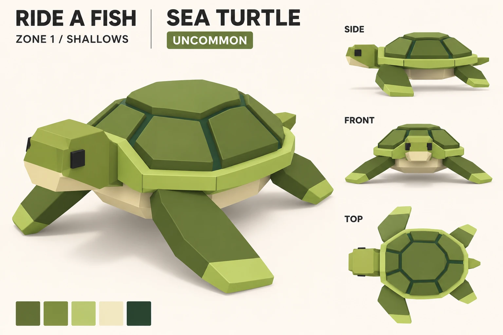
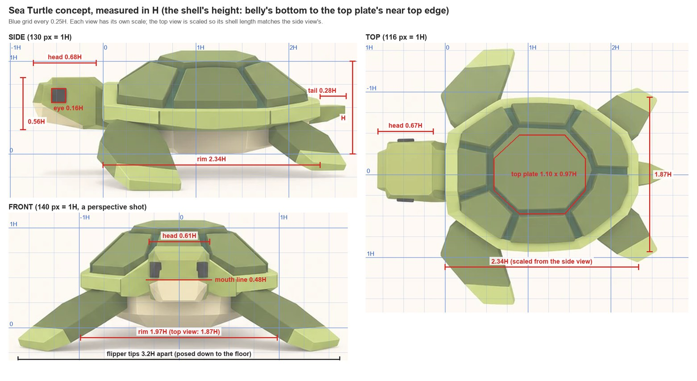
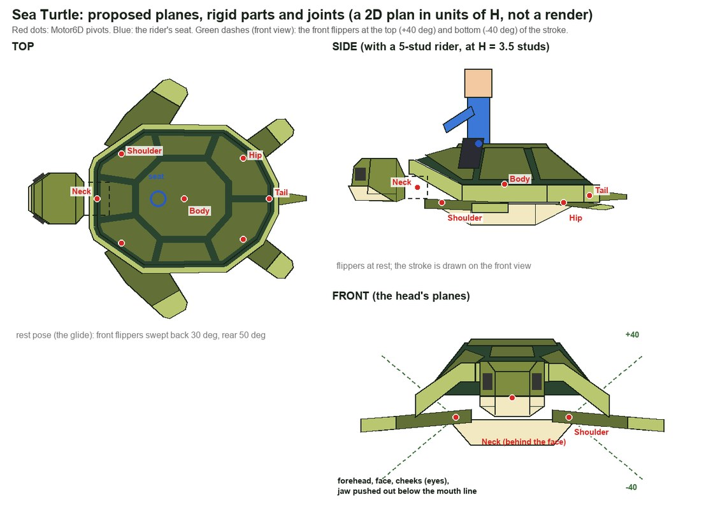

# Sea Turtle

Zone 1, Shallows, Uncommon. Read off the user's ChatGPT concept (`art/concepts/creatures/sea-turtle-gpt.webp`, 2026-11-09) by
the [creature method](../creature-method.md), the way [workout 2](../02-creature-look.md) read the Sergeant Major. Proposed
2026-11-09: nothing is built yet. This is the reading, the plan and the questions.

The turtle is the first creature that doesn't swim with its body, so this note also lays out a second body plan for the kit:
one rigid shell with a head, four flippers and a tail. Archelon (zone 1's Legendary) and the Grave Turtle (zone 9) in the
[roster list](../../design/roster-list.md) would come from the same plan.

## 1. Reading the concept

**What it shares with the Sergeant Major's rules:**
- Low-poly and faceted: hard edges, flat faces, no smoothing.
- Flat colours, no texture, no outlines, soft studio light.
- Square, pixel-like eyes on the head's sides, turned so they show from the front.
- A boxy head with a cream mouth part below the face (a lower jaw here, a lip block there).
- Fins as thick flat plates: here, four flippers.
- Chunky toy proportions: a big head (over half the shell's height), a deep shell, a short tail.

**What's new:**
- **A rigid body.** The shell can't bend, so the fish swim (a wave down the spine) has nothing to move. All the motion is in
  the flippers, the head and the tail.
- **A pattern made of shapes, not colour areas.** The shell's plates are raised slabs with dark grooves between them. The
  Sergeant Major's bars were colours on its ring of faces.
- **A rim band** round the shell, rising at the front into an arch over the neck.
- **Two-tone limbs:** each flipper ends in a pale tip.
- **A plain eye:** a black square raised a little off the head, with no cream square round it.
- **Five colours** plus the eyes' black: one more than the method's 3 or 4.

**Its signature:**
1. **The domed shell of raised plates:** one big octagonal top plate ringed by seven more, dark grooves between them, inside a
   pale rim band. From the riding camera this is most of what you see, so it's the turtle's real face in the game.
2. **Long front flippers with pale tips,** swept back. Their stroke is the animation's star.
3. **A blocky head on a short neck** under the rim's arch, with square black eyes and a cream lower jaw.

**The palette,** sampled from the middle of the concept's swatches:

| Swatch | Hex | Where (read off the views) |
|---|---|---|
| Dark olive | `#626F36` | the plates, the flippers |
| Mid olive | `#7E8D40` | the head, the neck, the tail |
| Pale green | `#B9C771` | the rim band, the flipper tips |
| Cream | `#F2E8C2` | the belly (the plastron), the lower jaw |
| Dark forest green | `#2A4430` | the grooves between the plates |
| Black (not a swatch) | about `#2A2A2A` in the render | the eyes: use the kit's `#353534` from the Sergeant Major, so every creature shares one |

The render draws the head lighter than the plates in every view. Lit like the top plate in the 3/4 view, it works out to about
the mid olive, so that's my reading; a lighter head is question 3.

**What not to copy (picture cheats):**
- **All four flippers stand on the floor like legs,** lifting the belly off the ground like a toy on a shelf (the Sergeant
  Major's belly fins did the same). A swimming turtle holds them out: the front pair level and swept back, the rear pair
  trailing.
- **The near front flipper in the 3/4 view looks huge** only because it's closest to the camera.
- **The eyes move between views:** on the head's front corners in the front view, on its flat side in the side view, sticking
  out sideways in the top view.
- **The views disagree on sizes** (section 2). As agreed in workout 2, the front view wins for the face.
- **Every view is drawn from a few degrees above:** the top plate's top shows as a strip (about 7 degrees in the side view, 4
  in the front). Measured to the silhouette, the shell comes out about 10% too tall.

## 2. Proportions

**The unit, H:** the shell's height, from the belly's bottom to the top plate's near top edge: 130 px in the side view, 140 px
in the front view. The top plate's far edge isn't counted: it only sits higher in the picture because the camera looks down.
Measured this way, the front and top views' shell widths agree to 6% (to the silhouette, 10%). The top view has no height, so it's scaled so its shell length
matches the side view's (116 px = 1H). The numbers are good to about 5 to 10%.

Positions: x back from the rim's front edge, y out from the centre line, z up from the belly's bottom.

**The shell:**

| Part | Measured | Use |
|---|---|---|
| Length (the rim) | side 2.34H | 2.34H |
| Width (the rim) | front 1.97H, top 1.87H | 1.9H |
| Height | 1.0H (the unit) | 1.0H |
| Outline from above | a flat front 0.72H wide (about the head's width), long shoulders out to full width 0.65H back, nearly straight sides to 1.7H, then closing to a blunt rear 0.38H wide | the same, as 12 straight edges (section 4) |
| Top plate | top face 1.10 by 0.97H (top view), 1.02H long (side); ends 0.38H, long sides 0.55H | an octagon 1.15 by 1.0H outside its bevel, from 0.57H to 1.72H back |
| The ring of plates | seven: one over the neck, three a side; side grooves about 0.8H and 1.55H back, one down the centre line behind | the same |
| Grooves | 0.08 to 0.09H wide | 0.09H |
| Plates' rise | the top plate's edge drops 0.06H | 0.06H, with a 0.04H bevel |
| Rim | outer face 0.19H tall (0.27H to 0.46H up), top at 0.49H; its top band 0.07 to 0.14H wide from above; at the front it rises to 0.78H | band 0.10H; sides 0.27H to 0.49H; the arch 0.62H to 0.80H |
| Seams in the rim | 0.60H and 1.80H back (side view) | at the outline's corners: 0.65H, 1.70H, 2.15H |
| Dome | the side plates slope 40 to 50 degrees, from 0.94H down to the rim | the same |
| Belly | flat bottom 0.82H long (side), 0.78H wide (front); 1.2H wide at its top; 0.24H deep | a dish: top 1.75 by 1.25H, flat bottom 0.8 by 0.8H, 0.25H deep |

**The head:**

| Part | Measured | Use |
|---|---|---|
| Length | side 0.68H, top 0.67H | 0.69H, jaw to the back of the head |
| Height | side 0.56H, front 0.54H | 0.54H, from 0.28H to 0.82H up |
| Width | front 0.61H, top 0.70H | 0.62H |
| Ahead of the rim | side 0.75H, top 0.81H | 0.75H |
| Neck | a band 0.08H (side) to 0.15H (top) long, as wide as the head | a stub 0.40H wide and 0.28H tall, under the arch |
| Eye | a black square 0.155H in both views; centre 0.63H up (side), 0.58H (front); the front view shows three quarters of its width; raised 0.03H | 0.155H square, centre 0.62H up, raised 0.03H, on the cheek |
| Mouth line | front: straight across at 0.48H; side: its corner at 0.55H is the most forward point, then a diagonal down and back at about 25 degrees to the head's bottom near the neck | 0.48H across the front; on the side, a diagonal from the cheek's back corner down to the chin, 0.2H in front of the neck |
| Jaw (cream) | front: the head's full width at the mouth line, narrowing to 0.34H at the chin; 0.20H tall | the same |
| Forehead | a strip 0.10H deep from above | from the face's top (0.72H up) back to the top (0.82H) |

**The flippers and the tail:**

| Part | Measured | Use |
|---|---|---|
| Front flipper length | about 1.1 to 1.2H (front: 1.0H out and 0.4H down; top: 0.3H back) | 1.10H from its hinge |
| Front flipper chord | top: 0.6H at the root, 0.32 to 0.39H at the tip; side and 3/4: up to 0.6H at the tip | 0.55H at the root, 0.34H at the tip |
| Front flipper thickness | 0.08 to 0.15H | 0.12H |
| Front flipper shape | the leading edge kinks once, about 40% out; a pale tip on the last 20 to 25%; the tip's corners cut | the same; the tip from 78% of the length |
| Front flipper reach | tips 1.35H (top) to 1.5H (front) from the centre line | 1.5H at rest: 3.0H tip to tip |
| Rear flipper | 0.55H showing past the rim, about 0.7H in all, 0.3H chord, back and out at about 45 degrees, a pale third at the tip | 0.70H long, 0.32H chord, 0.10H thick, swept back 50 degrees |
| Tail | 0.28 to 0.31H past the rim, a base 0.26H wide and 0.18H tall, a blunt point, at the rim's height | a wedge 0.45H from its hinge (0.33H showing) |
| Nose to tail | side 3.37H | 3.42H |

**Where the views disagree, and what I trust:**
- **The head's width** (front 0.61H, top 0.70H) and **the mouth line** (front 0.48H, side 0.55H): the front view, as agreed for
  faces.
- **The eye's place:** the front view again, so the eye goes on a face turned toward the front (section 3), not on the flat side.
- **The shell's width** (front 1.97H, top 1.87H): 1.9H, between them, with the top view's outline, since that's what the riding
  camera sees.
- **The flipper chord:** the top view (the riding camera's view); the side and 3/4 views draw the flippers broader.
- **The flipper angles:** neither; the drop to the floor is the cheat above.

**In studs:** a first spec at H = 3.5 studs gives a shell 8.2 studs long, 6.6 wide and 3.5 tall, 12.0 studs from nose to tail
(the Sergeant Major is about 12) and flipper tips 10.5 studs apart.

## 3. Topology

The rules applied: each eye sits parallel on one big flat face; a part that sticks out (the jaw, the plates) is pushed out of the
faces round it in the same mesh, with shared vertices and flush sides; each plate is one flat face. The lines, view by view; the
drawing shows the same lines (it's a 2D plan, not a render):

### The head
**From the front:**
- **The face:** a flat rectangle 0.34H wide, from 0.72H up down to the mouth line at 0.48H.
- **The forehead:** a band above it, sloping back from the face's top edge to the head's top (0.82H up), where it's 0.48H wide.
- **The cheeks:** either side, one big flat face from the face's edge back to the head's side wall, turned 35 degrees toward the
  front, running from the head's top down to the lower chamfer at 0.38H. The eye sits in the middle of its upper part, parallel to
  it. From the front it shows at 0.57 of its width (the concept about 0.75), from the side at 0.82 (the concept all of it):
  between the two, leaning to the front view. It's the Sergeant Major's eye face again, only shorter: the turtle's head is long,
  so a face turned 35 degrees can't run its whole length.
- **The mouth line** runs straight across the face and both cheeks.
- **The jaw:** cream, pushed out 0.04H below the mouth line (the mouth rule). It takes the face's whole width there; its back
  corners are the face's corners, shared with the cheeks; its sides lie flush on the cheeks' planes, so its front comes out
  narrower than its back. Its front leans back to the chin.
- **The lower chamfers:** below the cheeks, folding in from the side walls (0.62H apart) to the chin (0.34H wide). With the
  cheeks' cream lower parts, they narrow the cream from the head's full width at the mouth line to the chin, as in the concept.

**From the side:**
- **The top:** one flat face from the forehead back to the back chamfer.
- **The profile:** the face leans back a little above the mouth line and the jaw's front leans back below it, so the jaw's top
  edge is the head's most forward point, like a beak.
- **The cheek** shows as a narrow face at the front, its back edge one straight line from the top down to the lower chamfer.
- **The side wall:** one flat face from the cheek's back edge to the back chamfer. The mouth line goes on as a diagonal across it,
  from the cheek's back corner down to the chin 0.2H in front of the neck: green above, cream below, one plane.
- **The back chamfer** narrows the head into the neck, so the head can turn about 25 degrees either way before its back corners
  meet the arch.

**From above:**
- The top face, the forehead strip in front of it (0.10H deep), and the jaw's ledge just in front of that.
- The cheeks cut the head's front corners back at 35 degrees; each eye shows as a thin black edge on its cheek.
- The neck stub behind, going in under the arch.

### The shell
**From above:**
- **The rim's outline:** 12 straight edges. The front one is 0.72H wide, over the neck; long shoulders run out to full width;
  nearly straight sides; three edges close to a blunt rear.
- **The rim's inner line:** the outline 0.10H in. The band between is the rim's top.
- **The top plate:** an octagon with long sides 0.57H, ends 0.40H and diagonals 0.43H.
- **Seven grooves** from the octagon out to the rim: two forward from its front corners, with the plate over the neck between
  them; one out to each side from each end of its long sides; one straight back from the middle of its rear edge. That makes
  eight plates: the top plate, one over the neck and three a side, the rear pair meeting on the centre line.
- **Each plate:** one flat face, its edges 0.045H in from the groove's centre line, raised 0.06H, with a 0.04H bevel round its
  top.

**From the side:**
- **The top plate** flat on top, the side plates sloping 40 to 50 degrees down to the rim.
- **The rim:** an outer face from 0.27H to 0.46H up, its top sloping up to 0.49H at the inner line, corners (the seams) at 0.65H,
  1.70H and 2.15H back. At the front the shoulders rise into the arch over the neck, its outer face from 0.62H to 0.80H.
- **The belly** below the rim: a cream dish, its sides sloping in to a flat bottom.

**From the front:**
- **The top plate's front edge** on top; below it the plate over the neck, behind the head; the front side plates sloping down
  either side.
- **The rim's shoulders** sloping down and out from the head's sides to the rim's level sides, with the arch behind the head.
- **The belly's dish** below: 1.25H wide at its top, 0.8H across its flat bottom.

**How it's built:**
- **The plates are pushed out of the dome in one mesh:** each of the dome's faces is inset by half a groove, the inset is raised
  0.06H, and its top is inset again for the bevel. The groove floors are what's left of the dome's faces, in the dark forest
  green. No plate is a slab stuck on.
- **Each plate stays flat:** the side plates have four or five corners, and these must lie on one plane, or a flat-shaded plate
  shows a fold. So the rim's inner line takes its heights from the plates, not the other way round; where that can't work, a plate
  is split into two flat faces along a line chosen on purpose.
- **The rim's corners are its seams:** the concept's two seams on the side line up with its outline's corners, so with flat
  faces between the corners the seams come free.

### The flippers and the tail
- **Each flipper is one thick plate:** a flat top face, a flat bottom face and side strips round its outline, the same thickness
  all the way, as the concept draws them. A straight line across it marks the tip: dark olive to the line, pale beyond (78% of
  the length on the front pair, 65% on the rear pair). The tip's corners are cut at 45 degrees, 0.06H. The front pair's leading
  edge kinks once, 40% out.
- **The tail:** a wedge, flat top and bottom, closing to a blunt tip.
- **The roots:** each limb's root reaches 0.15H past its hinge into the body, under the rim (the fish kit's sleeve), so a moving
  flipper never opens a gap.

## 4. The kit plan

**What `fish_kit.py` already covers:**
- Building from a spec, headless, in studs, the head to -X; flat colours from hex, a colour per face.
- Thick plates from an outline (`plate_bm`): the flippers and the tail.
- Square eyes (`box_bm`) turned to sit on a face (`eye.onWall`).
- A head built from flat planes (`build_head`), with the mouth pushed out of the face.
- Rigid parts with pivots, parented like Motor6Ds (`mesh_object`, `attach`); sleeves at joints; caps coloured like the surface
  beside them.
- The turnaround views, the riding view (the shallows' water, a 5-stud rider, a Tiny and a Big one), `--wire`, `--swim` frames
  for `swim_gif.py`, and `creature_sheet.py` for the sheet.

**What it needs for a turtle:**
- **A second body plan:** `"plan": "shell"` beside the default `"fish"`, one rigid shell in place of the spine of segments.
  `fish_kit.py` runs top to bottom as one script, so its helpers (materials, plates, eyes, the head, parts, views, the riding
  view) need to move into a module both plans import.
- **A shell builder:** the outline, the rim with its arch, the dome, the plates pushed out of it, the belly's dish.
- **The head on a neck:** `build_head` closes onto the fish's body ring at the first joint. Here it closes onto a neck stub, and
  the cheeks are short faces at a set angle instead of running back to the body.
- **Limbs:** plates with a hinge, a rest pose (sweep, elevation, twist), a tip line with cut corners, mirrored left and right.
- **A plain eye:** `eye.style` "plain" (a raised black square) beside the kit's cream square with a black one in it, until
  question 1 is answered.
- **The flipper swim:** `--swim` runs section 5's stroke for a shell plan instead of the spine wave.
- **A seat on the shell** for the riding view's rider, and `creature_sheet.py`'s palette row reading the turtle's colour names
  (it reads the fish's: top, body, bars, eye).

**The rigid parts:** each one MeshPart in Roblox (the eyes merged into the head), joined by Motor6Ds. Pivots in H (x back from
the rim's front, y out, z up):

| Part | Joint | Parent | Pivot | Moves |
|---|---|---|---|---|
| Shell (plates, rim, belly) | Body | the creature's root (the invisible part that moves it) | 1.17, 0, 0.50 | heave, pitch, roll |
| Head (with the neck stub) | Neck | Shell | 0.10, 0, 0.46: under the arch | yaw, pitch |
| Front flipper, left and right | Shoulder | Shell | 0.40, ±0.55, 0.27: under the rim's shoulder | elevation, sweep, twist |
| Rear flipper, left and right | Hip | Shell | 1.90, ±0.50, 0.27 | elevation, sweep, twist |
| Tail | Tail | Shell | 2.22, 0, 0.36 | yaw, pitch |

Seven MeshParts on one root, about 650 triangles: the shell about 400 of them, mostly the plates' bevels and sides.

**Spec fields to add** (in H, times `unit` for studs):
- `plan`: "shell"; `unit`: 3.5 (H in studs).
- `shell.outline`: the rim's corners as [x, half width], mirrored:
  `[[0, 0.36], [0.05, 0.50], [0.65, 0.92], [1.70, 0.90], [2.15, 0.56], [2.34, 0.19]]`.
- `shell.rim`: `band` 0.10, `face` [0.27, 0.46], `top` 0.49, `arch` [0.62, 0.80].
- `shell.dome`: `top` 0.94 (under the top plate).
- `shell.belly`: `top` 0.25, its outline, `flat` [0.75, 1.55, 0.40] (from, to, half width).
- `plates`: `pattern` "ring" (or "keels", "none"), `centre` {front 0.57, rear 1.72, halfWidth 0.50, ends 0.20}, `grooves`
  (lines out from the octagon's corners), `groove` 0.09, `rise` 0.06, `bevel` 0.04, `missing` [].
- `head`: the Sergeant Major's corner fields plus `cheek` {angle 35, length 0.20}, `jaw` {z 0.48, protrude 0.04, sideFollow 1,
  diagonalTo [-0.20, 0.29]}, `neck` {pivot [0.10, 0.46], halfWidth 0.20, z [0.32, 0.60], sleeve 0.30} and `beak` "jaw"
  (Archelon: "hook").
- `eye`: `style` "plain" or "plate", `size` 0.155, `z` 0.62, `onCheek` true, `raise` 0.03.
- `limbs`: per pair `pivot`, `outline` `[[u, v], ...]` (u out along the span, v back along the chord), `thickness`, `tipAt`,
  `tipCut`, `rest` {sweep, elevation, twist}, `sleeve` 0.15, `style` "plate" (or "bone").
- `tail`: `pivot`, `length` 0.45, `base` [0.26, 0.18], `tip` 0.06.
- `seat`: [0.85, 1.0].
- `dressing`: pieces placed on the shell's faces (none here; barnacles and ribs later).
- `colours`: plates, groove, rim, belly, skin, tips, jaw, pupil.
- `swim`: section 5's numbers.

**Archelon, zone 1's Legendary** (a car-sized turtle, a hooked beak, a ridged leathery shell), from the same plan:
- `plates.pattern` "keels": five raised ridges running nose to tail (one on the centre line, two a side) with grooves between,
  in place of the ring of plates. A leathery shell, like a leatherback's, has no plates and no rim of plates, so the rim thins to
  a lip.
- `shell.outline`: a teardrop, tapering to a point behind.
- `head.beak` "hook": the upper beak pushed out of the face's lower edge and down over the jaw, the mouth rule turned downward.
  A bigger head: about 0.7H tall and 0.9H long.
- Longer front flippers (about 1.5H), its own palette (leathery dark slate, pale ridges, a cream belly), a bigger `unit`, and a
  slower stroke: 2.4 seconds at cruise.

**The Grave Turtle** (zone 9, an undead Archelon), from Archelon's spec:
- `plates.missing`: a stretch of ridges gone, the hole showing bone ribs (`dressing` ribs: pale bars across it).
- A chipped rim (corners cut off the outline) and barnacle clusters (`dressing` barnacles: small four-sided cones on chosen
  faces).
- A skull for a head, in bone colours, with square black sockets and a glowing pupil (Neon in Roblox).
- One or two flippers in `style` "bone": the plate cut into three finger bones with gaps.
- Archelon's stroke with a hitch in the downstroke and a lolling head.

## 5. The animation plan

**Why not the fish swim:** the fish swim is one wave down a chain of rigid segments. The turtle is one rigid shell, so there's
nothing to bend. Sea turtles fly through the water: both front flippers beat together, down and back, then up and forward,
twisting so they meet the water at an angle each way, like wings. The rear flippers mostly steer. All of that is done by the
parts in section 4.

All angles are added to the rest pose: front flippers swept back 30 degrees and level, rear flippers swept back 50 degrees and
10 degrees down. One cycle is 1.6 seconds at cruise. Both front flippers move together, like a real sea turtle's (freshwater
turtles paddle with their limbs in turn).

| Part | At cruise | Timing |
|---|---|---|
| Front flippers, up and down | ±40°: from 40° up to 40° down; the downstroke takes 55% of the cycle, so it reads as the push | the cycle starts at the top of the upstroke |
| Front flippers, forward and back | 30° back ±15°: forward at the top, back at the bottom | a tenth of a cycle behind the up and down, so the tip draws a thin loop: down and back, up and forward |
| Front flippers, twist | ±25°: the leading edge down through the downstroke, up through the upstroke | flat at the top and the bottom of the stroke |
| Rear flippers, up and down | ±8°, a gentle paddle | half a cycle after the front pair |
| Rear flippers, twist | ±10° | with their up and down |
| Shell, heave | ±0.04H (0.14 studs) | highest as the downstroke ends |
| Shell, pitch | ±2°: nose up as the downstroke ends | with the heave |
| Head, pitch | about ±3° at the neck, against the shell's pitch | a tenth of a cycle behind it: the head stays nearly level and nods softly |
| Tail, yaw | ±4° | with the rear flippers |

**Idle** (ridden, standing still): a slow scull. A 3.2-second cycle; the front flippers ±12° about 8 degrees down, ±6° forward
and back, ±15° of twist; the rear flippers ±4°; heave ±0.02H. The head looks round now and then: up to 20 degrees either way, a
new look every 3 to 6 seconds, eased in and out.

**Swimming faster:** the cycle shortens from 3.2 seconds (idle) to 1.6 (cruise) and 1.0 (top speed), and the amplitudes grow
from 0.3 of cruise to 1.2: at top speed the front flippers swing ±48° about 5 degrees up, sweep back to 45 degrees at the bottom
and twist ±30°. The phase is added up each frame (phase += time step / cycle length), so a change of speed changes the beat
smoothly and never makes the pose jump.

**Gliding** (an option, question 4): real sea turtles stroke and glide. When the rider coasts, the flippers finish the
downstroke and hold the glide pose (swept back 45 degrees, 5 degrees down, flat) until the next stroke.

**Turning, diving, climbing:** the shell banks up to 12 degrees into a turn. The outer front flipper strokes 20% bigger and the
inner one 20% smaller. The inner rear flipper drops to 35 degrees down and turns out 20 degrees, as a rudder and a brake. The
head leads the turn by up to 10 degrees and the tail turns up to 12. Diving and climbing, the rear flippers tilt together up to
15 degrees and the head looks along the path.

**The rider and the riding camera:**
- **The seat** is on the top plate's front quarter: 0.85H back from the rim's front (0.36 of the shell's length), on top at
  1.0H, the legs over the front side plates. Like the Sergeant Major's seat on its shoulders, it's ahead of the middle, so the
  camera sees the back half of the shell.
- **From behind and above** the camera sees the rider's back, the back half of the top plate, the rear plates and the rim, the
  rear flippers and the tail. The head is hidden behind the rider unless it turns.
- **The stroke shows on both sides of the shell:** at rest the front flippers reach 1.5H out, 0.6H past the rim. At the top of
  the upstroke the pale tips rise to about 0.9H up and 1.3H out, beside the plates; at the bottom they sweep back to about 1.1H
  out and 0.15H below the belly, mostly hidden under the rim's edge. The pale tips lifting beside the shell each stroke are what
  reads.
- **The shell's heave and pitch** move the rider with it (±0.14 studs, ±2 degrees). The camera should follow the creature's
  smoothed path, not the shell, or the screen bobs every stroke.
- **In the water:** the shallows' cyan light will likely push the olives toward teal and flatten the plates against their
  grooves; the pale rim is probably the strongest line from above. Pick the colours in the water, as workout 2 found.

## 6. Open questions
1. **The eye:** **Decided 2026-11-09 (the user): go by the reference:** the concept's plain black square. The options were: (a) the kit's eye, a cream square with a black square in it: one eye for every creature, as the method says;
   (b) the concept's plain black square, raised a little; (c) a plain black square, sunk flush into the cheek.
2. **Where the eye sits:** (a) on a cheek turned 35 degrees (planned: reads from the front and the 3/4, a little thin from the
   side); (b) on the flat side wall (square from the side and from the riding camera when the head turns, unseen from the
   front); (c) on a cheek turned 45 degrees with a narrower face (the concept's front view exactly, thinner from the side).
3. **The head's colour:** (a) the mid olive `#7E8D40`, as read; (b) a lighter green, as the render draws it (a sixth colour);
   (c) the pale rim green (stands out most from the riding camera).
4. **The stroke's feel:** (a) slow and heavy: 1.6 seconds at cruise, 1.0 at top speed (planned); (b) snappy, like the fish: 1.0
   and 0.6 seconds; (c) stroke and glide: two strokes, then a glide with the flippers swept back.
5. **The plates:** (a) raised, with grooves and bevels (the concept's look; about 400 triangles for the shell); (b) raised
   without the bevels (about 300); (c) flat, with the grooves as colour strips (about 200, but flatter).
6. **The seat:** (a) the top plate's front quarter (planned: the camera sees the back half of the shell and the stroke); (b) the
   middle of the shell (centred, but it hides more of the plates).

## What it teaches (for the shared rules; the lead merges)
- **Measure to the near top edge:** the concept views are drawn from a few degrees above, so silhouettes come out about 10% too
  tall, and the views agree better without the far edge.
- **A second body plan:** rigid creatures (shells, maybe rays and cuttlefish) get a shell plan with limbs, sharing the head, eyes,
  plates, colours, views and riding view, and the same rigid-part rules: one MeshPart per part, Motor6Ds, sleeved roots.
- **Every swim runs on an added-up phase,** its rate and amplitude scaled by speed, and the riding camera follows the smoothed
  path, not the body's bob.
- **The flipper as a shared kit piece:** a thick plate with a kinked leading edge and a pale tip line, for Archelon, the Grave
  Turtle, the Sea Lion and the four-flippered reptiles (Elasmosaurus, Liopleurodon, Kronosaurus).
- **Raised patterns** (plates, ridges, armour) are pushed out of the surface in one mesh, and each raised face stays flat.
- **Tips and bands on limbs** are colour lines across the plate, never caps stuck on.
- **One eye for the set,** or a plain variant beside it: question 1 settles it.
- **Colours:** the turtle needs five plus the eyes' black, so the method's 3 or 4 may need to become "up to 5".
