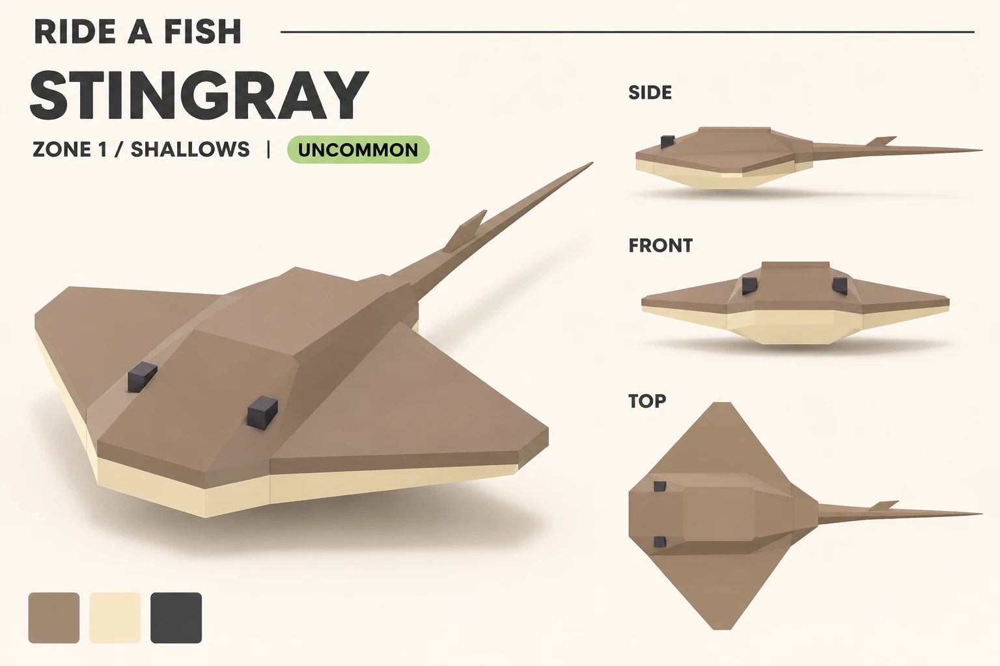
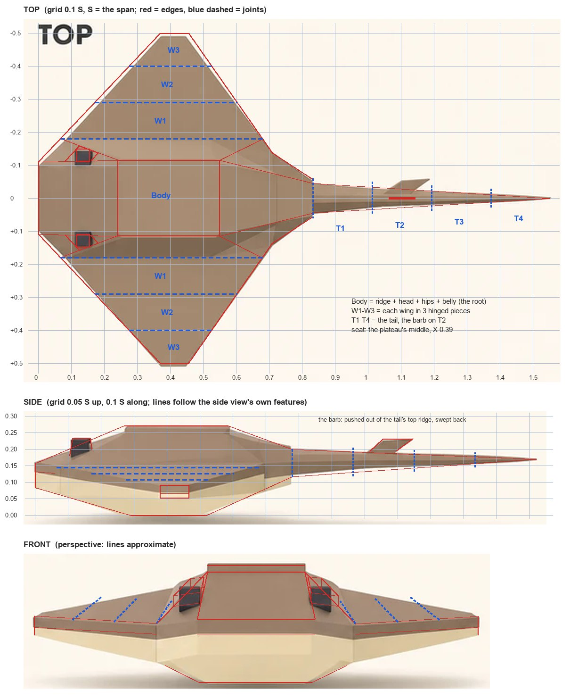

# Stingray

Zone 1, Shallows, Uncommon. Read off the user's ChatGPT concept (`art/concepts/creatures/stingray-gpt.webp`, 2026-11-09) by
the [creature method](../creature-method.md), the way [workout 2](../02-creature-look.md) read the Sergeant Major. Proposed
2026-11-09: nothing is built yet. This is the reading, the plan and the questions.

## 1. Reading the concept

**What it shares with the Sergeant Major's rules:**
- Low-poly and faceted: hard edges, flat faces, no smoothing.
- Flat colours, no texture, no outlines, soft studio light.
- Chunky toy proportions: the disc is 0.27 of its span thick in the middle.
- Small square eyes.
- Fins as thick flat plates: the barb on the tail is one.

**What's new:**
- No spine body. The body is a flat disc and its wings are the moving parts, so the fish kit's segment chain only fits the tail.
- A colour line round the edge. The top colour comes over the edge as a thin brown rim, and the underside's cream shows under it
  as a band all round. It's the Sergeant Major's yellow line, run round a disc.
- The eyes stand on top of the head as plain dark blocks: no cream plate, no pupil.
- No mouth from any view (a real ray's mouth is underneath).
- A raised ridge down the back with a flat top: a ready-made saddle.
- Three colours, not four.

**Its signature:**
1. **The kite-shaped disc:** close to 45 degrees all round, with a flat snout and flat wing tips, and the cream band under a brown
   rim all round its edge.
2. **The raised ridge:** a flat plateau down the middle, the head sloping from it to the snout, two dark eyes standing on the
   head's top corners.
3. **The whip tail:** long, tapering to a needle, with a swept barb a third of the way along.

**Palette** (sampled from the middle of each swatch): brown `#A08873` (the top, the tail, the barb), cream `#F6E7C5` (the
underside and the edge band), dark grey `#464646` (the eyes). The cream is a shade warmer than the Sergeant Major's `#EFE5CD`,
the dark lighter than its `#353534`.

**In the water:** workout 2 found the shallows' cyan light turns lemon into lime, so this brown will go olive and the cream
minty; pick them in the water. Against the sand floor (`#E9DCB0` in the kit's riding view) the cream has almost no contrast
(about 1.1 to 1) and the brown about 2.5 to 1, so from above the brown top carries the shape.

**Picture cheats, not to copy:**
- **The front view is a close perspective shot from a little above,** so what's near looks bigger: the eyes too far apart, the
  ridge too low (numbers in section 2). Measure on the side and top views; take only the head's faces from the front. Our front
  view should be perspective too, as for the Sergeant Major, so the comparison is like with like.
- **The top view draws the barb lying flat,** sticking out to one side: the side view's barb pasted in. The side and 3/4 views
  stand it upright on the tail. Upright wins.
- **The eyes are boxes set on the head,** each with its own shadow. By the user's rule they get pushed out of the head's faces.
- **The belly is a deep flat-bottomed block,** hanging 0.05 of the span below the wing tips, like a toy's stand on a shelf (the
  Sergeant Major's belly fins read as legs the same way). Keep the thickness; build it as the body's underside, chamfered.
- **Small rounded bevels** on the plateau and the tail root: the generator's softening. Our edges stay hard.
- **The cream shows in two shades,** lit and shaded. It's one colour.

## 2. Proportions

**The unit is S, the span** (wing tip to wing tip): 350 pixels in the top view. The side view is at the same scale (its wing
tips and plateau length agree with the top view to 3%). The front view is a perspective shot, used only for the head's faces.
Proposed size: S = 12 studs, so the plateau (2.8 studs wide) seats the 5-stud rider. The grid is on the sheet in section 3.

**The disc (top view):**
- Span 1 S. Length from the snout to the tail root 0.83 S (side view: 0.78). It's 1.2 times as wide as it is long.
- The snout: a straight front edge, 0.22 S wide.
- The leading edges run from the snout's corners to the tips, swept back 43 degrees (0.95 back for every 1 out).
- The tips: flat ends 0.086 S long, 0.37 to 0.46 S behind the snout. The widest point is halfway along the disc.
- The trailing edges come in at 35 degrees to the hips (0.71 S back, 0.14 S out). The hips then run in more steeply to the tail
  root, 0.11 S wide at 0.83 S back.

**Thickness (side view, heights from the belly's bottom):**
- 0.27 S in the middle, belly to plateau (3.3 studs).
- The edge: 0.077 S tall at the snout, 0.043 S at the tips, 0.083 S at the back of the disc.
- **The cream band:** the brown rim is about 0.026 S deep everywhere (0.3 studs). The cream band under it is about 0.02 S at the
  tips and about 0.05 S at the snout and the back.
- The wing's top falls 0.052 S from the ridge's foot (0.143 S up) to the tip (0.091 S up): about 9 degrees. The tips' undersides
  are 0.051 S up; no view shows the rest of the wing's underside, so I'd keep it close to level.
- The belly: flat from 0.29 to 0.52 S back, 0.05 S below the tips' undersides. A straight chin rises from it to the snout's
  bottom edge (0.08 S up), and a straight slope to the tail root.

**The ridge:**
- 0.36 S wide at its foot (0.18 S either side of the spine), from the leading edge back to the hips.
- **The plateau:** 0.23 S wide, from 0.24 to 0.55 S back (2.8 by 3.7 studs). It stands 0.13 S above the ridge's foot, so the
  flanks are steep: about 63 degrees by the side and top views.
- In front, the head slopes down from the plateau to the snout, as wide as the plateau: 0.11 S of drop over 0.24 S (25 degrees).
- Behind, the back slope narrows to the tail root: 0.07 S of drop over 0.28 S.

**The eyes:**
- Centres 0.137 S behind the snout and 0.121 S either side of the spine (0.24 S apart): on the head's slope, just in front of
  the plateau's front corners, about as far out as its sides.
- Each a dark block about 0.05 S long and 0.046 S wide, standing 0.045 S above the head (about 0.6 studs a side). Their tops are
  0.23 S up, 0.04 S below the plateau.

**The tail and barb:**
- The tail is 0.72 S long (side view: 0.74), so the ray is 1.55 S from the snout to the tip.
- Its root is 0.083 S tall and 0.09 S wide, about square, with a ridge along the top (the top view shows its two top facets). It
  tapers to a needle, faster near the root.
- **The barb:** a swept parallelogram on the tail's top, from 0.32 to 0.43 of the way along. It's 0.037 S tall, 0.08 S long at
  its foot and 0.09 S along its top edge, its front edge swept back about 50 degrees.

**Where the views disagree, and what I trust:**
- **The ridge's flanks:** the side and top views give 63 degrees, the front view about 35. The side and top agree with each
  other and with the 3/4 view's broad dark flank, so I trust them. The angle is the shape pass's call.
- **The eye spacing:** front 0.29 S, top 0.24 S. The top view: perspective spreads the front view's near things.
- **The plateau and the tail root,** shifted 0.03 and 0.05 S between the side and top views: the top view.
- **The barb,** upright in the side and 3/4 views, flat in the top view: upright.

## 3. Topology

Ours, not the concept's, with the user's rules applied: big flat faces built on purpose; each eye flat on one face; anything that
sticks out pushed out of the faces round it, sharing their vertices, its sides flush on their planes (as the Sergeant Major's
mouth is). The Body is one mesh; each wing piece and tail piece is its own. Drawn over the concept: red lines are edges, blue
dashed lines the joints between rigid parts.

**From the top:**
- **The outline:** the snout's edge straight across, the leading edges at 43 degrees, the tips' flat ends, the trailing edges in
  to the hips, the hips in to the tail root.
- **Three hinge lines either side,** straight and parallel to the spine, 0.18, 0.29 and 0.40 S out, each from the leading edge
  to the trailing edge. They're the cuts between the wing pieces. The first is the ridge's foot.
- **The plateau:** a rectangle, 0.23 S wide, 0.24 to 0.55 S back.
- **The head:** from each of the plateau's front corners, a line to the snout's corner (the forehead's side) and a line out to
  where the first hinge meets the leading edge (the eye face's back edge). Each eye face is the triangle between them: the
  snout's corner, the plateau's corner, the hinge's front end.
- **The eye mound:** two lines across each eye face, a third and two thirds of the way from its front edge to the plateau's
  corner, each from the forehead's side to the eye face's back edge. The band between them is pushed up.
- **Behind the plateau:** from each back corner, a line to the tail root (the back slope's side) and a line out to where the
  first hinge meets the trailing edge (the flank's back edge). Hip faces fill the corners between.
- **The tail:** a ridge line down its middle between its two top facets, three cuts across it, and the barb as a line along
  the ridge, since it stands upright.

**From the side:**
- **The top outline:** the snout's top edge, the forehead rising to the plateau, the plateau level, the back slope down to the
  tail root, the tail's top straight to the needle.
- **The colour line,** 0.026 S under the top edge, all the way round the disc: brown above, cream below.
- **The near wing's top** in three flat steps from the ridge's foot to the tip; the hinge lines show as level lines on it. Its
  underside is one flat cream face per piece.
- **The belly:** a straight chin from the snout's bottom edge down to the flat bottom, then a straight slope up to the tail root.
- **The barb:** its two sides continue the tail's two top facets up into a swept blade, so it grows out of the tail's ridge
  instead of sitting on it.

**From the front:**
- At the top, the plateau's level edge. Under it the forehead: one face sloping down to the snout's top edge.
- **Either side, the eye face:** the triangle from the forehead's side out and down to the first hinge. The eye mound runs across
  its middle with its top parallel to the eye face, and the eye lies flat on that top. The mound's inner side lies on the
  forehead's plane and its outer side on the flank's, so from the front the head's outline steps up into it: the head's corner
  left less cut, not a box.
- **Outside the eye face,** the flank (narrow from the front), then the wing: three flat top faces stepping down at the hinges.
  Each outer hinge folds about 3 degrees down at rest, so the steps read as a drooping wing's facets, not cracks.
- **The edge:** the snout's straight front face, a short face from each of its corners to the first hinge, then the leading
  edges, all with the brown rim over the cream band. The colour line runs level across.
- **Below,** the belly's flat bottom, about the plateau's width, and its chamfers up to the wings' undersides.

**The joints:** each outer wing piece turns about a line on the wing's top surface, so the top folds but never opens. Only the
underside opens, a wedge of at most 0.01 S on a downstroke, closed by a cream cap. The tail's cuts get the fish's sleeves.

## 4. The kit plan

**What `fish_kit.py` already gives:** a spec-in build in Blender 5.2; flat colours per face; plates (`plate_bm`) for the barb;
pivots and Motor6D-style parenting (`mesh_object`, `attach`); joint caps coloured like the faces beside them; sleeves; a head
built from planes with a part pushed out of it that shares its vertices (the mouth); an eye laid flat on a face; the four views;
`--wire`; the riding view (water, sand, the rider, the Tiny and Big copies); the swim loop with `swim_gif.py`; and the sheets
(`creature_sheet.py`, `lines_overlay.py`).

**What a ray needs:**
- **A second body plan.** The fish is rings round a spine; the ray is a plan outline with a cross-section (the top's height, the
  colour line and the underside at each point). I'd move the shared parts of `fish_kit.py` (materials, plates, objects, caps,
  views, the riding scene, the swim loop) into a module and add the ray as a second builder, picked by `"plan": "ray"`.
- **Hinges along the body:** joints that roll about a line parallel to the spine, cut along the span, pivoting on the top
  surface.
- **More than one turn per joint:** the wings roll (flap) and pitch (feather), the tail yaws and pitches. The fish's joints
  only yaw.
- **A thin tail chain:** the fish's segment chain with a 4-point diamond ring; the 10-point ring is too fine for a needle.
- **More pushed-out parts:** the eye mound (out of the eye face) and the barb (out of the tail's ridge).
- **A `--flap` render** of the cycle below, and the rider on the plateau in the riding view.

**The rigid parts** (each one MeshPart in Roblox, joined by Motor6Ds: 11 parts and an invisible Root):

| Part | What | Joint | Pivot | Turns |
|---|---|---|---|---|
| Root | invisible: the creature's position and steering | | | |
| Body | the ridge, the head with the eyes, the hips, the belly | Root to Body | the plateau's middle (0.39 S back), at the ridge's foot height | bob, bank, a little pitch |
| W1, left and right | the wing from the ridge's foot to 0.29 S out | Body to W1 | the first hinge (0.18 S out), on the top surface, halfway along it (0.37 S back) | flap (roll), feather (pitch) |
| W2, left and right | 0.29 to 0.40 S out | W1 to W2 | the second hinge (0.29 S out), top surface, 0.39 S back | flap, feather |
| W3, left and right | 0.40 S out to the tip | W2 to W3 | the third hinge (0.40 S out), top surface, 0.40 S back | flap, feather |
| T1 | the tail's first quarter | Body to T1 | the tail root (0.83 S back), on the tail's centre line | yaw, pitch |
| T2 | the second quarter, with the barb | T1 to T2 | a quarter of the way along (1.01 S back) | yaw, pitch |
| T3, T4 | on to the needle | T2 to T3 to T4 | halfway (1.19 S) and three quarters (1.37 S) | yaw, pitch |

The hinge pivots sit 0.37 to 0.40 S back, right where the rider sits (0.39 S): the rider is on the line the wings turn about.
Far-off rays don't animate, as for the fish.

**Spec fields I'd add** (in S, except `span`):
- `plan: "ray"`, and `span` in studs.
- `outline`: the right half's corners as [back from the snout, out from the spine]: snout corner, tip front, tip back, hip,
  tail root.
- `heights`: the snout's top, the ridge's foot, the tip's top and bottom, the plateau, and the belly's flat [from, to].
- `rim`: the colour line's depth below the top edge.
- `plateau`: [front, back, half width].
- `hinges`: [0.18, 0.29, 0.40], root first, and `restFold` in degrees.
- `eye`: the mound's lines on the eye face (a third and two thirds), its lift, the eye's size and colours.
- `tail`: its length, its root [tall, wide], its cuts [0.25, 0.5, 0.75]; `barb`: [from, to] along the tail, height, sweep.
- `seat`: 0.39.
- `flap`, `idle`, `fast`: the numbers in section 5.
- `colours`: top, under, eye.

**Who else could use it:**
- **The same disc:** Electric Ray (a round outline, a short thick tail with a small fin), Manta Ray (long swept wings, a bigger,
  slower flap, two head lobes as plates, a short tail), Grave Ray (ribs cut into the wings' tops) and Cinder Ray (the cream band
  becomes the glowing edge). Not the Sawfish: it's a ray shaped like a shark, so the fish plan with a flat saw for a snout.
- **The hinged wing with its feather:** the flippers of the Sea Turtle, Archelon and Grave Turtle; the four flippers of
  Elasmosaurus, Liopleurodon and Kronosaurus; the Sea Lion's flippers; the Flying Fish's wings (a glide pose).
- **A front-to-back ripple on a row of plates:** the Cuttlefish's fin skirt and the Anomalocaris's side flaps.

## 5. The animation plan

A real stingray ripples the edge of its disc in a wave from front to back. With rigid pieces, the flap travels out from the root
to the tip, and a feather on each piece makes it run front to back as well.

**Cruising** (24 frames a cycle in the render, like the fish):
- **Cycle:** 1.2 seconds (the fish's is 1).
- **Flap:** the hinges roll 8, 10 and 14 degrees (root to tip), each against the piece inside it and a step of 0.9 behind it
  (the fish swim's phase step). The tip then moves 0.08 S (about 1 stud) up and down from rest, and peaks 40 degrees of the
  cycle after the root piece: the bend runs out along the wing.
- **Feather:** the pieces pitch 3, 6 and 10 degrees in step with how fast each is rising: nose up on the way up, nose down on
  the way down, like a turtle's flipper stroke. The leading edge then moves 20 to 70 degrees of the cycle ahead of the trailing
  edge, so the ripple runs from front to back, as a real ray's does.
- **Body:** it rises 0.015 S (0.18 studs) on each downstroke, nose up 1.5 degrees with it. The rider rides the Body and the
  camera follows the Root, so the rider bobs and the view stays steady.
- **Tail:** a lazy trailing wave. Yaw 3, 5, 8 and 12 degrees down the four pieces, a step of 0.9 between them, at twice the
  cycle (2.4 seconds). Pitch 2, 3, 4 and 6 degrees at the flap's cycle, half a cycle behind the Body's bob, so the whip follows
  the heave.

**Faster and slower:** at full speed the cycle shortens to 0.8 seconds and the amplitudes grow by a quarter (the tip 0.1 S).
Slowing down, 1.8 seconds at 0.6 times the amplitudes. The cycle advances by the current rate each frame, so a change of speed
never makes the wings jump.

**Turning:** the Body banks up to 20 degrees into the turn, a carpet-ride lean that shows well from behind. The outer wing beats
1.3 times as big and the inner 0.7 times; the tail swings out and lags.

**Idle** (resting on the sand, or in the tank): 2.4 seconds a cycle; flap 2, 3 and 5 degrees (the tip 0.023 S: just the edges
rippling); feather 1, 2 and 3; the tail still but for 1 to 4 degrees of yaw at 4.8 seconds; no bob.

**The seat:** the plateau's middle, 0.39 S back, the legs down the flanks. It's the Body's flattest spot and sits on the line the
wings turn about, and the wing beside the legs hardly moves (the first piece's outer edge 0.02 S).

**What the riding camera sees.** Checked with the kit's stand-in camera and rider (16.7 studs behind the seat, 4.2 above it,
Roblox's 70-degree field of view) on a ray 12 studs across. A calculation, not a render:
- **The wings either side of the rider,** their tips about 20 degrees left and right of the screen's middle, a little below it.
  At cruise they move about 30 pixels up and down on a 720-pixel-tall screen (40 at full speed). The beat is the ray's read from
  the saddle, so give the tips a crisp outline and make the beat big enough to see.
- **The trailing edges face the camera,** so the cream band runs along the back of each wing. Keep it there.
- **The tail runs from just under the screen's middle down past its bottom edge,** with the barb in the lower middle, close by.
  Its sway reads big.
- **The eyes hide behind the rider.** With the concept's eyes (0.12 S out, 0.05 S tall) about a quarter of each shows from
  straight behind, and with the camera 3 studs to the side one is hidden completely. Bigger or taller eyes don't fix it: the
  rider's legs hang right behind them. Eyes past the legs (0.21 S out) show about half of each from straight behind; the rider
  moved back to 0.5 S with taller mounds (0.09 S) about half; both together about 70%. So the eyes are for wild rays ahead of
  you, the tank and the collection book. From the saddle, the wing beat carries it.
- A flat creature shows more of its top from a higher camera. If the riding camera's height ever varies by creature, the ray
  wants it higher.

## 6. Open questions

1. **The eyes' look:** **Decided 2026-11-09 (the user): go by the reference:** the concept's dark eyes (A). The options were:
   - A: the concept's: the raised mound all dark.
   - B: the Sergeant Major's eye (a cream square with a black pupil) on the mound's top, so every creature shares one eye.
   - C: the Sergeant Major's eye flat on the eye face, with no mound.
2. **Seeing the eyes from the saddle:**
   - A: leave it: the beat is the ray's read when ridden, and the eyes show on wild rays and in the tank.
   - B: eyes wider apart, 0.21 S out. The first hinge angles out at the front so the head is wider than the ridge.
   - C: the rider sits further back (0.5 S), with taller mounds.
3. **The barb:**
   - A: the concept's swept plate, like a small fin.
   - B: narrower and sharper: a swept spike that reads as a sting.
   - C: both: a small fin with a barb behind it.
4. **The tail's length:**
   - A: the concept's, 0.72 S (8.6 studs).
   - B: a real stingray's whip, about 1 S: more dramatic, and it reaches further under the riding camera.
   - C: shorter, 0.5 S.
5. **The swim:**
   - A: flap and feather on 3 pieces a wing, as planned.
   - B: a true ripple: each wing also cut front to back (6 pieces a wing). More parts and seams.
   - C: 2 pieces a wing: cheaper, a stiffer beat.
6. **The underside:**
   - A: plain cream, as in the concept.
   - B: a small dark mouth and the gill slits underneath, seen when it banks hard and in the collection book.
