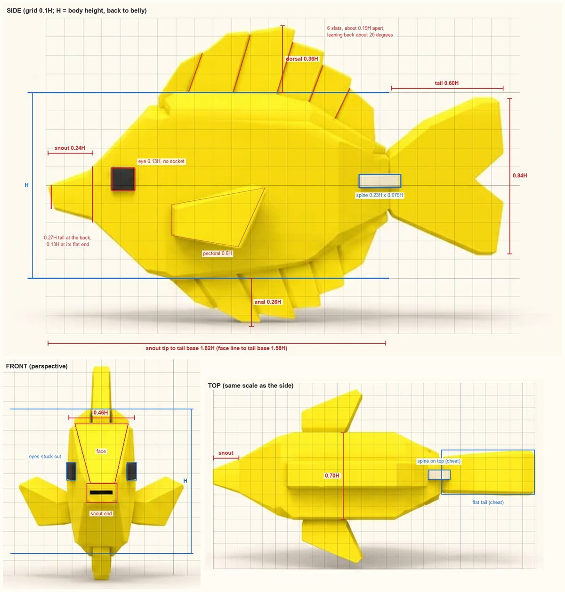
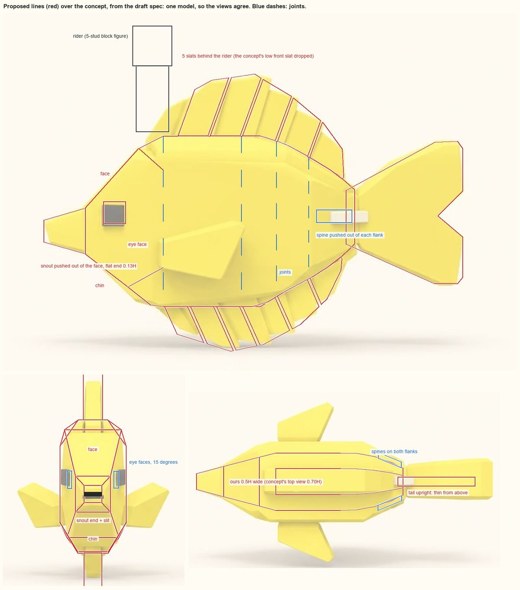

# Yellow Tang

**Zone 1, Shallows, Common:** the plain starter, partner to the striped Sergeant Major. Read off the user's ChatGPT concept
(`art/concepts/creatures/yellow-tang-gpt.webp`, 2026-11-09) by the [creature method](../creature-method.md), the way
[workout 2](../02-creature-look.md) read the Sergeant Major. **Proposed:** nothing is built yet. Every number here is a first
draft for the kit to test.

## 1. Reading the concept
**What it shares with the Sergeant Major's rules:**
- Low-poly and faceted: an octagon round the body, hard edges, flat colours, no texture, no outlines, soft studio light.
- A square pixel eye on the side of the head.
- Fins as thick flat plates, and a forked tail.
- Chunky toy proportions: a big head (the first 30% of the body), a short tail.
- The same neutrals: near-black `#393736` (the Sergeant Major's `#353534`) and cream `#F3E8CD` (its `#EFE5CD`).
- The same head: a face plane narrowing to the mouth, and one big flat eye face either side.

**What's new:**
- **One colour all over.** No top line, no bars, no belly colour.
- **Fins made of slats.** The dorsal and anal fins are rows of separate ray strips, 6 each, leaning back, with thin grooves
  between them.
- **A snout.** The mouth is pushed out three times as far as the Sergeant Major's (0.24H), and it tapers to half its size, ending
  in a small flat face with a mouth slit.
- **A plain eye:** a black square with no cream socket, the size of the Sergeant Major's pupil.
- **The tail spine** (the tang's "scalpel"): a cream bar on each flank at the tail base. It's the only accent.
- **No pelvic fins.**
- **Thin and tall:** half as wide as the Sergeant Major from the front, and nearly as tall as it is long once the fins count.
- **A wedge head in profile:** the face leans back 42 degrees above the snout and the chin about 50 below it. The Sergeant
  Major's face is nearly upright.

**Its signature features:**
1. **The tall disc:** the body with its slatted dorsal and anal fins makes a disc 1.63H tall and 1.82H long to the tail base.
2. **The pointed snout on a wedge head,** ending in a small flat face with the slit.
3. **The white tail spine** on each flank.

**The palette** (sampled from the middle of each swatch, not the shaded render): yellow `#F9DF12`, cream `#F3E8CD` (the spine),
near-black `#393736` (the eye and the mouth slit). The yellow is much stronger than the Sergeant Major's pale lemon `#FBEC7F`.

**In the water:** the shallows' cyan light pushes yellow toward green. Here is how the Sergeant Major's lemon changed in its
riding render (swatch to lit top), applied to other yellows:

| Yellow | Hue on white | Lit top in the shallows (hue) | Side-lit flank (hue) |
|---|---|---|---|
| Sergeant Major's lemon `#FBEC7F` | 53 | `#C9F38F`, 85: lime (what workout 2 saw) | 108 |
| This concept's `#F9DF12` | 53 | `#C7E616`, 69: chartreuse | 79 |
| A warmer gold `#FFCC14` | 47 | `#CCD218`, 62: a true yellow | 73 |

A strong yellow with almost no blue in it holds its hue far better than a pale one. Shaded flanks go green whatever the yellow:
that's the water's ambient light ([workout 1](../01-going-down.md)), not the creature. This is from the Blender render only, not
Studio.

**Picture cheats, not to copy:**
- The top view draws the body 0.70H wide, the front view 0.46H. They can't both be right (see below).
- The top view draws the tail as a flat strip 0.36H wide and 25% longer than in the side view: a whale's tail again, the same
  cheat as the Sergeant Major's top view. The tail is upright.
- The top view puts the spine on the centre line, on top of the tail base. The side and 3/4 views put it on the flank, which is
  where the real fish has one each side.
- The front view's eyes are boxes sticking out past the head's outline. In the side view they're flat squares.
- The front view is a perspective shot, and the snout is the nearest thing in it, so its end is drawn big (0.21H wide against
  0.13H from above).
- The front view's slats have rounded ends, like pills. In every other view they're flat slats.
- The side and 3/4 views light the back's top chamfers so they look like a separate raised block under the dorsal. The front
  and top views show they're the body's own top facets.
- It rests on its anal fin, like a toy on a shelf. A fish in the game swims.

## 2. Proportions
H is the body's height from the back (where the slats stand) to the belly, without the fins. Measured on a 0.1H grid off each
view. The side and top views are drawn at the same scale (the length matches to 2 px); the front view has its own.



| | The concept (view) | Proposed | Sergeant Major (workout 2) |
|---|---|---|---|
| Length, snout tip to tail base | 1.82H (side; top agrees) | 1.82H | 1.84H from its lips |
| Length, face line (the snout's back) to tail base | 1.58H | 1.58H | 1.76H |
| Width | 0.46H front, 0.70H top | 0.5H | 0.86H |
| Height with the fins | 1.63H | 1.63H | about 1.33H |
| Snout | 0.24H long. Back 0.27H tall (side), 0.26H wide (top). End 0.13H square (side, top) | the same | mouth 0.28H wide, 0.11H tall, out 0.08H |
| Eye | 0.13H square, black (side and front agree). Centre 0.16H behind the snout's back, 0.45H below the back, level with the snout's top | the same | cream 0.2H, pupil 0.12H |
| Dorsal | 6 slats, 0.36H tall at the third. From 0.23 to 0.96 of the face-to-tail length, slats about 0.19H apart at the base, leaning back 17 to 26 degrees, 0.14H thick | 5 slats from 0.34 (the seat in front), same height, spacing and thickness | 0.21H tall, 0.1H thick, one plate from 0.31 |
| Anal | 6 slats, 0.26H deep, from 0.27 to 0.94, about 0.17H apart, leaning 24 degrees, 0.13H thick | 6 slats from the first joint (0.29) | 0.12H deep, one plate |
| Tail | 0.60H long, 0.84H tall, fork 0.14H deep; tail base 0.32H tall | the same | 0.58H long, 1.0H tall |
| Tail spine | 0.23H long, 0.075H tall, on the flank at mid-height, from 0.92 of the length to 0.08H past the tail base | 0.21H, ending at the tail base | none |
| Pectoral | a plate 0.6H long, its root 0.17H tall at 0.27 of the length, low (0.19H below the middle), swept back about 34 degrees, out 0.33H (top and front agree) | the same | about 0.38H long |
| Pelvic | none | none | a pair |

**Where the views disagree, and which to trust:**
- **Width:** front 0.46H, top 0.70H. Trust the front view. It wins for the face (workout 2), it's the only view that shows the
  body's cross-section, and the real fish is thin. The top view is the sheet's weakest: the flat tail and the spine on top are
  in it too. Proposed 0.5H: the front view's thinness, with a little more back for the rider. (At a glance the tang looks
  thinner than the Sergeant Major in both views, but that's half right: from the front, 0.46H against 0.86H; from the top, the
  tang is wider, 0.70H against about 0.55H in the Sergeant Major's own top view. ChatGPT's top views don't hold widths.)
- **The snout's end:** 0.21H x 0.14H from the front, 0.13H square from the side and top. Trust the side and top (perspective).
- **The dorsal's height:** 0.36H from the side, 0.28H from the front (the peak is far behind the face). Trust the side.
- **The eye's height:** the side view puts its centre level with the snout's top, the front view 0.09H higher. Within the
  views' slop; use the side view's.

**H in studs:** 5.2, the Sergeant Major's. The two starters then have the same depth and the same length (9.5 studs from the
snout's tip to the tail base, against the Sergeant Major's 9.55 from its lips), so the riding camera frames them alike. One is
chunky by width (4.5 studs), the other 2.6 studs wide and tall by its fins (8.5 studs with them).

## 3. Topology
Lines per view, the way the user draws them. In the picture the red lines are our planes, projected from the draft spec (section
4) onto the concept's views. It's one model, so the three views agree, which the concept's don't.



**Front view:**
- **The outline:** a tall octagon, 0.5H wide. A narrow flat top (0.45 of the width) for the dorsal to stand on, broad top
  chamfers down 0.2H to the full width, upright sides, then bottom chamfers (0.23H) to a narrow belly.
- **The face:** two lines from the face's top corners (0.42H apart, 0.07H below the back) run down and in to the snout's top
  corners (0.26H apart). The plane between them is the face, narrowing to the snout.
- **The snout:** a line straight across at the snout's top and one at its bottom, edge to edge. The snout is pushed out between
  them, across the face's whole width. Its end is a small square (0.13H), with the slit across its middle.
- **The chin:** from the snout's bottom corners two lines run down and out to the chin's corners (0.39H apart, 0.12H above the
  belly). The plane between them is the chin, widening downward.
- **The eye faces:** between those edges and the outline, one flat face either side, turned 15 degrees toward the front (the
  Sergeant Major's turn 29). The eye sits on it, parallel.
- **Above the face,** the brow runs back to the flat top, with a corner facet either side. **Below the chin,** the chin's bottom
  and the jaw, split by diagonals. Both as on the Sergeant Major.

**Side view:**
- **The snout:** a short trapezoid. Its end is upright (0.13H), and so is its back (0.27H): the crease where the two lines
  across the face end. Its top falls and its bottom rises about 0.07H toward the end.
- **The face's edge:** one straight line from the snout's top-back corner, up and back at 42 degrees from upright, to the head's
  top corner (0.31H behind the snout, 0.07H below the back).
- **The chin's edge:** one line from the snout's bottom-back corner, down and back at about 50 degrees, to the chin's corner, then
  the jaw to the belly.
- **The eye face:** everything between those two lines, back to the first joint (0.46H behind the snout's back), is one flat face.
  The eye's centre is 0.17H behind the snout's back, level with the snout's top.

**Top view:**
- **The snout's sides and the eye faces are one straight line** each side, at 15 degrees, from the snout's end (0.13H wide) to the
  full width at the first joint. The concept breaks this line at the snout's back (the snout at 17 degrees, the head at 27). Ours
  runs straight because the snout's sides are flush.
- A line across at the face's top edge, then the brow. Behind it, the back's flat strip with the slats along its middle.
- At the tail base, a cream spine stands out of each flank.

**The body and the fins:**
- **The body:** the kit's rigid segments with the 8-point ring. It's one colour, so the colour line's points weld away
  (`topLineZ: "chamfer"`).
- **The slats:** each a thick flat plate (0.73 studs for the dorsal, 0.7 for the anal). Its outline is cut from the fin's outline
  by lines leaning back 20 degrees (the anal 24), with a 0.08-stud gap between neighbours. Each slat rides one segment whole, so
  a joint always falls in a gap.
- **The tail:** one thick forked plate on its own joint, 0.4 studs.
- **The pectorals:** thick plates, low behind the eye.
- **The spine:** a rectangle cut into each flank of the last segment and pushed out 0.25 studs, its sides square to the flank,
  sharing the flank's vertices. Not a box stuck on. Cream.
- **The eye:** a black box parallel on the eye face, standing 0.17 studs proud like the Sergeant Major's socket. On a face turned
  15 degrees a flush eye would show from the front at a quarter of its width; standing proud it shows at about half, as in the
  concept's front view, without the concept's cheat of sticking out past the outline.

**The snout and "never a snout running to a point"** ([Decisions](../../Decisions.md), 2026-11-09). The proposal: the snout is
workout 2's mouth, pushed further. Its back corners are where the lines across the face at its top and bottom meet the face's
edges, shared with the eye faces. Its sides lie flush on the eye faces' planes. It ends in a flat face, never a point: 0.13H
square, the eye's size, carrying the slit. Its top and bottom close in about 0.07H each toward the end.

Why it works: the eye faces' angle sets how fast a flush snout narrows. On the top view's wide body (0.70H) the head's sides run
at 27 degrees, and a flush snout 0.24H long would close to a point. On the thin body (0.5H) they run at 15 degrees, and the same
snout ends 0.13H wide, which is the concept's own flat end. So the thin body, the user's flush rule and the concept's snout all
agree. The concept already ends its snout in a flat face with the slit (its 3/4 view shows it): the pointed look comes from the
face and the chin sloping in to a small snout, not from a point. Open question 2.

## 4. The kit plan
A draft spec for `tools/blender/fish_kit.py` (studs; t = 0 is the face line at the snout's back, the snout sticks out 1.25 in
front). Fields marked new below don't exist yet. Not saved as a spec file.

```json
{
  "name": "Yellow Tang",
  "zone": "ZONE 1 / SHALLOWS",
  "rarity": "COMMON",
  "length": 8.2,
  "stations": [[0.0, 0.4, -1.0, 0.67], [0.2, 2.22, -2.3, 1.1], [0.29, 2.6, -2.6, 1.3], [0.65, 2.6, -2.6, 1.3],
               [0.744, 2.35, -2.13, 1.27], [0.84, 1.91, -1.72, 1.13], [0.935, 1.44, -1.22, 0.87], [1.0, 0.97, -0.69, 0.6]],
  "chamfer": [0.55, 0.2],
  "chamferBottom": [0.54, 0.23],
  "topLine": 0.3,
  "topLineZ": "chamfer",
  "head": {
    "faceTop": [1.63, 1.1, 2.22],
    "faceBottom": [1.3, -2.0],
    "chin": [2.0, 0.6, -2.55],
    "faceFold": true,
    "faceColour": "body"
  },
  "segments": [0.29, 0.58, 0.71, 0.83],
  "colours": {
    "top": "#F9DF12", "body": "#F9DF12", "bars": "#F9DF12", "fins": "#F9DF12", "lips": "#F9DF12",
    "eye": "#393736", "pupil": "#393736", "spine": "#F3E8CD"
  },
  "eye": { "onWall": true, "dx": 0.9, "z": 0.26, "size": 0.68, "thickness": 0.2, "socket": false },
  "lips": {
    "z": -0.3, "size": [1.25, 1.33, 1.4], "protrude": 1.25, "sideFollow": 1.0,
    "frontHeight": 0.68, "frontZ": -0.3,
    "slit": { "height": 0.16, "inset": 0.05, "colour": "pupil" }
  },
  "seat": 0.25,
  "fins": {
    "dorsal": {
      "points": [[0.34, -0.3], [0.345, 1.1], [0.47, 1.7], [0.63, 1.88], [0.77, 1.55], [0.885, 1.3], [0.955, 0.9], [0.96, -0.3]],
      "thickness": 0.73,
      "slats": { "spacing": 1.0, "gap": 0.08, "lean": 20 }
    },
    "anal": {
      "points": [[0.29, 0.3], [0.3, -0.7], [0.54, -1.35], [0.66, -1.2], [0.8, -1.25], [0.9, -0.95], [0.95, -0.4], [0.955, 0.3]],
      "thickness": 0.7,
      "slats": { "spacing": 0.9, "gap": 0.08, "lean": 24 }
    },
    "tail": {
      "points": [[-0.25, 0.95], [2.45, 2.41], [3.13, 2.44], [3.29, 2.22], [3.29, 0.91], [2.54, 0.16], [3.29, -0.47],
                 [3.29, -1.72], [3.13, -1.91], [2.44, -1.91], [-0.25, -0.7]],
      "thickness": 0.4
    },
    "pectoral": { "points": [[0.0, 0.44], [3.1, 0.9], [2.2, -0.75], [0.0, -0.44]], "t": 0.27, "z": -0.97, "yaw": 34, "tilt": -8, "thickness": 0.3 },
    "pelvic": null
  },
  "spine": { "t": [0.86, 0.99], "z": 0.15, "height": 0.39, "proud": 0.25, "colour": "spine" },
  "swim": { "amplitudes": [1, 4, 8, 12, 20], "phaseStep": 0.7, "headCounter": 1.5 },
  "sleeve": 0.4,
  "rideFog": "#3CBED2",
  "rideFogEnd": 900
}
```

The head's numbers are a first guess, to tune on the first build with `--wire`. With these the eye faces run at 15 degrees, the
snout's end comes out 0.66 studs wide, and the dorsal gets 5 slats and the anal 6 (the planes picture is drawn from these).

**What the kit needs** (all new fields, so the Sergeant Major's spec is unaffected):
1. **Slat fins:** `fins.dorsal.slats` and `fins.anal.slats` = `{spacing, gap, lean}`. The fin's outline is cut into separate ray
   strips by lines leaning back from the body. Each segment's share of the fin gets whole slats about `spacing` apart, so the
   joints always fall in gaps (today's fins are cut at the joints instead). The butterflyfish, angelfish and lionfish can use it.
2. **The tail spine:** `spine` = `{t, z, height, proud, colour}`, pushed out of each flank of the last segment, sharing its
   vertices, plus a new colour area `spine` in the kit's colour list.
3. **A plain eye:** `eye.socket: false` builds only the black box.
4. **A one-colour body:** already works. Give every area the same colour; `topLineZ: "chamfer"` welds the colour line's points,
   which leaves a plain octagon.
5. **A snout:** `head.faceFold` puts the mouth's back corners on the face line, with the face above leaning back to `faceTop` and
   the chin plane below leaning back to `faceBottom`: two planes, where the Sergeant Major's face is one. `lips.frontHeight` and
   `lips.frontZ` make the end smaller than the back. `lips.slit` = `{height, inset, colour}` adds two lines across the end, the
   band between them dark and pushed in.
6. **Optional fins:** `fins.pelvic: null` builds none (today the kit needs a pair).

## 5. The animation plan
**The swim:** the kit's one swim, a sine wave down the chain of rigid segments (workout 2), tuned for a short, deep disc. A disc
doesn't bend along its length. A real tang holds its body stiff and moves its tail stock and tail.
- **The cuts** at 0.29, 0.58, 0.71 and 0.83: the head (with the rider's seat), one long stiff middle (the deepest part, 2.4
  studs), then three short segments down the tail stock with one dorsal slat each, then the tail fin on its own joint.
- **The amplitudes** 1, 4, 8, 12 and 20 degrees from the front back (the Sergeant Major's 3, 6, 9, 12, 18). About the same
  total swing (45 degrees against 48), all in the back half.
- **The phase step** 0.7 (the Sergeant Major's 0.9). A short body carries less than one whole wave, so it swings more as one
  piece.
- **The head's counter-swing** 1.5 degrees (the Sergeant Major's 2). The rider sits on the head segment, so less.
- **The slats need no animation of their own.** Each rides its segment, so when the body bends they fan apart on the outside of
  the bend and close up on the inside, like real fin rays. A 0.08-stud gap keeps 0.73-stud slats from touching up to a
  12-degree bend at a joint, the biggest before the tail.
- **The spine** rides the last segment and ends at the tail base, so the tail's flick never crosses it.
- **Optional:** a slow tang mostly rows with its pectorals. A small pectoral flap in the idle would sell that.

**The rider:** sits at t = 0.25, on the brow just behind the head's top corner, in front of the dorsal fin (every fish needs that
seat, workout 2). The concept's dorsal starts right at the head with a low front slat, so that slat goes and the rider takes its
place. The next slat rises 0.24 studs behind the rider's back, like the back of a saddle. On a body 2.6 studs wide the legs hang
down the flat flanks, like riding a horse.

**What the riding camera sees** (behind and above, about 15 degrees down): a thin, tall fish from behind is mostly fin.
- **Nearest, the tail,** edge-on: a blade 0.4 studs thick. Its fork shows only as it swings.
- **The two cream spines** on the tail base. They're the closest body part to the camera, so the tang's one accent is the one
  the camera sees best.
- **The dorsal:** a tall thin comb, 1.9 studs above the back and 0.73 thick, snaking with the swim. Its stepped top is what
  reads, since the slats' backs lean away from the camera. It hides only a 0.7-stud strip of the rider.
- **The pectorals** stick out either side: the widest thing from behind (6 studs across).
- **Not seen:** the face, the eye and the snout, hidden by the rider and the head.

So from behind the two starters read apart by shape: the Sergeant Major is a wide striped back, the tang a thin yellow comb and
blade. Its snout and eye are for the side views: in the wild and in the tank.

## 6. Open questions
1. **Body width.** A: 0.5H (recommended: thin like the front view, room for the seat, the snout flush). B: 0.46H, the front
   view exactly. C: 0.70H, the top view, nearer the Sergeant Major; the snout then can't be flush without running to a point.
2. **The snout.** A: the flush snout above, 0.24H long, ending in a flat face the eye's size (recommended). B: shorter and blunter
   (0.15H long, end 0.18H), nearer the Sergeant Major's mouth. C: the concept's crease: the snout's sides break away from the eye
   faces instead of lying flush, so the eye faces can turn further to the front (27 degrees) and the eyes show more from the front.
3. **The mouth slit.** A: a dark band across the snout's end, pushed in a little, as the concept has (recommended). B: no slit,
   a plain flat end.
4. **The seat.** A: drop the concept's low front slat; 5 slats at its spacing behind the rider (recommended). B: keep 6 slats,
   squeezed to 0.16H apart behind the rider.
5. **The yellow.** A: the concept's `#F9DF12` (chartreuse on lit faces in the shallows). B: a warmer gold `#FFCC14` (a true yellow
   in the shallows, golden at the dock). C: decide in Studio, in the water, once a test model is uploaded.
6. **The eye.** **Decided 2026-11-09 (the user): go by the reference:** the concept's plain black square (how far it stands proud is still open). A: a black box standing 0.17 studs proud, like the Sergeant Major's socket, so it shows from the front
   (recommended). B: flush, as in the concept's side view; from the front it's then a thin sliver.
7. **The accents for the riding camera.** A: the concept's sizes. B: the spines 1.5 times bigger and the slat gaps 0.15 studs, so
   the spines and the comb's rays read from behind.

## What it teaches (for the shared rules; the lead merges)
- **A snout or beak ends in a flat face at least the eye's size,** pushed out of the face with flush sides. Whether that's
  possible depends on the eye faces' angle: a narrow head allows a long snout, a wide one only a short one.
- **The face can fold at the mouth:** the face above and the chin below as two planes meeting at the mouth.
- **Every seat is measured:** about 1.2 studs of back between the head's top corner and the dorsal's first ray (the rider's
  1-stud torso plus a gap). If a concept's dorsal starts at the head, its front rays go.
- **Slat fins:** a joint always falls in a gap; each slat rides one segment whole.
- **Widths come from the front view, lengths from the side.** The top view is the least reliable on both concepts so far: it
  drew the tail flat both times, and here also the width and the spine.
- **Pick colours in the water:** a strong colour with little blue holds its hue under the cyan light; a pale one drifts.
- **Creatures of one tier share H** (5.2 studs for the starters), so the riding camera frames them alike.
